# 🚤 法国四大运河 & 英美加三大运河自驾游船深度对比（6大3小9人团 3卧/4卧 6月初精确报价与北威尔士/里多运河7晚停泊攻略）

> 本指南完整收录针对 **6大3小（共9人）** 在 **6月初（Early June）** 出行的欧美加自驾游船深度评测与实时精确报价：
> 1. **法国四大经典运河线（南法米迪运河 Canal du Midi、勃艮第运河 Burgundy、阿尔萨斯运河 Alsace、卢瓦尔河/夏朗德河 Loire/Charente）**：四大船司（Le Boat、Locaboat、Nicols、Les Canalous）3卧室与4卧室全档次精确报价（含7晚整周 & 3晚/4晚短租）。
> 2. **英美加三大运河横向评测与精确报价**：英国传统窄船（UK Narrowboat）vs. 加拿大里多运河（Canada Rideau Canal）vs. 美国伊利运河（US Erie Canal）。
> 3. **英国北威尔士兰戈伦运河 & 加拿大里多运河 7晚逐日停泊与酒馆/营地攻略 + 与法国 Midi / Alsace 四线实景图集对比**。
> 4. **体验过一次法国米迪运河（Canal du Midi）后的下一次自驾游船进阶选线指南**。

---

## 第一部分：法国四大经典运河线（6大3小 / 3卧室与4卧室 / 四大租赁商 6月初精确报价）

为您通过法国四大运河自驾船租赁商官网（**Le Boat**、**Locaboat Holidays**、**Nicols**、**Les Canalous**，其中 Locaboat 与 Nicols 现已整合至官方统一预订平台 `riverly.com`）实测查询了 **6月初（以 2027年6月5日–12日 经典7晚整周，以及 6月4日–7日 3晚短租、6月7日–11日 4晚短租为准）**，在 **法国四大经典运河线** 上可容纳 **9人（6大3小）** 的 **3卧室船型** 与 **4卧室船型** 精确报价。

---

### 选船前提说明（针对 6大3小 共9人）
1. **免驾照自驾 & 免费过闸**：以下所有船型均属于法国 **免驾照自驾运河船（Sans Permis）**，取船时接受约1小时操作培训即可自己开船过船闸；且**法国全境运河过船闸费（Lock Fees）及野外岸边停泊全部免费（€0）**。
2. **「3卧室」vs「4卧室」住9人（6大3小）的区别**：
   - **3个卧室（核载9–10人）**：并非所有3卧船都能上9人（普通3卧船限载7–8人，超员违法无法登船）。能合法住9–10人的3卧船共有 **5 款**，结构为 **3对成人各住1间卧室 + 3个孩子睡客厅沙龙变形大床/单人铺**（或1间三人铺卧室+沙龙）。
   - **4个卧室（核载9–12人）**：**3对成人各住1间卧室 + children 住第4间独立卧室**（无需每晚拆装客厅桌子铺床），且实测发现 **部分4卧室船型（如 `Nicols Sedan 1160`）的租金与3卧室完全相同（折合每人每晚仅 €24–€29）**！
3. **6月初季节与早鸟折扣**：6月初属于法国运河气候最佳（白天22–26°C、日照长至晚9点半）、且尚未进入7–8月盛夏旺季的**黄金平季**。目前四大公司针对6月初均开放 **7折至8折早鸟/闪促价（Early Booking / Flash Sale）**。下表同时列出**2027标准门市原价**与**当前实付促销价**（全部为整船包船精确单一数字，按官方汇率基准 `1 EUR ≈ 1.1777 USD` 附美元折算）。

---

## 一、 【3个卧室 · 可住9–10人】6月初（7晚整周：6月5日–12日）各公司各档次精确报价表

| 租船公司与船型档次 | 船型名称（卧室/卫浴/核载） | 经典运河路线与出发基地 | 7晚整船门市原价 | **7晚整船早鸟实付价** | **折合每晚整船价** *(÷7晚)* | **折合9人人均周价** *(÷9人)* | 船型配置亮点 |
| :--- | :--- | :--- | :--- | :--- | :--- | :--- | :--- |
| **Les Canalous** *(Classic 经典实惠档)* | **[Espade Concept Fly](https://www.lescanalous.com/)** **3卧 / 2卫 · 核载9人** *(11.5米)* | **四大运河同价**：①米迪运河、②勃艮第、③阿尔萨斯、④洛特河 | €2,096.00 EUR *(\$2,468.46 USD)* | **€1,467.19 EUR** ***(\$1,727.91 USD)*** | **€209.60 /晚** *(\$246.84)* | **€163.02 /人** *(\$191.99)* | **全法最便宜9人3卧船**（7折早鸟），带飞桥双驾驶台与后甲板 |
| **Nicols (Riverly)** *(Comfort 舒适档)* | **[Grand Confort 1100](https://www.riverly.com/)** **3卧 / 3独卫 · 核载9人** *(11.1米)* | **④ 安茹/卢瓦尔河支流** *(Sablé-sur-Sarthe / Grez)* | €2,293.00 EUR *(\$2,700.47 USD)* | **€1,490.00 EUR** ***(\$1,754.77 USD)*** | **€212.86 /晚** *(\$250.68)* | **€165.56 /人** *(\$194.97)* | **3间卧室全部配独立卫浴（3卧3卫）**，65折闪促 |
| **Nicols (Riverly)** *(Comfort 舒适档)* | **Grand Confort 1100** **3卧 / 3独卫 · 核载9人** *(11.1米)* | **① 南法米迪运河** *(Le Somail)* **④ 夏朗德河** *(Sireuil)* | €2,791.00 EUR *(\$3,286.96 USD)* | **€1,814.00 EUR** ***(\$2,136.35 USD)*** | **€259.14 /晚** *(\$305.19)* | **€201.56 /人** *(\$237.37)* | 3对成人各享1间带独卫大床房，3个孩子睡全景沙龙 |
| **Les Canalous** *(Classic 经典主力档)* | **[Tarpon 37 / 37 N](https://www.lescanalous.com/)** **3卧 / 2卫 · 核载9人** *(11.2米)* | **四大运河同价**：①米迪运河、②勃艮第、③阿尔萨斯、④夏朗德/洛特 | €2,762.00 EUR *(\$3,252.81 USD)* | **€1,933.41 EUR** ***(\$2,276.98 USD)*** | **€276.20 /晚** *(\$325.28)* | **€214.82 /人** *(\$253.00)* | 包含1间3人铺卧室（1双+1单），仅需2人睡沙龙 |
| **Locaboat (Riverly)** *(Comfort 传统平底船档)* | **[Pénichette 1260 R](https://www.riverly.com/)** **3卧 / 2卫 · 核载10人** *(12.6米)* | **三大运河同价**：①南法米迪运河、②勃艮第、③阿尔萨斯 | €3,563.00 EUR *(\$4,196.15 USD)* | **€2,316.00 EUR** ***(\$2,727.55 USD)*** | **€330.86 /晚** *(\$389.65)* | **€257.33 /人** *(\$303.06)* | 经典法式平底船，全船高护栏极适合带3个孩子出行 |
| **Le Boat** *(Premier 豪华旗舰档)* | **[Vision 3 / Vision 3 SL](https://www.leboat.com/)** **3卧 / 3独卫 · 核载9–10人** *(14.97米)* | **②B 勃艮第索恩河线** *(St-Jean-de-Losne / Branges)* | €4,209.00 EUR *(\$4,959.00 USD)* | **€2,939.00 EUR** ***(\$3,719.00 USD)*** | **€419.86 /晚** *(\$531.29)* | **€326.56 /人** *(\$413.22)* | **顶奢现代游艇**：带空调、摇杆侧推器、飞桥铁板烧 BBQ |
| **Le Boat** *(Premier 豪华旗舰档)* | **Vision 3 / Vision 3 SL** **3卧 / 3独卫 · 核载9–10人** *(14.97米)* | **③ 阿尔萨斯运河线** *(Hesse 基地)* | €4,399.00 EUR *(\$5,189.00 USD)* | **€3,079.00 EUR** ***(\$4,409.00 USD)*** | **€439.86 /晚** *(\$629.86)* | **€342.11 /人** *(\$489.89)* | 7折早鸟（欧元站更划算），3间全尺寸套房各带独卫 |
| **Le Boat** *(Premier 豪华旗舰档)* | **Vision 3 / Vision 3 SL** **3卧 / 3独卫 · 核载9–10人** *(14.97米)* | **②A 勃艮第尼韦尔奈/卢瓦尔线** *(Tannay 基地)* | €4,799.00 EUR *(\$5,639.00 USD)* | **€3,359.00 EUR** ***(\$4,229.00 USD)*** | **€479.86 /晚** *(\$604.14)* | **€373.22 /人** *(\$469.89)* | 法国最美乡村运河线，含3卫浴+大型阳光飞桥 |
| **Le Boat** *(Premier 豪华旗舰档)* | **Vision 3 / Vision 3 SL** **3卧 / 3独卫 · 核载9–10人** *(14.97米)* | **① 南法米迪运河线** *(Port Cassafières / Homps / Trèbes)* | €4,839.00 EUR *(\$5,699.00 USD)* | **€3,379.00 EUR** ***(\$4,269.00 USD)*** | **€482.71 /晚** *(\$609.86)* | **€375.44 /人** *(\$474.33)* | 世界遗产米迪运河旗舰3卧船（④夏朗德河为 **€3,539.00**） |

---

## 二、 【4个卧室 · 可住9–12人】6月初（7晚整周：6月5日–12日）各公司各档次精确报价表

*(6大3小最推荐选择 4卧室船型：3对成人 + 3个孩子各有独立卧室，按船只档次分为 **A. 经济/舒适高性价比档**、**B. 中高端宽敞飞桥档**、**C. 顶奢4卧4独卫旗舰档**)*

### A档：经济 / 经典舒适档 4卧室船型（整船周租 €1,515 – €2,689 EUR）

| 租船公司与船型档次 | 船型名称（卧室/卫浴/核载） | 经典运河路线与出发基地 | 7晚整船门市原价 | **7晚整船早鸟实付价** | **折合每晚整船价** *(÷7晚)* | **折合9人人均周价** *(÷9人)* | 船型配置亮点 |
| :--- | :--- | :--- | :--- | :--- | :--- | :--- | :--- |
| **Nicols (经 Les Canalous)** *(Comfort 舒适档)* | **[Nicols 1160](https://www.lescanalous.com/)** **4卧 / 2卫 · 核载10人** *(11.6米)* | **① 南法米迪运河** *(Homps / Le Somail 基地)* | €2,165.00 EUR *(\$2,549.72 USD)* | **€1,515.47 EUR** ***(\$1,784.77 USD)*** | **€216.50 /晚** *(\$254.97)* | **€168.39 /人** *(\$198.31)* | **全法4卧室性价比冠军**：比大多数3卧室船还便宜！ |
| **Nicols (Riverly)** *(Comfort 舒适档)* | **[Sedan 1160 / 1170 N](https://www.riverly.com/)** **4卧 / 2卫 · 核载10人** *(11.7米)* | **② 勃艮第卢瓦尔** *(Sermoise)* **④ 安茹** *(Sablé-sur-Sarthe)* | 勃艮第: €2,482.00 安茹: €2,503.00 | **勃艮第: €1,737.00** **安茹: €1,627.00** | **€248.14 /晚** **€232.43 /晚** | **€193.00 /人** **€180.78 /人** | 客厅与后甲板同层平推门连通，采光极佳 |
| **Nicols (Riverly)** *(Comfort 舒适档)* | **Sedan 1160 / 1170 N** **4卧 / 2卫 · 核载10人** *(11.7米)* | **四大区域同价**：①米迪运河、③阿尔萨斯、④夏朗德、④洛特河 | €2,791.00 EUR *(\$3,286.96 USD)* | **€1,814.00 EUR** ***(\$2,136.35 USD)*** | **€259.14 /晚** *(\$305.19)* | **€201.56 /人** *(\$237.37)* | **与同厂3卧船 Grand Confort 1100 完全同价**，白得第4间卧室！ |
| **Le Boat** *(Value 经济超值档)* | **[Classique Star (`CAL`)](https://www.leboat.com/)** **4卧 / 3卫 · 核载10人** *(14.0米)* | **②B 勃艮第索恩河** *(Branges/SJL)* **②A 勃艮第尼韦尔奈** *(Decize/Migennes)* | 索恩: €2,919.00 尼韦尔奈: €3,149.00 | **索恩: €2,039.00** **尼韦尔奈: €2,199.00** | **€291.29 /晚** **€314.14 /晚** | **€226.56 /人** **€244.33 /人** | **Le Boat 最实惠4卧3卫船**（含2间双人床舱+2间上下铺舱+3卫浴） |
| **Le Boat** *(Value 经济超值档)* | **Classique Star (`CAL`)** **4卧 / 3卫 · 核载10人** *(14.0米)* | **③ 阿尔萨斯** *(Hesse)* **④ 夏朗德** *(Jarnac)* / **洛特河** *(Douelle)* | 阿尔萨斯: €3,559 夏朗德: €3,179 | **阿尔萨斯: €2,489.00** **夏朗德: €2,539.00** | **€355.57 /晚** **€362.71 /晚** | **€276.56 /人** **€282.11 /人** | 洛特河基地早鸟实付价为 **€2,639.00 EUR**（\$3,289 USD） |
| **Le Boat** *(Value 经济超值档)* | **Classique Star (`CAL`)** **4卧 / 3卫 · 核载10人** *(14.0米)* | **① 南法米迪运河** *(Port Cassafières / Homps / Trèbes)* | €3,849.00 EUR *(\$4,539.00 USD)* | **€2,689.00 EUR** ***(\$3,399.00 USD)*** | **€384.14 /晚** *(\$485.57)* | **€298.78 /人** *(\$377.67)* | 14米大船体，米迪运河高性价比首选 |

---

### B档：中高端舒适飞桥档 4卧室船型（整船周租 €2,379 – €3,119 EUR）

| 租船公司与船型档次 | 船型名称（卧室/卫浴/核载） | 经典运河路线与出发基地 | 7晚整船门市原价 | **7晚整船早鸟实付价** | **折合每晚整船价** *(÷7晚)* | **折合9人人均周价** *(÷9人)* | 船型配置亮点 |
| :--- | :--- | :--- | :--- | :--- | :--- | :--- | :--- |
| **Le Boat** *(Comfort 舒适档)* | **[Dancer 4 (`SAL`, 原Salsa A)](https://www.leboat.com/)** **4卧 / 2卫 · 核载10人** *(14.24米)* | **②B 勃艮第索恩河** *(Branges)* **③ 阿尔萨斯** *(Hesse)* | 勃艮第: €3,409.00 阿尔萨斯: €3,779.00 | **勃艮第: €2,379.00** **阿尔萨斯: €2,639.00** | **€339.86 /晚** **€377.00 /晚** | **€264.33 /人** **€293.22 /人** | 配船首侧推器（Bow Thruster），超大飞桥甲板可坐10人用餐 |
| **Le Boat** *(Comfort 舒适档)* | **Dancer 4 (`SAL`) & Dancer 4 Plus (`SAL12`)** **4卧 / 2卫 · 核载10–12人** | **① 南法米迪运河** *(Port Cassafières / Homps)* | Dancer 4: €4,029 Dancer 4+: €3,919 | **Dancer 4: €2,819.00** **Dancer 4+: €2,739.00** | **€402.71 /晚** **€391.29 /晚** | **€313.22 /人** **€304.33 /人** | `Dancer 4 Plus` 设2间三人铺舱+2间双人舱，**光卧室就能睡10人！** |
| **Le Boat** *(Comfort 经典畅销档)* | **[Magnifique (`MAG`)](https://www.leboat.com/)** **4卧 / 3卫 · 核载10人** *(14.50米)* | **②B 勃艮第索恩河** *(Branges/SJL)* **②A 勃艮第尼韦尔奈** *(Decize/Migennes)* | 索恩: €3,439.00 尼韦尔奈: €3,989.00 | **索恩: €2,399.00** **尼韦尔奈: €2,789.00** | **€342.71 /晚** **€398.43 /晚** | **€266.56 /人** **€309.89 /人** | Le Boat 欧洲最畅销4卧3卫船型，配冷气风扇、飞桥遮阳棚 |
| **Le Boat** *(Comfort 经典畅销档)* | **Magnifique (`MAG`)** **4卧 / 3卫 · 核载10人** *(14.50米)* | **① 南法米迪运河** *(PCA/Homps)* **③ 阿尔萨斯** *(Hesse/Boofzheim)* | 米迪: €4,279.00 阿尔萨斯: €4,299.00 | **米迪: €2,989.00** **阿尔萨斯: €3,009.00** | **€427.00 /晚** **€429.86 /晚** | **€332.11 /人** **€334.33 /人** | 2间双人床舱 + 2间双床舱 + 3间卫浴（④洛特河为 **€3,119.00**） |
| **Locaboat (Riverly)** *(Comfort 传统平底船档)* | **[Pénichette 1400 FB](https://www.riverly.com/)** **4卧 / 3卫 · 核载9–10人** *(14.0米)* | **① 南法米迪运河** *(经Canalous)* **②勃艮第 / ③阿尔萨斯 / ④夏朗德** *(Riverly)* | 米迪: €3,596.00 其它区: €4,336.00 | **米迪: €2,517.23** **其它区: €2,818.00** | **€359.60 /晚** **€402.57 /晚** | **€279.69 /人** **€313.11 /人** | 带飞桥（Flying Bridge）的4卧3卫传统平底船 |
| **Locaboat (Riverly)** *(Comfort 传统平底船档)* | **[Pénichette 1500 R](https://www.riverly.com/)** **4卧 / 2卫 · 核载12人** *(15.0米)* | **三大运河同价**：①南法米迪运河、②勃艮第、③阿尔萨斯 | €4,032.00 EUR *(\$4,748.49 USD)* | **€2,621.00 EUR** ***(\$3,086.75 USD)*** | **€374.43 /晚** *(\$440.96)* | **€291.22 /人** *(\$342.97)* | 15米超长平底船，设4间宽敞双人/三人舱 |
| **Les Canalous** *(Classic 经典大船档)* | **[Tarpon 42 / 42 N](https://www.lescanalous.com/)** **4卧 / 2卫 · 核载10–12人** *(12.93米)* | **四大运河同价**：①米迪运河、②勃艮第、③阿尔萨斯、④夏朗德/洛特 | €3,776.00 EUR *(\$4,447.00 USD)* | **€2,643.19 EUR** ***(\$3,112.89 USD)*** | **€377.60 /晚** *(\$444.70)* | **€293.69 /人** *(\$345.88)* | 船尾设2间双人舱、船首2间双人/三人舱，配船首侧推器 |
| **Nicols (Riverly)** *(Premium 现代游艇档)* | **[Estivale Octo](https://www.riverly.com/)** **4卧 / 2卫 · 核载10人** *(13.50米)* | **四大运河同价**：①米迪运河、②勃艮第、③阿尔萨斯、④夏朗德/洛特 | €4,431.00 EUR *(\$5,218.39 USD)* | **€2,880.00 EUR** ***(\$3,391.78 USD)*** | **€411.43 /晚** *(\$484.54)* | **€320.00 /人** *(\$376.86)* | 4间等大对称双人舱（均可拼大床或拆双床），现代豪华内饰 |

---

### C档：顶奢「4卧4独立卫浴」旗舰档（每间卧室自带独立卫浴！整船周租 €2,479 – €5,269 EUR）

| 租船公司与船型档次 | 船型名称（卧室/卫浴/核载） | 经典运河路线与出发基地 | 7晚整船门市原价 | **7晚整船早鸟实付价** | **折合每晚整船价** *(÷7晚)* | **折合9人人均周价** *(÷9人)* | 船型配置亮点 |
| :--- | :--- | :--- | :--- | :--- | :--- | :--- | :--- |
| **Nicols (Riverly)** *(Comfort XL 四卧四卫王)* | **[Confort 1350](https://www.riverly.com/)** **4卧 / 4独卫 · 核载10人** *(13.50米)* | **三大运河同价**：①南法米迪运河、②勃艮第、③阿尔萨斯 | €3,814.00 EUR *(\$4,491.75 USD)* | **€2,479.00 EUR** ***(\$2,919.52 USD)*** | **€354.14 /晚** *(\$417.07)* | **€275.44 /人** *(\$324.39)* | **4卧4独卫性价比全网第一**：4间大床舱每间自带私人卫浴+前后双露台！ |
| **Locaboat (Riverly)** *(Premium 旗舰平底船)* | **[Pénichette 1500 FB](https://www.riverly.com/)** **4卧 / 4独卫 · 核载12人** *(15.00米)* | **① 南法米迪运河** *(Bram/Negra/Argens)* **② 勃艮第索恩河** *(Scey)* | €5,129.00 EUR *(\$6,040.42 USD)* | **€3,334.00 EUR** ***(\$3,926.45 USD)*** | **€476.29 /晚** *(\$560.92)* | **€370.44 /人** *(\$436.27)* | Locaboat 15米旗舰船：**4卧4独卫** + 飞桥 + 船首侧推器 |
| **Le Boat** *(Premier 豪华旗舰档)* | **[Vision 4 / Vision 4 SL](https://www.leboat.com/)** **4卧 / 4独卫 · 核载9人** *(14.97米)* | **②B 勃艮第索恩河** *(Branges/SJL)* **① 南法米迪运河** *(PCA/Homps/Trèbes)* | 索恩: €4,929.00 米迪: €5,319.00 | **索恩: €3,449.00** **米迪: €3,719.00** | **€492.71 /晚** **€531.29 /晚** | **€383.22 /人** **€413.22 /人** | **全空调 + 4卧4独卫 + 摇杆操纵 + 免费飞桥BBQ**（④夏朗德为 **€3,799.00**） |
| **Nicols (Riverly)** *(Premium+ 总统级旗舰)* | **[Estivale Octo Fly C](https://www.riverly.com/)** **4卧 / 4独卫 · 核载10人** *(14.90米)* | **三大运河同价**：①南法米迪运河、②勃艮第、④夏朗德河 | €6,151.00 EUR *(\$7,244.03 USD)* | **€3,998.00 EUR** ***(\$4,708.44 USD)*** | **€571.14 /晚** *(\$672.63)* | **€444.22 /人** *(\$523.16)* | **Nicols 最高级别旗舰**：含发电机、空调、洗碗机、船首+船尾双侧推器、大飞桥 |
| **Le Boat** *(Premier 最新一代旗舰)* | **[Horizon 4 (`HOR4`)](https://www.leboat.com/)** **4卧 / 4独卫 · 核载9人** *(13.50米)* | **②B 勃艮第索恩河** *(Branges/SJL)* **① 南法米迪运河** *(PCA/Homps/Trèbes)* | 索恩: €5,639.00 米迪: €6,259.00 | **索恩: €4,229.00** **米迪: €4,689.00** | **€604.14 /晚** **€669.86 /晚** | **€469.89 /人** **€521.00 /人** | Le Boat 最新一代游艇，配空调、船首+船尾双侧推器、免费铁板烧BBQ |
| **Le Boat** *(Premier 最新一代旗舰)* | **Horizon 4 (`HOR4`)** **4卧 / 4独卫 · 核载9人** *(13.50米)* | **②A 勃艮第尼韦尔奈** *(Migennes/Decize)* **③ 阿尔萨斯** *(Hesse/Boofzheim)* | 尼韦尔奈: €6,699 阿尔萨斯: €6,779 | **尼韦尔奈: €5,019.00** **阿尔萨斯: €5,079.00** | **€717.00 /晚** **€725.57 /晚** | **€557.67 /人** **€564.33 /人** | ④夏朗德河基地早鸟实付价为 **€5,269.00 EUR** |

---

## 三、 如果只租 3晚 或 4晚？6月初「短租（Short Break）」整船精确报价表

如果您不打算租满7晚，四大公司在6月初均提供 **3晚周末短租（6月4日周五–6月7日周一）** 和 **4晚周中短租（6月7日周一–6月11日周五）**：

| 公司与船型（卧室/核载） | 运河区域 | **3晚周末短租（6月4–7日）** 整船早鸟实付价 *(折合每晚 / 9人人均)* | **4晚周中短租（6月7–11日）** 整船早鸟实付价 *(折合每晚 / 9人人均)* |
| :--- | :--- | :--- | :--- |
| **Les Canalous · Espade Concept Fly** *(3卧/9人)* | 米迪 / 勃艮第 / 阿尔萨斯 / 洛特 | **€896.04 EUR** *(€298.68/晚 · **€99.56/人**)* | **€896.04 EUR** *(€224.01/晚 · **€99.56/人**)* *(3晚与4晚同价！)* |
| **Nicols · Grand Confort 1100** *(3卧3卫/9人)* | 南法米迪运河 | **€909.00 EUR** *(€303.00/晚 · **€101.00/人**)* | **€1,033.00 EUR** *(€258.25/晚 · **€114.78/人**)* |
| **Nicols · Sedan 1160 / 1170 N** *(4卧2卫/10人)* | 南法米迪运河 / 阿尔萨斯 | **€909.00 EUR** *(€303.00/晚 · **€101.00/人**)* | **€1,033.00 EUR** *(€258.25/晚 · **€114.78/人**)* |
| **Le Boat · Classique Star** *(4卧3卫/10人)* | 南法米迪运河 勃艮第索恩河 | 米迪: **€1,109.00 EUR** *(€369.67/晚 · **€123.22/人**)* 勃艮第: **€1,119.00 EUR** *(€373.00/晚 · **€124.33/人**)* | 米迪: **€1,649.00 EUR** *(€412.25/晚 · **€183.22/人**)* 勃艮第: **€1,269.00 EUR** *(€317.25/晚 · **€141.00/人**)* |
| **Locaboat · Pénichette 1260 R** *(3卧2卫/10人)* | 米迪 / 勃艮第 / 阿尔萨斯 | **€1,161.00 EUR** *(€387.00/晚 · **€129.00/人**)* | **€1,319.00 EUR** *(€329.75/晚 · **€146.56/人**)* |
| **Nicols · Confort 1350** *(4卧4独卫/10人)* | 米迪 / 勃艮第 / 阿尔萨斯 | **€1,243.00 EUR** *(€414.33/晚 · **€138.11/人**)* | **€1,411.00 EUR** *(€352.75/晚 · **€156.78/人**)* |
| **Locaboat · Pénichette 1400 FB** *(4卧3卫/9人)* | 米迪 / 勃艮第 / 阿尔萨斯 | **€1,413.00 EUR** *(€471.00/晚 · **€157.00/人**)* | **€1,604.00 EUR** *(€401.00/晚 · **€178.22/人**)* |
| **Le Boat · Magnifique** *(4卧3卫/10人)* | 南法米迪运河 / 勃艮第 | 米迪: **€1,559.00 EUR** / 勃艮第: **€1,499.00 EUR** | 勃艮第: **€1,699.00 EUR** *(€424.75/晚 · **€188.78/人**)* |
| **Les Canalous · Tarpon 42** *(4卧2卫/10–12人)* | 四大运河同价 | **€1,614.24 EUR** *(€538.08/晚 · **€179.36/人**)* | **€1,614.24 EUR** *(€403.56/晚 · **€179.36/人**)* *(3晚与4晚同价！)* |
| **Le Boat · Vision 3** *(3卧3卫/9人)* | 南法米迪运河 / 勃艮第 | 米迪: **€1,769.00 EUR** / 勃艮第: **€1,559.00 EUR** | 勃艮第: **€2,029.00 EUR** *(€507.25/晚 · **€225.44/人**)* |
| **Le Boat · Vision 4** *(4卧4卫/9人)* | 南法米迪运河 / 勃艮第 | 米迪: **€1,929.00 EUR** / 勃艮第: **€1,809.00 EUR** | 夏朗德: **€2,299.00 EUR** *(€574.75/晚 · **€255.44/人**)* |

---

## 四、 必付燃油费与保险说明 & 6大3小最终选船建议

### 1. 除船票外的必付/常选附加费（全团9人平摊）
- **发动机燃油与耗材费（按实际开船发动机小时数结算，必付）**：3–4卧室船型每开船1小时约 **€14.00 – €26.00 EUR**（每天平均开船 4 小时，7晚约 27 小时，整周燃油费合计约 **€400.00 – €650.00 EUR /船**，9人平摊约 €45–€72/人）。
- **免赔车损险（CDW，强烈建议购买以降低押金）**：
  - `Les Canalous` 最便宜：7晚整船仅 **€140.00 – €183.00 EUR /周**（还提供包含「无限燃油 + 免赔险 + 内外终末清洁 + 1辆自行车」的 **Liberty 全包套餐**：3卧 `Tarpon 37` 为 **€839.00/周**，4卧 `Tarpon 42` 为 **€932.00/周**）；
  - `Nicols / Locaboat`：约 **€196.00 – €294.00 EUR /周**；
  - `Le Boat`：Value 档 **€210.00/周**，Comfort 档 **€322.00/周**，Premier 档 **€413.00/周**。

### 2. 针对「6大3小（9人）」6月初出行的 3 个黄金推荐
1. **最高性价比首选（花3卧的钱直接住4卧）**：选 **`Nicols Sedan 1160 / 1170 N`**（米迪运河经 Les Canalous 预订仅 **€1,515.47 EUR /周**，Riverly 官网为 **€1,814.00 EUR /周**）。它和3卧船价格一模一样，但多了第4间卧室给3个孩子住，9人人均船票仅 **€168 – €201 EUR /周**。
2. **最舒适「4卧4独立卫浴」性价比之王**：选 **`Nicols Confort 1350`**（南法米迪运河 / 勃艮第 / 阿尔萨斯 7晚统一早鸟价 **€2,479.00 EUR /周**，折合9人人均 **€275.44 EUR /周**）。4间卧室**每一间都自带独立卫浴和淋浴间**，早上9个人洗漱完全不用排队，且比 Le Boat 的4卧4卫船（`Vision 4` / `Horizon 4`）便宜 €1,000 – €2,500 EUR！
3. **不差预算追求现代空调游艇 + 摇杆操控**：选 **`Le Boat Vision 4`（€3,449 – €3,719 EUR /周）** 或 **`Horizon 4`（€4,229 – €4,689 EUR /周）**，全船冷气空调、飞桥户外铁板烧 BBQ 及船首船尾双侧推器，新手停靠码头最轻松。

---

## 第二部分：英国窄船（UK Narrowboat）、加拿大里多运河（Rideau Canal）、美国伊利运河（Erie Canal）深度评测与 6月初精确报价

针对 **6大3小（共9人）** 在 **6月初** 的出行需求，以下为您深度对比 **英国运河窄船（UK Narrowboat）**、**加拿大里多运河（Canada Rideau Canal）** 和 **美国伊利运河（US Erie Canal）** 的真实体验差异、综合排名，以及 **3卧室与4卧室配置在各运营商的精确单一报价**（无任何价格区间）。

---

### 一、三大运河哪个体验最好？（6大3小9人团综合评测与排序）

#### 🏆 第一名：英国运河窄船（UK Narrowboat）—— 文化底蕴最深厚、亲子互动感最强、性价比最高
* **核心体验优势**：
  1. **百年英伦乡村与临水酒馆文化（Waterside Pubs）**：英国拥有超过2,000英里的历史运河网，每隔1–2小时航程就会经过古老的石拱桥、茅草屋村庄和百年临水酒馆（Pub）。傍晚直接把船停在酒馆门前的运河岸边（英国运河野泊完全免费），6个大人喝英式精酿啤酒、吃传统烤肉，3个孩子在岸边草坪看天鹅和野鸭，生活气息极其浓郁。
  2. **震撼的世界遗产高空水道桥**：强烈推荐从北威尔士边界的 **Trevor** 或 **Chirk** 基地出发走 **Llangollen Canal（兰戈伦运河）**，您将亲自驾驶长达21米的窄船驶过距离河谷地面 **38米高、307米长** 的世界遗产 **Pontcysyllte Aqueduct（庞特卡萨尔特高空水道桥，被誉为“天空中的溪流”）**，船体两侧紧贴高空铸铁水槽边缘，视觉体验全球独一无二。其他经典路线还包括 **Bath（巴斯肯尼特-埃文运河线）** 和 **莎士比亚故乡沃里克郡线（Wootton Wawen / Napton）**。
  3. **全员参与的手动船闸（DIY Narrow Locks）**：英国窄船的船闸大多需要船员自己用摇柄（Windlass）开启闸门水阀，并合力推开巨大的橡木平衡梁（Balance Beam）。6个大人和3个孩子分工协作（有人掌舵、有人摇闸、有人推门），孩子们的参与感和成就感拉满。
  4. **单船轻松住9–12人且价格极其实惠**：英国窄船虽然宽度只有 **6英尺10英寸（2.08米）**，但长度可达 **69–70英尺（21米）**，内部像一列豪华复古小火车，单船即可提供 **3个或4个独立卧室 + 2间卫浴**，7晚整周租金加上柴油费总共仅约 **\$2,730–\$3,600 USD**（人均每晚仅 **\$43–\$57 USD**），甚至比法国运河还要便宜。
* **唯一短板**：船体较窄（2.08米），室内为纵向长走廊布局，没有宽体游艇的顶层大飞桥（Flybridge），且运河水不可游泳。

---

#### 🥈 第二名：加拿大里多运河（Canada Rideau Canal）—— 自然湖泊风光最美、游艇最宽敞奢华、开船最轻松
* **核心体验优势**：
  1. **“运河+天然冰川千岛湖泊”双重景观**：连接首都渥太华（Ottawa）与金斯顿（Kingston）的里多运河全长202公里（UNESCO世界遗产），其中 **80%以上水域是由广阔清澈的天然湖泊（Big Rideau Lake、Newboro Lake、Indian Lake 等）组成**！视野极其开阔，6月初可以在湖湾抛锚划桨板（SUP）、皮划艇、垂钓鲈鱼，沿岸森林常能看到潜鸟（Loon）、河狸、白头海雕和鱼鹰。
  2. **1832年古董手动船闸，但由国家公园员工全程为您服务**：全线47座船闸保留了19世纪手摇绞盘原貌，但全部由 **Parks Canada（加拿大国家公园管理局）工作人员亲自为您手摇开闸**！您只需在船上拉好缆绳，无需自己下船费力，晚上还能直接停泊在如公园般整洁的船闸草坪营地（Lockstations）烧烤、篝火。
  3. **全线配5星级宽体游艇（Le Boat Horizon系列）**：由欧洲巨头 **Le Boat** 独家运营，船宽达 **4.35米**（是英国窄船的2倍多），顶层超大飞桥露台（Flybridge）**免费标配燃气烧烤炉（Onboard Gas BBQ）**，9个人可以同时坐在顶层甲板边开船边烤牛排，船宿居住舒适度在三者中最高。
* **短板与9人预订限制**：
  1. **6大3小（9人）单船必须选4卧室**：受加拿大交通部救生定员法规严格限制，3卧室的 **Horizon 3 法定上限为8人（含儿童）**，9人严禁超载登船；因此 **9人单船必须预订 4卧室4卫浴的 Horizon 4（法定上限9人）**。
  2. **价格偏高**：6月初7晚单船租金折合约 **\$4,575.15 USD**（早鸟价），加上国家公园停泊费、保险和燃油后总价约 **\$5,770 USD**。

---

#### 🥉 第三名：美国伊利运河（US Erie Canal）—— 工业历史体验独特，但船队较小、9人必须拆成2艘船且总价最贵
* **核心体验优势**：
  1. **19世纪美国运河小镇与巨型电动船闸**：从纽约州罗切斯特近郊的 **Fairport** 出发，向西可至 **Lockport（著名双联深水船闸）**，向东可至 **Seneca Falls**。船闸均为大型电动船闸（由闸门管理员按钮控制，落差可达6–15米），沿途美式小镇（Fairport、Brockport、Medina）的市政码头免费提供岸电、水和淋浴。
  2. **一价全包燃油与过闸费**：独家运营商 **Erie Canal Adventures** 的报价直接包含了柴油费、运河通行费、全船床品和清洁费。
* **致命短板（为何排第三）**：
  1. **没有能住9人的单船，6大3小必须租2艘船！** 整个伊利运河船队最大的船型是 **Lockmaster 41 Foot / 42 Foot**，仅有 **2个卧室、1个卫生间**（最多住4–6人）。因此 **9人团队必须拆成2艘船**（需至少2位满21岁的成年人分别驾驶两艘船），无法在一艘船上聚餐起居。
  2. **双船总价极其昂贵**：租2艘船（凑齐3卧或4卧）7晚不含税总价高达 **\$9,928.00 USD（3卧组合）** 或 **\$11,198.00 USD（4卧组合）**，加上8%纽约州消费税后超过 **\$10,700–\$12,000 USD**，是英国窄船的 **3.5倍以上**，是加拿大里多运河的 **2倍**。

---

### 二、三大运河维度横向对比速览表

| 对比维度 | 🇬🇧 英国运河窄船 (UK Narrowboat) | 🇨🇦 加拿大里多运河 (Rideau Canal) | 🇺🇸 美国伊利运河 (Erie Canal) |
| :--- | :--- | :--- | :--- |
| **9人（6大3小）能否住1艘船** | ✅ **可以**（单船69–70英尺，可选3卧10人船或4卧12人船） | ✅ **可以，但限4卧船型**（Horizon 4 限9人；3卧 Horizon 3 限8人不可住9人） | ❌ **不可以**（最大船仅2卧限6人，**9人必须租2艘船**） |
| **船体宽度与户外空间** | 船宽 **2.08米**（极窄长条形），无顶层飞桥，尾部站立掌舵 | 船宽 **4.35米**（宽体游艇），有超大顶层飞桥 + 免费燃气BBQ | 船宽 **3.05米**（美式仿窄船），无顶层飞桥，前甲板带小桌椅 |
| **风景与沿途特色** | ⭐⭐⭐⭐⭐ 百年石桥、高空水道桥、田园牧场、密集临水Pub酒馆 | ⭐⭐⭐⭐⭐ 广阔冰川湖泊、森林岛屿、野生动物、国家公园草坪营地 | ⭐⭐⭐ 19世纪工业运河河道、美式历史小镇、大型农业平原 |
| **船闸操作方式** | 船员亲手摇柄开闸推门（亲子互动感极强） | 国家公园员工为您手摇1832年古董船闸（轻松且具观赏性） | 闸门管理员电动按钮升降巨型工业船闸 |
| **水上活动（游泳/桨板）** | ❌ 不可游泳，以岸上徒步、逛古镇与泡酒馆为主 | ✅ 可在天然大湖游泳、划桨板（SUP）、皮划艇、钓鱼 | ❌ 不建议游泳，以岸上骑行（Erie Canalway Trail）为主 |
| **6月初7晚船租总价（9人）** | **£1,895.00 – £2,550.00 GBP** （折合 **\$2,558.25 – \$3,442.50 USD**） | **£3,389.00 GBP / €3,994.00 EUR** （折合 **\$4,575.15 USD**） | **\$9,928.00 USD**（双船3卧） **\$11,198.00 USD**（双船4卧） |

---

### 三、2027年6月初（Early June）精确单一价格全表

> **汇率换算基准**：`£1 GBP = \$1.35 USD` | `€1 EUR = \$1.16 USD` | `CA\$1 CAD = \$0.73 USD`。所有价格均取自各官网 2027年6月4日–6月7日（6月初首周）实时预订系统。

#### 1. 🇬🇧 英国运河窄船（UK Narrowboat）—— 三大主流船司 3卧 vs. 4卧精确价格
英国窄船船租 **免收运河通行费与停泊费**，且包含全船床品、毛巾、厨房设备与燃气；ABC Boat Hire 与 Black Prince 报价已含 £50 免赔险（Damage Waiver）。唯一需另付的是 **柴油费**（按实际消耗结算，7晚整周约 **£130.00 GBP / \$175.50 USD**）。

| 运营商与档次 | 卧室配置 | 具体船型与船长 | 出发基地与代表路线 | 7晚整周标准原价 | 7晚整周6月初实付价 | 折合每晚单价 | 9人分摊人均7晚 | 3晚周末短假实付价 | 4晚周中短假实付价 |
| :--- | :--- | :--- | :--- | :--- | :--- | :--- | :--- | :--- | :--- |
| **Anglo Welsh** *(高性价比紧凑型)* | **3卧室 + 客厅** *(最多住9人，2卫2淋浴)* | **Drum Class** *(Islas Drum, 59英尺)* | Silsden *(约克郡利兹-利物浦运河)* | £1,895.00 GBP *(\$2,558.25 USD)* | **£1,895.00 GBP** ***(\$2,558.25 USD)*** | **£270.71 GBP** *(\$365.46 USD)* | **£210.56 GBP** *(\$284.25 USD)* | **£1,390.00 GBP** *(\$1,876.50 USD)* | **£1,390.00 GBP** *(\$1,876.50 USD)* |
| **Anglo Welsh** *(经典加长型)* | **3卧室 + 客厅** *(最多住10人，2卫1淋浴)* | **Constellation 10** *(Gemini / Scorpius, 69英尺)* | Trevor *(兰戈伦水道桥)* / Wootton Wawen *(莎翁线)* | £2,325.00 GBP *(\$3,138.75 USD)* | **£2,325.00 GBP** ***(\$3,138.75 USD)*** | **£332.14 GBP** *(\$448.39 USD)* | **£258.33 GBP** *(\$348.75 USD)* | **£1,690.00 GBP** *(\$2,281.50 USD)* | **£1,690.00 GBP** *(\$2,281.50 USD)* |
| **Anglo Welsh** *(2卫2淋浴舒适型)* | **3卧室 + 客厅** *(最多住10人，2卫2淋浴)* | **Sacha Class** *(Sacha, 68英尺)* | Bradford on Avon *(巴斯肯尼特-埃文运河)* | £2,325.00 GBP *(\$3,138.75 USD)* | **£2,325.00 GBP** ***(\$3,138.75 USD)*** | **£332.14 GBP** *(\$448.39 USD)* | **£258.33 GBP** *(\$348.75 USD)* | **£1,690.00 GBP** *(\$2,281.50 USD)* | **£1,690.00 GBP** *(\$2,281.50 USD)* |
| **Anglo Welsh** *(旗舰灵活床型)* | **3卧室 + 客厅** *(最多住10人，2卫1淋浴)* | **Ocean Class** *(Phoenix / Aurora / Vanora, 69英尺)* | Trevor / Great Haywood / Bradford on Avon / Bunbury | £2,425.00 GBP *(\$3,273.75 USD)* | **£2,425.00 GBP** ***(\$3,273.75 USD)*** | **£346.43 GBP** *(\$467.68 USD)* | **£269.44 GBP** *(\$363.75 USD)* | **£1,865.00 GBP** *(\$2,517.75 USD)* | **£1,865.00 GBP** *(\$2,517.75 USD)* |
| **Anglo Welsh** *(超值4卧大团型)* | **4卧室 + 客厅** *(最多住12人，2卫2淋浴)* | **Bond 12 Class** *(Norton / Langton, 69英尺)* | Trevor *(兰戈伦水道桥)* / Bath *(巴斯)* | £2,325.00 GBP *(\$3,138.75 USD)* | **£2,325.00 GBP** ***(\$3,138.75 USD)*** | **£332.14 GBP** *(\$448.39 USD)* | **£258.33 GBP** *(\$348.75 USD)* | **£1,690.00 GBP** *(\$2,281.50 USD)* | **£1,690.00 GBP** *(\$2,281.50 USD)* |
| **Anglo Welsh** *(主力4卧大团型)* | **4卧室 + 客厅** *(最多住12人，2卫2淋浴)* | **Constellation 12** *(Delphinus / Orion, 69英尺)* | Trevor *(兰戈伦水道桥)* / Wootton Wawen / Great Haywood | £2,425.00 GBP *(\$3,273.75 USD)* | **£2,425.00 GBP** ***(\$3,273.75 USD)*** | **£346.43 GBP** *(\$467.68 USD)* | **£269.44 GBP** *(\$363.75 USD)* | **£1,865.00 GBP** *(\$2,517.75 USD)* | **£1,865.00 GBP** *(\$2,517.75 USD)* |
| **ABC Boat Hire** *(5星手工精品船队)* | **3卧室 + 客厅** *(最多住10人，2卫2淋浴)* | **Alvechurch Tern / Wagtail** *(70英尺，含Wi-Fi与免赔险)* | Aldermaston / Alvechurch / Anderton / Wrenbury Mill | £2,699.00 GBP *(\$3,643.65 USD)* | **£2,294.15 GBP** ***(\$3,097.10 USD)*** *(早鸟85折)* | **£327.74 GBP** *(\$442.44 USD)* | **£254.91 GBP** *(\$344.12 USD)* | **£1,605.65 GBP** *(\$2,167.63 USD)* *(原价£1,889)* | **£1,605.65 GBP** *(\$2,167.63 USD)* *(原价£1,889)* |
| **ABC Boat Hire** *(5星手工4卧旗舰)* | **4卧室 + 客厅** *(最多住12人，2卫2淋浴)* | **Alvechurch Swan** *(Trumpeter / Coscoroba Swan, 70英尺)* | Aldermaston / Alvechurch / Hilperton *(巴斯)* / Nantwich | £2,799.00 GBP *(\$3,778.65 USD)* | **£2,379.15 GBP** ***(\$3,211.85 USD)*** *(早鸟85折)* | **£339.88 GBP** *(\$458.84 USD)* | **£264.35 GBP** *(\$356.87 USD)* | **£1,699.15 GBP** *(\$2,293.85 USD)* *(原价£1,999)* | **£1,699.15 GBP** *(\$2,293.85 USD)* *(原价£1,999)* |
| **Black Prince** *(高端Classic系列)* | **3卧室 + 客厅** *(最多住10人，2卫1淋浴)* | **Duchess 8 Classic** *(70英尺，含免赔险+免费停车)* | Napton *(沃里克郡，6月4日出发)* | £2,999.00 GBP *(\$4,048.65 USD)* | **£2,400.00 GBP** ***(\$3,240.00 USD)*** *(早鸟8折)* | **£342.86 GBP** *(\$462.86 USD)* | **£266.67 GBP** *(\$360.00 USD)* | *仅按周起租* | *仅按周起租* |
| **Black Prince** *(北威尔士水道桥基地)* | **3卧室 + 客厅** *(最多住10人，2卫1淋浴)* | **Duchess 8 Classic** *(70英尺，含免赔险+免费停车)* | Chirk *(兰戈伦水道桥旁，6月5日出发)* | £2,999.00 GBP *(\$4,048.65 USD)* | **£2,550.00 GBP** ***(\$3,442.50 USD)*** *(早鸟85折)* | **£364.29 GBP** *(\$491.79 USD)* | **£283.33 GBP** *(\$382.50 USD)* | *仅按周起租* | *仅按周起租* |
| **Black Prince** *(2024新建奢华旗舰)* | **3卧室 + 客厅** *(最多住10人，2卫1淋浴)* | **Duchess 8 Signature** *(70英尺，2024全新下水奢华内饰)* | Acton Bridge *(柴郡)* / Stoke on Trent *(6月5日出发)* | £3,099.00 GBP *(\$4,183.65 USD)* | **£2,480.00 GBP** ***(\$3,348.00 USD)*** *(早鸟8折)* | **£354.29 GBP** *(\$478.29 USD)* | **£275.56 GBP** *(\$372.00 USD)* | *仅按周起租* | *仅按周起租* |

---

#### 2. 🇨🇦 加拿大里多运河（Canada Rideau Canal）—— Le Boat 5星级 Horizon 游艇 6月初精确价格
* **出发基地**：**Smiths Falls（史密斯瀑布镇，`SMTH`）**。
* **价格亮点**：2027年6月初，**4卧室的 Horizon 4 比 3卧室的 Horizon 3 价格更低**，且 9人团队唯有租 **Horizon 4** 才符合加拿大法定安全定员（上限9人）：

| 船型与档次 | 卧室配置与法定上限 | 出发日期 | 7晚整周标准原价 | 7晚整周早鸟实付价 | 折合每晚单价 | 9人分摊人均7晚 | 3晚短假实付价 *(6月4日)* | 4晚短假实付价 *(6月7日)* |
| :--- | :--- | :--- | :--- | :--- | :--- | :--- | :--- | :--- |
| **Le Boat — Horizon 3** *(5星级 Luxury 飞桥游艇)* | **3卧室 + 3独立卫浴 + 客厅** ⚠️ *加拿大法定限住8人（9人不可选）* | 2027年6月4日 *(周五)* | £4,049.00 GBP *(€4,769.00 EUR / \$5,466.15 USD)* | **£3,449.00 GBP** ***(€4,059.00 EUR / \$4,656.15 USD)*** | **£492.71 GBP** *(\$665.16 USD)* | *限8人（8人分摊人均 \$582.02 USD）* | **£1,809.00 GBP** *(\$2,442.15 USD)* *(原价£2,119)* | **£1,899.00 GBP** *(\$2,563.65 USD)* *(原价£2,229)* |
| **Le Boat — Horizon 3** *(5星级 Luxury 飞桥游艇)* | **3卧室 + 3独立卫浴 + 客厅** ⚠️ *加拿大法定限住8人（9人不可选）* | 2027年6月5日 *(周六)* | £4,139.00 GBP *(\$5,587.65 USD)* | **£3,529.00 GBP** ***(\$4,764.15 USD)*** | **£504.14 GBP** *(\$680.59 USD)* | *限8人（8人分摊人均 \$595.52 USD）* | — | **£2,149.00 GBP** *(\$2,901.15 USD)* *(6月5日出发4晚)* |
| **Le Boat — Horizon 4** *(5星级 Luxury 飞桥游艇)* ✅ **6大3小9人必选** | **4卧室 + 4独立卫浴 + 客厅** ✅ *法定上限9人（无需睡客厅或仅1孩睡客厅）* | 2027年6月4日 *(周五)* | £3,979.00 GBP *(€4,684.00 EUR / \$5,371.65 USD)* | **£3,389.00 GBP** ***(€3,994.00 EUR / \$4,575.15 USD)*** | **£484.14 GBP** *(\$653.59 USD)* | **£376.56 GBP** ***(\$508.35 USD)*** | **£1,779.00 GBP** *(\$2,401.65 USD)* *(原价£2,089)* | **£1,869.00 GBP** *(\$2,523.15 USD)* *(原价£2,189)* |
| **Le Boat — Horizon 4** *(5星级 Luxury 飞桥游艇)* ✅ **6大3小9人必选** | **4卧室 + 4独立卫浴 + 客厅** ✅ *法定上限9人* | 2027年6月5日 *(周六)* | £4,059.00 GBP *(\$5,479.65 USD)* | **£3,459.00 GBP** ***(\$4,669.65 USD)*** | **£494.14 GBP** *(\$667.09 USD)* | **£384.33 GBP** ***(\$518.85 USD)*** | — | **£2,109.00 GBP** *(\$2,847.15 USD)* *(6月5日出发4晚)* |

* **加拿大里多运河必付附加费（单船7晚）**：
  * **国家公园强制停泊与过闸附加费（Mandatory Parks Canada Mooring Supplement）**：7晚 **\$155.00 USD**（3–6晚为 **\$110.00 USD**）。
  * **船损免责险（CDW）**：每天 **€61.00 EUR**，7晚共 **€427.00 EUR（\$495.32 USD）**（将可退押金从 CA\$6,685 降至 CA\$1,330）。
  * **7晚预计燃油费**：约27航行小时，实付约 **CA\$750.00 CAD（\$547.50 USD）**。
  * **Horizon 4（6月4日出发7晚）全包落地总花费**：\$4,575.15 + \$155.00 + \$495.32 + \$547.50 = **\$5,772.97 USD**（9人分摊人均全包 **\$641.44 USD**）。

---

#### 3. 🇺🇸 美国伊利运河（US Erie Canal）—— Erie Canal Adventures 6月初精确价格
* **出发基地**：**Fairport, NY（纽约州罗切斯特近郊）**。
* **报价规则**：以下价格 **已包含柴油燃料费、运河过闸通行费、全船床品毛巾及清洁费**，全年旺季（含6月初）统一执行官方固定价：

| 类别 | 船型组合与卧室/卫浴配置 | 最大可住人数 | 7晚整周总价 *(不含税)* | 7晚含8%州税+双船保险落地总价 | 折合每晚单价 *(不含税)* | 9人分摊人均7晚 *(不含税)* | 4晚短假总价 *(不含税)* | 3晚短假总价 *(不含税)* |
| :--- | :--- | :--- | :--- | :--- | :--- | :--- | :--- | :--- |
| *单船参考（9人不够住）* | **Lockmaster 34 Foot** *(1独立卧室 + 餐厅双床 + 1卫)* | 限住4人 | **\$4,329.00 USD** | \$4,785.32 USD | \$618.43 USD | *不可住9人* | **\$3,149.00 USD** | **\$2,770.00 USD** |
| *单船参考（9人不够住）* | **Lockmaster 41 Foot 或 42 Foot** *(2独立卧室 + 客厅变形床 + 1卫)* | 限住6人 | **\$5,599.00 USD** | \$6,156.92 USD | \$799.86 USD | *不可住9人* | **\$3,849.00 USD** | **\$3,299.00 USD** |
| **9人双船方案 A** *(共 3卧室 配置)* | **1艘 Lockmaster 41/42 (2卧)** **+ 1艘 Lockmaster 34 (1卧)** *(共3独立卧室 + 2客厅床 + 2卫)* | 最多住10人 | **\$9,928.00 USD** | **\$10,942.24 USD** *(含\$794.24州税+\$220双船保险)* | **\$1,418.29 USD** | **\$1,103.11 USD** *(含税保险人均 \$1,215.80 USD)* | **\$6,998.00 USD** | **\$6,069.00 USD** |
| **9人双船方案 B** *(共 4卧室 配置)* | **2艘 Lockmaster 41/42 (2卧+2卧)** *(共4独立卧室 + 2客厅床 + 2卫)* | 最多住12人 | **\$11,198.00 USD** | **\$12,313.84 USD** *(含\$895.84州税+\$220双船保险)* | **\$1,599.71 USD** | **\$1,244.22 USD** *(含税保险人均 \$1,368.20 USD)* | **\$7,698.00 USD** | **\$6,598.00 USD** |

---

### 四、给您（6大3小共9人）的最终决策建议

1. **如果您追求最地道的人文体验、最高性价比、且希望9个人住同一艘船且全住独立卧室（4卧室）**：
   * 首选 **🇬🇧 英国窄船**：推荐预订 **ABC Boat Hire 的 *Alvechurch Swan*（70英尺，4卧2卫2淋浴，早鸟实付 £2,379.15 GBP / \$3,211.85 USD）**（从 Aldermaston 或 Hilperton 巴斯出发），或者 **Anglo Welsh 的 *Bond 12 / Constellation 12*（69英尺，4卧2卫2淋浴，£2,325.00–£2,425.00 GBP / \$3,138.75–\$3,273.75 USD）**（从 **Trevor** 出发走北威尔士 **Llangollen 兰戈伦高空水道桥线**）。加上一周柴油费总花费不到 **\$3,450 USD**，人均仅 **\$380 USD** 左右！
2. **如果您更喜欢大自然的湖光山色、希望船体宽敞豪华（带顶层大飞桥甲板BBQ）、能够下水游泳划船、且不想自己费力推船闸**：
   * 首选 **🇨🇦 加拿大里多运河**：直接预订 **Le Boat 的 *Horizon 4*（4卧4卫，2027年6月4日出发7晚早鸟实付 £3,389.00 GBP / \$4,575.15 USD）**，既有4间独立卧室+4间独立卫浴，又能畅游安大略省的冰川湖泊群。
3. **🇺🇸 美国伊利运河** 仅建议在4–6人小家庭（只需租1艘船）时考虑；对于9人团队因必须拆成2艘船且落地总价高达 **\$10,942.24–\$12,313.84 USD**，性价比与团队聚会体验均远逊于英国和加拿大。

---

## 第三部分：英国北威尔士窄船 & 加拿大里多运河 7晚逐日停泊推荐 + 与法国 Midi / Alsace 四线实景图集对比

# 四大世界级运河自驾航线实景图集与7晚逐日停泊全攻略
*(专为 6大3小 共9人团队定制：英国北威尔士 Llangollen 窄船 vs. 加拿大里多运河 vs. 法国米迪运河 vs. 法国阿尔萨斯运河)*

---

## 一、四大经典运河航线实景图集（滑动浏览）

### 1. 🇬🇧 英国北威尔士：兰戈伦运河（Llangollen Canal — 世界遗产高空水道桥线）

| 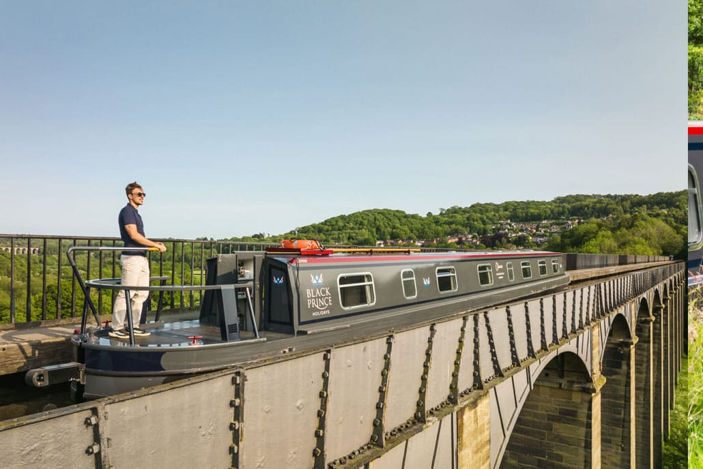 | 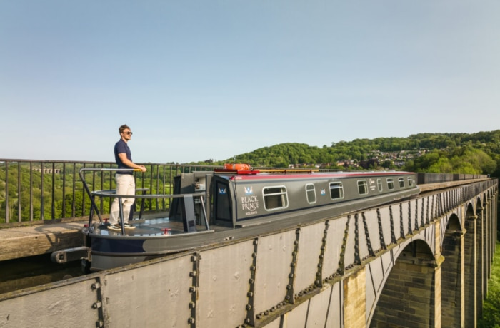 | 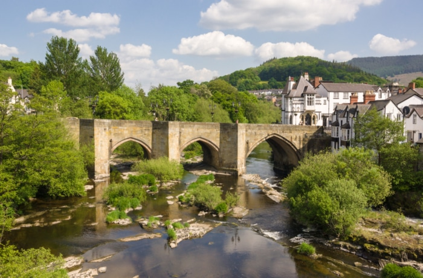 |
| :---: | :---: | :---: |
| *窄船驶过北威尔士兰戈伦运河高空水道桥（Chirk / Pontcysyllte Aqueduct）* | *传统英式窄船穿行在北威尔士迪河谷（Dee Valley）翠绿山谷间* | *兰戈伦古镇（Llangollen Town）古老石桥与蒸汽火车站风光* |

---

### 2. 🇨🇦 加拿大安大略省：里多运河（Rideau Canal — 天然冰川千岛湖泊与1832年古董船闸）

| 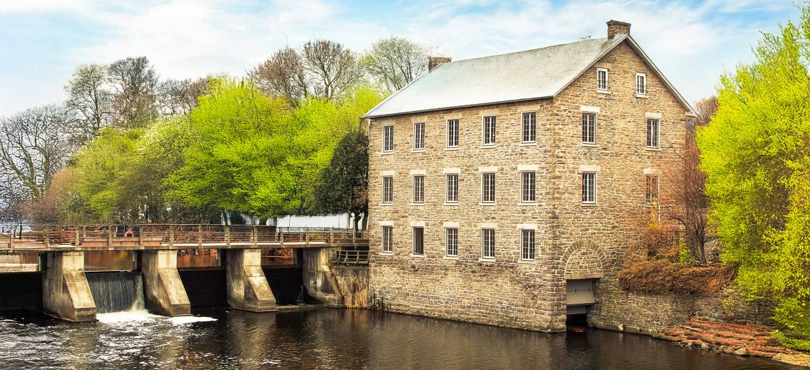 | 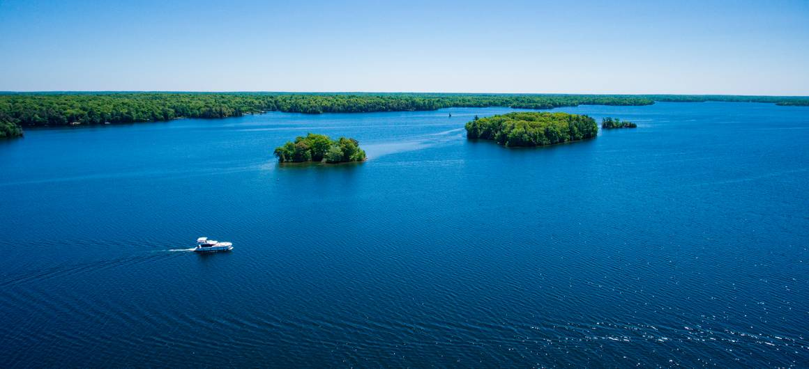 | 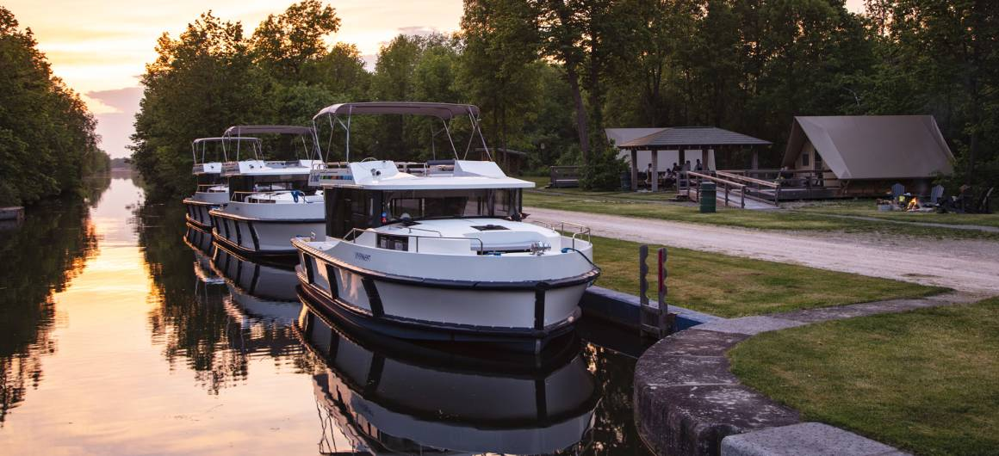 |
| :---: | :---: | :---: |
| *里多运河百年石磨坊与国家公园员工手摇操作的阶梯船闸* | *Le Boat 宽体游艇航行在里多运河天然冰川湖泊与森林群岛之间* | *傍晚停泊在加拿大国家公园船闸草坪营地（Lockstation）的 Horizon 游艇与露营木屋* |

---

### 3. 🇫🇷 法国南法：米迪运河（Canal du Midi — 梧桐树拱廊与卡尔卡松中世纪双层古城）

| 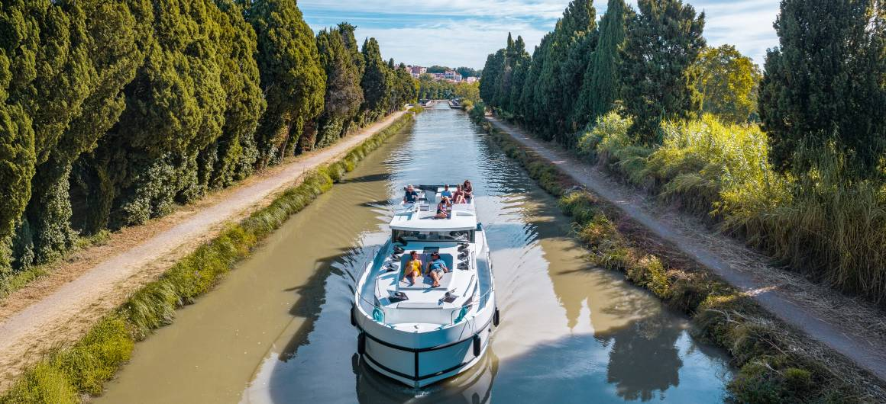 | 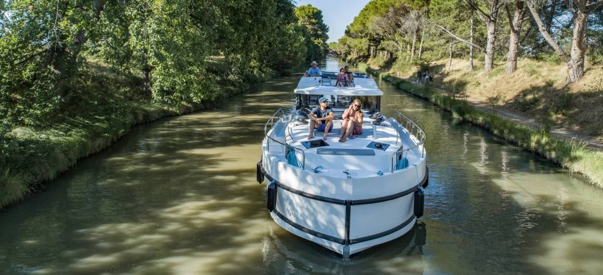 | 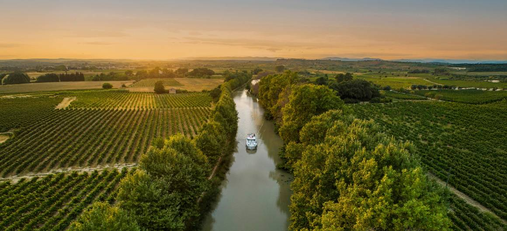 |
| :---: | :---: | :---: |
| *自驾游船驶过南法卡尔卡松（Carcassonne）中世纪双层城墙古堡脚下* | *米迪运河标志性的百年法国梧桐林荫水道* | *南法朗格多克葡萄酒产区米迪运河日落航行* |

---

### 4. 🇫🇷 法国东北部：阿尔萨斯-洛林运河（Alsace-Lorraine — 红砂岩悬崖古堡、穿山隧道与斜坡升船机）

| 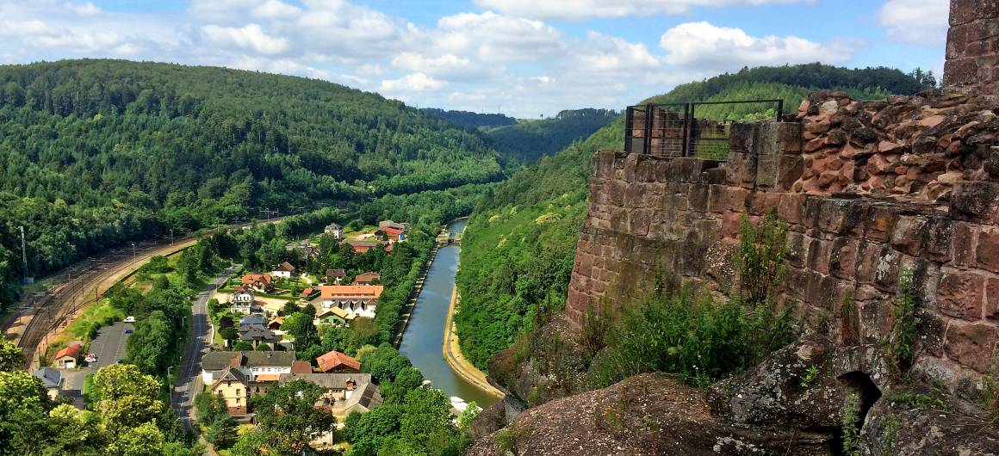 | 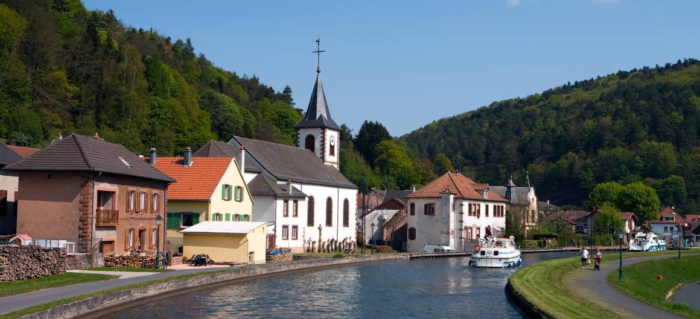 | 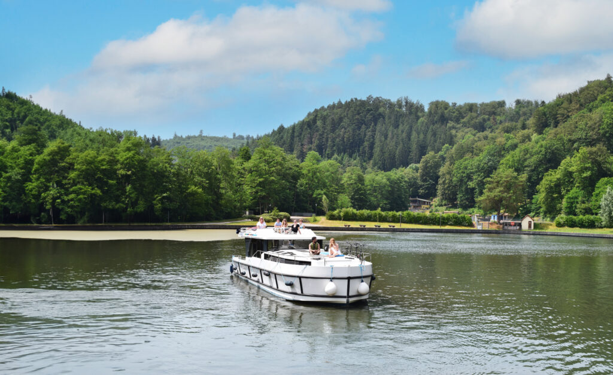 |
| :---: | :---: | :---: |
| *马恩-莱茵运河穿行于吕策尔堡（Lutzelbourg）红砂岩悬崖与中世纪城堡之下* | *阿尔萨斯运河沿线德法交融的彩色木筋房童话小镇* | *家庭船员在阿尔萨斯-洛林孚日山脉森林与湖泊水道上巡航* |

---

## 二、🇬🇧 英国窄船·北威尔士兰戈伦运河（Llangollen Canal）7晚每晚停泊点与酒馆推荐

> [!TIP]
> **英国窄船过夜停泊规则**：英国运河除了私人游艇码头（Marina）外，**全线只要在纤道侧（Towpath Side，非桥洞、非船闸引道、非掉头区 Winding Hole）均可免费打桩或系缆野泊（Free Visitor Moorings）**！最地道的方式就是把船直接停在百年临水酒馆（Waterside Pub）门前50米内，下船步行1分钟进店吃晚餐。

以下以最经典的 **Trevor（Anglo Welsh 基地，紧邻庞特卡萨尔特高空水道桥北端）** 或 **Chirk（Black Prince 基地）** 出发 **7晚往返路线（兰戈伦山谷 + 埃尔斯米尔湖区 + 惠特彻奇古镇，全长约72英里，往返仅需过4座船闸，极其轻松！）** 为例，推荐每晚最佳停泊点：

| 晚数 | 航段与白天核心体验 | 晚上推荐停泊点（Overnight Mooring） | 岸上步行可达的推荐酒馆 / 餐厅与亲子看点 |
| :--- | :--- | :--- | :--- |
| **第1晚** | **下午在 Trevor 取船培训 → 西行穿越山谷直抵 Llangollen（约2小时，0船闸）** 沿着贴山悬崖开凿的狭窄水道逆流而上，脚下就是奔腾的迪河（River Dee）。 | **Llangollen Basin（兰戈伦运河终点港池）** *(港池内提供带岸电与供水的官方过夜泊位，收费仅 **£7.00 GBP/晚**)* | 🍺 **The Corn Mill（水车磨坊酒馆）**：直接建在迪河急流之上，露台正对古老水车与蒸汽火车站，必点威尔士羊肉派与鲜酿苦啤。 🚂 **次日清晨看点**：带3个孩子坐 **Llangollen Railway（复古蒸汽火车）**、步行去马蹄瀑布（Horseshoe Falls）或登顶 Dinas Bran 古堡遗址。 |
| **第2晚** | **Llangollen → 驶过世界遗产高空水道桥 → Chirk Bank（约3.5小时，0船闸）** 全周高潮！开着70英尺窄船驶过38米高的 **Pontcysyllte Aqueduct（庞特卡萨尔特高空水道桥）**，随后穿过黑暗的 Whitehurst 隧道与21米高的 **Chirk Aqueduct（彻克水道桥，横跨英格兰与威尔士边界）** 及421米长的 Chirk 隧道。 | **Chirk Bank Visitor Moorings（彻克水道桥南岸，靠近 Gledrid Bridge 21号桥）** *(免费48小时访客泊位，风景极佳)* | 🍺 **The Poachers Pocket**（就在 Gledrid Bridge 桥边，自带超大河畔花园与儿童游乐区，极适合6大3小）或 **The Bridge Inn**（紧邻彻克水道桥头，可仰望高架铁路桥与水道桥双桥奇观）。 🏰 **看点**：国家信托管理的 **Chirk Castle（彻克城堡，建于1295年）**。 |
| **第3晚** | **Chirk Bank → New Marton 船闸 → Ellesmere 湖区（约4.5小时，2船闸）** 在 New Marton 体验全家人第一次合力手摇开闸推门，穿过 Франктон 交汇口进入被称为“什罗普郡湖区（Shropshire Lake District）”的冰川湖畔。 | **Ellesmere Town Arm（埃尔斯米尔支线终点码头，紧邻 Tesco 超市与古镇中心）** 或 **Blake Mere 湖畔泊位** *(免费访客泊位)* | 🍺 **The Red Lion**（埃尔斯米尔镇中心17世纪古老驿站酒馆）或 **The Boathouse**（位于 The Mere 大湖岸边，落地窗看天鹅与湖景）。 🦢 **看点**：带孩子环绕 **The Mere（埃尔斯米尔湖）** 散步喂鸟、在镇中心大超市补给食材。 |
| **第4晚** | **Ellesmere → Bettisfield → Whixall Moss 泥炭荒原 → Whitchurch（约5小时，0船闸）** 穿过如电影《指环王》夏尔郡般的田园牧场、升降吊桥（Lift Bridges，需船员下船手拉配重梁升桥！）与国家级自然保护区 Fenn's & Whixall Moss。 | **Whitchurch Canal Arm（惠特彻奇支线运河草坪泊位）** *(免费草坪岸边泊位，距离古镇步行15分钟)* | 🍺 **The Black Bear**（惠特彻奇古镇中心的都铎式黑白木筋老酒馆）或步行至 **Old Town Hall Vaults**。 🕰️ **看点**：惠特彻奇是英国著名的百年塔钟制造之乡（J.B. Joyce 钟表厂所在地），镇上有古罗马历史步道。 |
| **第5晚** | **Whitchurch 掉头返航 → 经 Morris 吊桥 → Colemere 森林湖泊（约4小时，0船闸）** 在 Grindley Brook 阶梯船闸前掉头，慢节奏返航，深入静谧的 Colemere 乡村公园湖区。 | **Colemere Visitor Moorings（55号桥与56号桥之间，紧邻 Colemere 森林大湖）** *(全线最安静、最贴近大自然的免费森林湖畔野泊点)* | 🔥 **船上自炊/湖畔野餐之夜**：Colemere 是绝佳的纯自然停泊点（无酒馆喧嚣），傍晚带孩子们沿着森林湖畔步道观鸟，在窄船上做一顿丰盛的英式家庭晚餐。*(若想泡酒馆，可往前多开40分钟停在 **Welshampton 51号桥**，步行5分钟去 **The Sun Inn**)*。 |
| **第6晚** | **Colemere → Ellesmere → Frankton → Jackfield / Hindford（约3.5小时，0船闸）** 再次穿过美丽的什罗普郡草甸，傍晚停靠在英格兰边境最受欢迎的网红运河酒馆门前。 | **Hindford Visitor Moorings（13号桥 Jackfield Bridge 旁）** *(免费泊位，正对酒馆草坪)* | 🍺 **The Jack Mytton Inn（Hindford）**：兰戈伦运河全线口碑第一的运河酒馆！就在运河岸边，您可以坐在花园里看着自己的窄船吃烤牛排和炸鱼薯条。 |
| **第7晚** | **Hindford → New Marton 船闸 → 再次跨越两座高空水道桥返回 Trevor（约4小时，2船闸）** 最后一天再次从高空俯瞰迪河峡谷，傍晚回到基地码头。 | **Trevor Basin（特雷弗港池基地码头）** *(免费基地泊位，含水电补给)* | 🍺 **The Telford Inn（Trevor Basin）**：就在庞特卡萨尔特高空水道桥北桥头旁，以设计该水道桥的工程大师托马斯·特尔福德命名，为7晚航程画上完美句号（次日早上9:00–9:30还船）。 |

---

## 三、🇨🇦 加拿大里多运河（Rideau Canal）7晚每晚停泊点与营地/古镇推荐

> [!IMPORTANT]
> **里多运河过夜停泊规则（与英国完全不同！）**：在里多运河，您预订 Le Boat 时支付的 **\$155.00 USD 国家公园强制附加费（Parks Canada Mooring Pass）** 已经包含了全线 **所有47座国家公园船闸营地（Lockstations）的过夜停泊费**！
> 每个国家公园船闸营地都像一座修剪整齐的风景公园，配有 **免费冲水卫生间、热水淋浴间、野餐桌、草坪、篝火坑（Fire Pits）**，甚至有加拿大特色红椅子（Red Chairs）。您既可以选择住在 **纯自然静谧的船闸小岛营地（船顶飞桥烧烤+岸上篝火烤棉花糖）**，也可以选择停在 **古镇中心的船闸码头（下船步行逛街下馆子）**。

以下以从运河中心枢纽 **Smiths Falls（史密斯瀑布镇）** 出发，向南深入风景最壮丽的 **大里多湖（Big Rideau Lake）+ 韦斯特波特（Westport）+ 琼斯瀑布（Jones Falls）+ 往北串联梅里克维尔（Merrickville）** 的 **7晚经典精华环线** 为例：

| 晚数 | 航段与白天核心体验 | 晚上推荐停泊点（Parks Canada Lockstation / Marina） | 营地特色 / 岸上古镇餐厅与亲子活动推荐 |
| :--- | :--- | :--- | :--- |
| **第1晚** | **下午在 Smiths Falls (Combined Lock 29a) 取船培训 → 驶入大里多湖门户 Poonamalie Lock 32（约1小时，1船闸）** 首日下午3:00后登船，不宜远航，开出小镇后进入被雪松森林环绕的第一座古董手摇船闸。 | **Poonamalie Lockstation (Lock 32) 国家公园船闸营地** *(包含在国家公园通行证内，免费停泊)* | 🌲 **森林草坪与萤火虫之夜**：这里远离公路喧嚣，长长的百年石砌引水道旁全是参天雪松。晚上在 Horizon 4 游艇的顶层大飞桥上用 **免费燃气BBQ炉烤牛排**，孩子们在国家公园草坪上抓萤火虫、围着篝火烤棉花糖（S'mores）。 |
| **第2晚** | **Poonamalie → 横跨广阔的大里多湖（Big Rideau Lake）→ Westport（约3.5小时，1船闸 [Narrows Lock 35]）** 驶入里多运河最美的天然冰川大湖，沿途无数花岗岩松林小岛（可在 Colonel By Island 国家公园小岛抛锚游泳、划桨板），穿过狭窄水道进入上里多湖西岸的度假小镇。 | **Westport Municipal Harbour（韦斯特波特小镇中心码头）** 或返回 **Narrows Lock 35 营地** *(Westport 市政码头提供岸电，约 CA\$1.90/英尺；Narrows 船闸营地免费)* | 🍷 **Scheuermann Vineyard & Winery（湖畔酒庄）**：从码头步行或打车5分钟即可到达，坐在湖畔葡萄园吃木火披萨、喝安大略冰酒与黑皮诺。 🍦 **小镇漫步**：Westport 被称为“里多运河最热闹的度假村”，镇上有精酿啤酒厂（Westport Brewing Company）、手工冰淇淋店和独立精品店。 |
| **第3晚** | **Westport → Newboro Lock 36 → Chaffeys Lock 37（约3小时，2船闸）** 穿过运河海拔最高点的分水岭（Newboro 湖，加拿大钓大口黑鲈鱼 Bass 的圣地），穿过蜿蜒狭窄的 Indian Lake 群岛水道。 | **Chaffeys Lockstation (Lock 37) 国家公园船闸营地** *(免费停泊，公认全线最美船闸村落之一)* | 🍽️ **The Opinicon Resort（百年传奇度假村餐厅 & 冰淇淋屋）**：就在船闸旁边步行2分钟！这家建于19世纪末的森林湖畔度假村拥有超赞的湖景餐厅和复古冰淇淋吧（Opinicon Ice Cream Shop），6大3小必打卡。 🥾 **步道**：船闸旁有古老磨坊遗址与穿越森林的 Cataraqui Trail 步道。 |
| **第4晚** | **Chaffeys Lock → Davis Lock 38 → Jones Falls（琼斯瀑布四联阶梯船闸，约2小时，5船闸）** 驶过迷人的 Sand Lake，抵达里多运河工程奇迹——建于1832年的 **Jones Falls 巨型石拱大坝（当时北美最高大坝）** 与落差达18米的 **4级阶梯手摇船闸（Locks 39–42）**！ | **Jones Falls Lockstation (Locks 39–42) 顶池或底池国家公园营地** *(免费停泊，配备极佳的淋浴房与大草坪)* | 🏛️ **Hotel Kenney（1877年百年历史木结构酒店餐厅）**：紧邻琼斯瀑布下船闸，坐在百年廊柱露台上吃安大略湖鲜。 🔨 **亲子互动**：船闸旁有 **铁匠铺博物馆（Blacksmith Shop）** 和守闸官石屋（Sweeney House），国家公园讲解员会穿19世纪古装为孩子们演示打铁与古法开闸。 |
| **第5晚** | **Jones Falls 返航北上 → 经 Newboro → Beveridges Locks 33–34 → 历史名镇 Perth（珀斯，约4.5小时，5船闸）** 沿着 Tay Canal 支线（泰伊运河）穿过两座手摇船闸，一路驶进全加拿大公认最美丽的19世纪苏格兰石建筑古镇 **Perth** 的市中心公园！ | **Perth Downtown Basin（Last Duel Park 市政公园港池码头）** *(停在古镇市中心 Stewart Park 旁，带岸电与淋浴)* | 🌮 **Mex & Co.**（就在运河港池岸边的墨西哥风味露台餐厅）或 **Maximilian Restaurant**（正宗德奥猪肘与牛排餐厅）。 🏞️ **看点**：带孩子们逛宛如童话花园的 **Stewart Park（斯图尔特公园，小桥流水就在码头旁）**、珀斯博物馆与精品奶酪店。 |
| **第6晚** | **Perth → 返回 Smiths Falls → 继续向北驶达“运河明珠” Merrickville（梅里克维尔，约4.5小时，7船闸）** 穿过 Old Slys 与 Edmonds 船闸，傍晚抵达被评为“加拿大最美村庄”的 **Merrickville（Locks 21–23）**。 | **Merrickville Lockstation (Locks 21–23) 国家公园船闸营地** *(免费停泊，直接停在1832年石头碉堡旁)* | 🍻 **The Goose & Gridiron（鹅与铁架英式酒馆）**、**Yellow Canoe Café（黄独木舟花园咖啡馆）**，以及孩子最爱的 **Mrs. McGinty's 甜品屋**。 🏰 **看点**：船泊位正对着1832年建成的 **Merrickville Blockhouse（北美现存最大的石砌军事碉堡博物馆）**，古镇街道遍布吹玻璃工坊、铁艺店和手工芥末酱店。 |
| **第7晚** | **Merrickville → Kilmarnock Lock 24（全线最浪漫独岛船闸）→ 返回 Smiths Falls（约3.5小时，5船闸）** 中午在 Kilmarnock 船闸野餐、游泳，下午慢悠悠返回 Smiths Falls 基地码头。 | **Smiths Falls Combined Lockstation / Victoria Park Marina（基地码头）** *(免费基地泊位，含岸电与水补给)* | 🚂 **漫步 Smiths Falls 小镇**：晚餐推荐去镇中心的 **Bowie's** 或 **4 Degrees Brewing**，带孩子参观旁边的 **东安大略铁路博物馆（Railway Museum of Eastern Ontario，可爬上老式蒸汽火车头和守车）**，次日早上9:00–10:00还船。 |

---

## 四、四大经典航线全方位横向对比（北威尔士 vs. 里多运河 vs. 法国米迪 Midi vs. 法国阿尔萨斯 Alsace）

如果您正在 **英国北威尔士（Llangollen）**、**加拿大里多运河（Rideau）**、**法国南法米迪运河（Canal du Midi）** 和 **法国阿尔萨斯-洛林（Alsace-Lorraine）** 之间为 **6大3小（共9人）** 做最终取舍，请参考以下深度对比表：

| 对比维度 | 🇬🇧 英国北威尔士 *(Llangollen Canal)* | 🇨🇦 加拿大里多运河 *(Rideau Canal)* | 🇫🇷 法国南法米迪运河 *(Canal du Midi)* | 🇫🇷 法国阿尔萨斯-洛林 *(Alsace-Lorraine)* |
| :--- | :--- | :--- | :--- | :--- |
| **6月初7晚9人船租实付价** *(以4卧室同级/顶配船型计)* | **最便宜！** **£2,325 – £2,379.15 GBP** ***(\$3,138.75 – \$3,211.85 USD)*** *(Anglo Welsh Bond 12 / ABC Swan)* | **中高（5星Horizon 4）** **£3,389.00 GBP / €3,994 EUR** ***(\$4,575.15 USD)*** *(Le Boat Horizon 4)* | **最贵（南法最热门）** **€3,469 – €4,629 EUR** ***(\$4,024.04 – \$5,369.64 USD)*** *(4星 Magnifique / 5星 Horizon 4)* | **法国高性价比** **€2,919 – €3,889 EUR** ***(\$3,386.04 – \$4,511.24 USD)*** *(4星 Magnifique / 5星 Horizon 4)* |
| **加上燃油/附加费7晚全包总价** | **约 \$3,350 – \$3,450 USD** *(免过闸停泊费，柴油仅约\$175)* | **约 \$5,772.97 USD** *(含公园费\$155+免责险+燃油)* | **约 \$4,950 – \$6,350 USD** *(另付高额按小时燃油+码头岸电费)* | **约 \$4,250 – \$5,450 USD** *(另付按小时燃油+码头水电费)* |
| **核心景观气质** | **高空工程奇迹 + 翠绿河谷 + 百年英式酒馆** 38米高空水道桥、迪河峡谷、蒸汽火车、天鹅湖泊 | **狂野天然大湖 + 森林千岛 + 古董石船闸** 80%为天然冰川湖，湖岸松林、白头海雕、国家公园大草坪 | **南法阳光葡萄园 + 梧桐林荫 + 中世纪古堡** 卡尔卡松双层古堡、地中海酒庄、鹅卵石古桥 | **红砂岩悬崖古堡 + 德法童话木筋小镇 + 升船机** 吕策尔堡悬崖城堡、穿山双隧道、萨韦尔纳宫殿 |
| **6月初气候与水温** | **12°C–20°C** 温和凉爽，绿意最浓，偶有阵雨（不可下水游泳） | **15°C–25°C** 初夏晴朗干爽，空气极佳，浅湖湾已可划桨板/戏水 | **18°C–28°C** 温暖晴朗、阳光充足（最稳定），距地中海海滩近 | **15°C–24°C** 清爽舒适，孚日山脉森林空气清甜（西段大湖可戏水） |
| **船闸操作难易度** | **全员手动摇闸（7晚仅4座船闸！）** 北威尔士线船闸极少（以水道桥和吊桥为主），一点都不累且很好玩 | **最省心！国家公园员工全程帮您手摇** 全线47座1832年古董船闸，您只需在船上抓绳，完全不用出力 | **电动船闸（有守闸员或自动感应）** 但6月船只较多，在多级阶梯船闸（如Fonserannes）可能需排队等候 | **全自动拉杆/雷达感应船闸 + 巨型斜坡升船机** 船闸数量较多，但有震撼的 Arzviller 斜坡升船机（1次顶17座闸） |
| **美食与微醺体验** | ⭐⭐⭐⭐ 每晚停在百年乡村 Pub 门口，吃炸鱼薯条、威尔士烤羊肉、喝 Real Ale 鲜啤 | ⭐⭐⭐½ 以游艇顶层甲板自烤安大略牛排BBQ、营地篝火 + 古镇酒庄/冰淇淋屋为主 | ⭐⭐⭐⭐⭐ 法式油封鸭（Cassoulet）、鹅肝、生蚝、南法桃红葡萄酒、每天早晨现烤法棍可颂 | ⭐⭐⭐⭐⭐ 阿尔萨斯酸菜炖肉（Choucroute）、火焰薄饼（Tarte Flambée）、雷司令白葡萄酒 |
| **对3个孩子的吸引力** | ⭐⭐⭐⭐⭐ 高空水道桥像在天上开船、坐复古蒸汽火车、亲自拉吊桥摇船闸、喂天鹅 | ⭐⭐⭐⭐⭐ 在大湖划桨板钓鱼、看国家公园铁匠打铁、晚上草坪抓萤火虫烤棉花糖 | ⭐⭐⭐⭐ 卡尔卡松中世纪骑士城堡探秘、沿着运河纤道骑自行车 | ⭐⭐⭐⭐⭐ 坐巨型水箱“斜坡升船机”从山顶滑下、开船钻2.3公里山洞隧道、爬山顶废墟古堡 |

---

## 第四部分：体验过一次法国米迪运河（Canal du Midi）后，下一次去哪？（阿尔萨斯 vs. 英国窄船 vs. 欧洲6大进阶航线）

如果您已经体验过一次 **法国米迪运河（Canal du Midi）**，那么第二次自驾船假期，我的第一条核心建议是：**千万不要紧接着去法国阿尔萨斯（Alsace）！**

### 一、为什么去过 Midi 后，不建议紧接着去阿尔萨斯？
* **“同质化审美疲劳”**：在米迪运河，您已经完整体验过了 **“法国人工开凿窄运河 + 4米宽白色玻璃钢游艇 + 每天排30–40座法式船闸 + 岸上买法棍喝红酒”** 的标准公式。
* 阿尔萨斯（马恩-莱茵运河）虽然岸上建筑变成了德法木筋房、多了一个斜坡升船机（Arzviller），但 **您开的依然是同一家船司的同款白色玻璃钢船、走的依然是不能游泳的法国人工运河、每天依然要过几十座一模一样的法国船闸**——约 **65% 的日常体验与 Midi 高度重合**。

因此，去过一次米迪运河后，第二次最聪明的玩法是 **彻底换一种“船只物种”（去英国开21米钢铁窄船）**，或者 **彻底换一种“水域形态”（去欧洲的大湖、海上泻湖或皇家天然大河）**！

---

### 二、去过 Midi 之后，欧洲最惊艳的 5 大进阶路线推荐（附6月初9人精确价格）

> **汇率基准**：`£1 GBP = \$1.35 USD` | `€1 EUR = \$1.16 USD`。以下均为 **2027年6月初（6月4日–6月7日出发）7晚整周、可住6大3小（共9人）** 的官网实时精确价格。

#### 🥇 首选 1（换一种船、换一种文化）：🇬🇧 英国北威尔士窄船（UK Narrowboat — Llangollen 兰戈伦高空水道桥线）
* **为什么去过 Midi 后必体验一次？**
  1. **船与驾驶方式完全不同**：从法国4米宽的白色方向盘游艇，换成 **仅2.08米宽、21米超长、全钢彩绘船身、站在船尾露天手推传统木质舵柄（Tiller）转向** 的英式窄船，过弯和操控手感完全是另一个平行宇宙。
  2. **过闸与吊桥互动完全不同**：Midi 是等守闸员按按钮；北威尔士线7晚往返只有4座船闸，但沿途有十几个木制升降吊桥（Lift Bridges），3个孩子和大人跳下船合力拉下配重木梁把桥升起来让船通过，晚上直接停在百年英式酒馆（Pub）草坪前喝鲜酿苦啤。
  3. **38米高空水道桥奇观**：开着窄船悬空驶过 **Pontcysyllte Aqueduct** 的视觉震撼，是平缓的米迪运河完全无法比拟的。
* **6月初7晚9人精确价格（回顾）**：
  * **Anglo Welsh — 4卧室 *Bond 12*（69英尺，最多12人，Trevor出发）**：**£2,325.00 GBP（\$3,138.75 USD）**。
  * **ABC Boat Hire — 4卧室 *Alvechurch Swan*（70英尺，最多12人，早鸟85折）**：标准原价 £2,799.00 GBP | 实付 **£2,379.15 GBP（\$3,211.85 USD）**。

---

#### 🥈 首选 2（从“人工小河”跃升为“史诗级高地深水大湖+古堡”）：🏴󠁧󠁢󠁳󠁣󠁴󠁿 苏格兰喀里多尼亚运河与尼斯湖（Caledonian Canal & Loch Ness）
* **为什么它是去过 Midi 后的欧洲自然风光天花板？**
  1. **三分之二航程在天然冰川深水大湖上巡航**：全长60英里横贯苏格兰大峡谷（Great Glen），只有22英里是人工运河，其余38英里直接航行在 **Loch Ness（尼斯湖）**、**Loch Oich**、**Loch Lochy** 四座群山环抱的深水大湖上！
  2. **中世纪古堡、雪山与威士忌**：两岸是苏格兰高地森林与英国最高峰本尼维斯山（Ben Nevis），您可以直接开着游艇停在 **尼斯湖畔的厄克特城堡废墟（Urquhart Castle）** 下方仰望古堡、带孩子在尼斯湖面寻找“水怪”、登岸参观百年单一麦芽威士忌酒厂，并体验英国最壮观的8级连环船闸 **“海神阶梯”（Neptune's Staircase）**。
  3. **0手动船闸**：全线船闸与旋转桥均由苏格兰运河管理局专职守闸员电动操作，完全不用自己费力。
* **2027年6月初（6月5日，Laggan 基地往返7晚）9人精确价格**：
  * **Le Boat — Magnifique（4★ Premier，4卧3卫+客厅=最多10人，带顶层大飞桥）**：标准原价 **£4,772.00 GBP** | 早鸟实付 **£3,372.00 GBP（\$4,552.20 USD）** | 折合每晚 **£481.71 GBP（\$650.31 USD）** | 9人分摊人均7晚 **£374.67 GBP（\$505.80 USD）**。

---

#### 🥉 首选 3（从“内陆河道”变成“海上泻湖跳岛游+亚得里亚海沙滩”）：🇮🇹 意大利威尼斯泻湖与弗留利（Venetian Lagoon & Friuli）
* **为什么极适合去过 Midi 的6大3小家庭？**
  1. **全欧洲唯一的“游艇海上泻湖跳岛游”**：从威尼斯北门户 **Casale sul Sile** 出发，顺着西莱河直接驶入碧蓝开阔的 **威尼斯泻湖（Venetian Lagoon）**！
  2. **把船停在彩色岛过夜的特权**：您可以开着自己的游艇直接停靠在 **彩色岛 Burano（布拉诺岛）**、**玻璃岛 Murano（穆拉诺岛）**、**Torcello 古岛** 的码头过夜！傍晚一日游团队撤离后，整座彩色岛归于宁静，全家人下船吃威尼斯海鲜墨鱼面、喝 Aperol Spritz，白天还能开船去 **Jesolo 或 Lido 金沙滩** 让孩子们在亚得里亚海游泳玩沙！
* **2027年6月初（6月4日，Casale sul Sile 基地往返7晚）9人精确价格**：
  * **【3卧室奢华型】Le Boat — Vision 3（5★ Luxury，3卧3卫+客厅=最多10人，含冷气空调+Joystick摇杆停船）**：标准原价 **£4,069.00 GBP** | 早鸟实付 **£2,839.00 GBP（\$3,832.65 USD）** | 9人分摊人均 **\$425.85 USD**。
  * **【4卧室高性价比】Le Boat — Salsa（3★ Comfort+，4卧2卫+客厅=最多12人）**：标准原价 **£3,359.00 GBP** | 早鸟实付 **£2,349.00 GBP（\$3,171.15 USD）** | 9人分摊人均 **\$352.35 USD**。
  * **【4卧室经典主力】Le Boat — Magnifique（4★ Premier，4卧3卫+客厅=最多10人）**：标准原价 **£3,589.00 GBP** | 早鸟实付 **£2,509.00 GBP（\$3,387.15 USD）** | 9人分摊人均 **\$376.35 USD**。
  * **【4卧室顶配旗舰】Le Boat — Vision 4（5★ Luxury，4卧4卫+客厅=最多9人，含冷气空调+Joystick摇杆）**：标准原价 **£4,479.00 GBP** | 早鸟实付 **£3,129.00 GBP（\$4,224.15 USD）** | 9人分摊人均 **\$469.35 USD**。

---

#### 🏅 首选 4（既想要英伦古堡与酒馆，又想要4.35米宽体大游艇）：🇬🇧 英国泰晤士河皇家航线（River Thames — 温莎城堡至牛津）
* **为什么适合既喜欢英国风情、又怕窄船太挤的家庭？**
  1. **宽体游艇 + 皇家守闸员服务**：泰晤士河是宽阔的天然大河，直接运营和法国同款的 **4.35米宽飞桥游艇（Magnifique / Horizon 4）**，所有船闸均由身穿制服的皇家守闸员（Lock Keepers）电动操作，无需自己推门。
  2. **一路串联世界顶级王室与学府地标**：从伦敦希思罗机场旁的 **Chertsey** 或牛津旁的 **Benson** 出发，直接把船停在 **温莎城堡（Windsor Castle）** 脚下过夜、带3个孩子去岸边的 **温莎乐高乐园（LEGOLAND Windsor）** 狂欢一天，途经 **伊顿公学（Eton）**、皇家赛艇圣地 **Henley-on-Thames**，直抵 **牛津大学城（Oxford）**！
* **2027年6月初（6月5日，Chertsey 或 Benson 往返7晚）9人精确价格**：
  * **【3卧室+客厅】Le Boat — Calypso（3★ Comfort，3卧2卫+客厅=限8人，若9人需选下方4卧）**：标准原价 £2,819.00 GBP | 实付 **£1,969.00 GBP（\$2,658.15 USD）**。
  * **【4卧室经济型】Le Boat — Classique Star（3★ Comfort，4卧2卫+客厅=最多10人）**：标准原价 **£2,879.00 GBP** | 早鸟实付 **£2,159.00 GBP（\$2,914.65 USD）** | 9人分摊人均 **\$323.85 USD**。
  * **【4卧室主力型】Le Boat — Magnifique（4★ Premier，4卧3卫+客厅=最多10人）**：标准原价 **£3,339.00 GBP** | 早鸟实付 **£2,329.00 GBP（\$3,144.15 USD）** | 9人分摊人均 **\$349.35 USD**（比米迪运河同款船便宜 **\$880 USD**！）。
  * **【4卧室奢华型】Le Boat — Horizon 4（5★ Luxury，4卧4卫+客厅=最多9人，6月7日 Benson 往返）**：标准原价 **£4,389.00 GBP** | 早鸟实付 **£3,289.00 GBP（\$4,440.15 USD）** | 9人分摊人均 **\$493.35 USD**。

---

#### 🏅 首选 5（全程0船闸、风车木鞋吊桥与天然湖区）：🇳🇱 荷兰弗里斯兰湖区或阿姆斯特丹北线（Netherlands — Vinkeveen / Hindeloopen）
* **为什么孩子会特别喜欢？**
  1. **0船闸 + 钓鱼竿小木鞋收过桥费**：荷兰航线几乎没有高低落差船闸，全是电动开启的吊桥（Lifting Bridges）。过桥时守桥人会用一根长钓鱼竿把一只 **荷兰传统小木鞋（Klomp）** 荡到您的船头收 €1.50–€2.00 过桥费，3个孩子每次都会抢着往小木鞋里塞硬币！
  2. **大湖游泳 + 风车奶酪小镇**：水道串联起数十个清澈的天然湖泊（可随时下水游泳、玩帆船），岸上到处是旋转的古老风车、奶酪市场（Edam / Gouda）与童话花园村落。
* **2027年6月初（6月5日，Vinkeveen 或 Hindeloopen 往返7晚）9人精确价格**：
  * **【3卧室奢华型】Le Boat — Vision 3（5★ Luxury，3卧3卫+客厅=最多10人）**：标准原价 **£4,179.00 GBP** | 早鸟实付 **£3,549.00 GBP（\$4,791.15 USD）**。
  * **【4卧室主力型】Le Boat — Magnifique（4★ Premier，4卧3卫+客厅=最多10人）**：标准原价 **£3,679.00 GBP** | 早鸟实付 **£3,119.00 GBP（\$4,210.65 USD）**。
  * **【4卧室奢华型】Le Boat — Horizon 4（5★ Luxury，4卧4卫+客厅=最多9人）**：标准原价 **£5,059.00 GBP** | 早鸟实付 **£4,549.00 GBP（\$6,141.15 USD）**。

---

### 三、总结：去过 Midi 后的“下一站”决策表

| 您的团队偏好 | 去过 Midi 后的最佳下一站 | 核心理由 | 6月初9人4卧室7晚实付船租 |
| :--- | :--- | :--- | :--- |
| **想玩完全不同的船、喜欢高空奇观与乡村酒馆** | **🇬🇧 英国北威尔士窄船** *(Llangollen Canal)* | 21米全钢窄船手推木舵 + 38米高空水道桥 + 亲手升吊桥 | **£2,325.00 – £2,379.15 GBP** ***(\$3,138.75 – \$3,211.85 USD)*** |
| **想带孩子去温莎城堡/乐高乐园/牛津，且要宽敞大游艇** | **🇬🇧 英国泰晤士河** *(River Thames)* | 4.35米宽体大飞桥游艇 + 皇家守闸员服务 + 王室名校地标 | **£2,159.00 – £3,289.00 GBP** ***(\$2,914.65 – \$4,440.15 USD)*** |
| **想要最壮丽的雪山大湖与古堡荒原风光** | **🏴󠁧󠁢󠁳󠁣󠁴󠁿 苏格兰尼斯湖** *(Caledonian Canal)* | 直接在尼斯湖等4座冰川大湖巡航 + 厄克特城堡 + 威士忌 | **£3,372.00 GBP** ***(\$4,552.20 USD)*** |
| **想开游艇跳岛游威尼斯、吃海鲜、去海滩游泳** | **🇮🇹 意大利威尼斯泻湖** *(Venetian Lagoon)* | 唯一海上泻湖航线，直接停靠彩色岛 Burano 过夜 + 沙滩戏水 | **£2,349.00 – £3,129.00 GBP** ***(\$3,171.15 – \$4,224.15 USD)*** |
| **依然想留在法国，但想要可游泳的清澈大河与悬崖** | **🇫🇷 法国洛特河** *(River Lot)* | 天然翡翠色大河（非人工运河）+ 百米悬崖古村 Saint-Cirq-Lapopie | **€3,676.25 EUR** ***(\$4,264.45 USD)*** *(Nicols Octo)* |
