# 欧洲10大经典运河/内河自驾游船全攻略：3卧室精确报价 & 8天7晚逐日双图精确匹配行程
*(全部10条航线均按标准 **8天7晚 [Day 1 至 Day 8]** 编排，**每一天均配2张与当日途经船闸/古镇/古堡/湖泊100%精确匹配的实景大图**，共 **80天、160张精确地标图片**)*

---

## 一、🇧🇪 比利时根特（Ghent）与布鲁日（Bruges）航线深度评测

如果您已体验过法国米迪运河（Canal du Midi），**比利时佛兰德斯航线（Nieuwpoort ↔ 布鲁日 Bruges ↔ 根特 Ghent ↔ 利斯河 Deinze）** 是一条 **“双世界遗产名城 + 零船闸压力 + 顶级啤酒巧克力美食”** 的人文旗舰线：
* **核心优势**：
  1. **游艇直入两座中世纪传奇古城中心过夜**：您可以开船驶过布鲁日护城河的四座古老风车，直接停进 **布鲁日（Bruges）老城 Coupure 码头**；随后继续东行停进 **根特（Ghent）市中心游艇港**，步行攻占建于1180年的水上护城河石头城堡 **Gravensteen（格拉文斯丁伯爵城堡）**、仰望圣巴夫主教座堂《神秘的羔羊》真迹。
  2. **全程几乎无船闸折腾**：佛兰德斯平原地势平坦，8天7晚往返仅需经过约6座现代化电动船闸与开启桥（全部由专职守闸/守桥员远程按钮控制），完全没有米迪运河排队过闸的辛苦。
  3. **北海沙滩 + 画家之河 + 比利时美食**：起点 **Nieuwpoort** 紧邻北海金沙滩（适合3个孩子玩沙看海），根特以南的 **River Lys（利斯河）** 则是禁止货船通行的柔美花园水道，每天都能品尝比利时青口贝配薯条（Moules-frites）、现烤华夫饼、手工巧克力与修道院精酿啤酒。
* **短板提醒**：连接布鲁日与根特的主运河段河道较宽且平直，行船途中的纯自然山水奇观不如苏格兰尼斯湖、法国洛特河百米悬崖或英国北威尔士高空水道桥；此外比利时基地的3卧室船型（*Elegance*）法定上限为6人，**6大3小（共9人）同船需选同基地的4卧室 *Magnifique*（上限10人）**。

---

## 二、10大航线 2027年6月初（Early June）8天7晚【3卧室船型】精确单一价格总表

> [!IMPORTANT]
> **3卧室船型与“6大3小（9人）”定员说明**：
> * 欧洲宽体游艇的 **3卧室船型** 分为 **限住6人**（3间双人房，客厅不睡人）、**限住8人**（3间双人房+客厅变形双人床=8人）和 **可住9–10人（✅ 6大3小9人合规单船：Le Boat 5星 *Vision 3* [上限10人]、Les Canalous *Tarpon 37 Duo Prestige* [上限9人]、Locaboat *Pénichette 1180FB* [上限9人]，以及全部英国70英尺3卧室窄船 [上限10人]）**。
> * 下表列出全部10大航线 **2027年6月4日/6月5日/6月7日出发（8天7晚）** 的 **3卧室精确单一报价**；若某基地3卧室上限不足9人，表中同时附带同基地 **9人合规4卧室船型精确价**。（汇率基准：`£1 GBP = \$1.35 USD`，`€1 EUR = \$1.16 USD`）。

| 航线名称 | 运营商与3卧室船型 | 卧室/卫浴与法定人数上限 | 出发基地与日期 *(8天7晚)* | 标准原价 *(7晚)* | 6月初早鸟实付价 *(7晚)* | 折合每晚实付单价 |
| :--- | :--- | :--- | :--- | :--- | :--- | :--- |
| **1. 🇫🇷 法国米迪运河** *(Canal du Midi)* | **Le Boat — Continentale** *(2★)* | 3卧3卫 *(限住6人)* | Homps *(6月5日)* | £2,759.00 GBP *(\$3,724.65 USD)* | **£2,069.00 GBP** ***(\$2,793.15 USD)*** | **£295.57 GBP** *(\$399.02 USD)* |
| **1. 🇫🇷 法国米迪运河** | **Le Boat — Elegance** *(3★+)* | 3卧3卫 *(限住6人)* | Homps *(6月5日)* | £3,299.00 GBP *(\$4,453.65 USD)* | **£2,309.00 GBP** ***(\$3,117.15 USD)*** | **£329.86 GBP** *(\$445.31 USD)* |
| **1. 🇫🇷 法国米迪运河** | **Le Boat — Calypso** *(3★)* | 3卧2卫+客厅 *(限住8人)* | Homps *(6月5日)* | £3,359.00 GBP *(\$4,534.65 USD)* | **£2,349.00 GBP** ***(\$3,171.15 USD)*** | **£335.57 GBP** *(\$453.02 USD)* |
| **1. 🇫🇷 法国米迪运河** | **Le Boat — Vision 3** *(5★奢华)* | **3卧3卫+客厅 *(最多10人 ✅9人可住)*** | Homps *(6月5日)* | £4,219.00 GBP *(\$5,695.65 USD)* | **£2,949.00 GBP** ***(\$3,981.15 USD)*** | **£421.29 GBP** *(\$568.74 USD)* |
| **1. 🇫🇷 法国米迪运河** | **Le Boat — Horizon 3** *(5★奢华)* | 3卧3卫+客厅 *(限住8人)* | Homps *(6月5日)* | £5,179.00 GBP *(\$6,991.65 USD)* | **£3,879.00 GBP** ***(\$5,236.65 USD)*** | **£554.14 GBP** *(\$748.09 USD)* |
| **1. 🇫🇷 法国米迪运河** | **Les Canalous — Tarpon 37 Duo** | **3卧2卫+客厅 *(最多9人 ✅9人可住)*** | Homps *(6月5日)* | €3,670.00 EUR *(\$4,257.20 USD)* | **€3,303.00 EUR** ***(\$3,831.48 USD)*** | **€471.86 EUR** *(\$547.35 USD)* |
| **1. 🇫🇷 法国米迪运河** | **Locaboat — Pénichette 1180FB** | **3卧3卫 *(最多9人 ✅9人可住)*** | Argens *(6月5日)* | €3,738.00 EUR *(\$4,336.08 USD)* | **€3,738.00 EUR** ***(\$4,336.08 USD)*** | **€534.00 EUR** *(\$619.44 USD)* |
| **2. 🇫🇷 法国阿尔萨斯** *(Alsace-Lorraine)* | **Le Boat — Crusader** *(2★)* | 3卧3卫 *(限住6人)* | Hesse *(6月5日)* | £2,479.00 GBP *(\$3,346.65 USD)* | **£2,099.00 GBP** ***(\$2,833.65 USD)*** | **£299.86 GBP** *(\$404.81 USD)* |
| **2. 🇫🇷 法国阿尔萨斯** | **Le Boat — Elegance** *(3★+)* | 3卧3卫 *(限住6人)* | Hesse *(6月5日)* | £2,699.00 GBP *(\$3,643.65 USD)* | **£2,159.00 GBP** ***(\$2,914.65 USD)*** | **£308.43 GBP** *(\$416.38 USD)* |
| **2. 🇫🇷 法国阿尔萨斯** | **Le Boat — Calypso** *(3★)* | 3卧2卫+客厅 *(限住8人)* | Hesse *(6月5日)* | £3,019.00 GBP *(\$4,075.65 USD)* | **£2,409.00 GBP** ***(\$3,252.15 USD)*** | **£344.14 GBP** *(\$464.59 USD)* |
| **2. 🇫🇷 法国阿尔萨斯** | **Le Boat — Vision 3** *(5★奢华)* | **3卧3卫+客厅 *(最多10人 ✅9人可住)*** | Hesse *(6月4日)* | £3,739.00 GBP *(\$5,047.65 USD)* | **£2,989.00 GBP** ***(\$4,035.15 USD)*** | **£427.00 GBP** *(\$576.45 USD)* |
| **2. 🇫🇷 法国阿尔萨斯** | **Le Boat — Mystique** *(4★)* | 3卧3卫+客厅 *(限住8人)* | Hesse *(6月5日)* | £4,279.00 GBP *(\$5,776.65 USD)* | **£3,419.00 GBP** ***(\$4,615.65 USD)*** | **£488.43 GBP** *(\$659.38 USD)* |
| **2. 🇫🇷 法国阿尔萨斯** | **Le Boat — Horizon 3** *(5★奢华)* | 3卧3卫+客厅 *(限住8人)* | Hesse *(6月5日)* | £5,119.00 GBP *(\$6,910.65 USD)* | **£4,349.00 GBP** ***(\$5,871.15 USD)*** | **£621.29 GBP** *(\$838.74 USD)* |
| **2. 🇫🇷 法国阿尔萨斯** | **Les Canalous — Tarpon 37 Duo** | **3卧2卫+客厅 *(最多9人 ✅9人可住)*** | Languimberg *(6月5日)* | €3,310.00 EUR *(\$3,839.60 USD)* | **€2,979.00 EUR** ***(\$3,455.64 USD)*** | **€425.57 EUR** *(\$493.66 USD)* |
| **3. 🇬🇧 英国北威尔士窄船** *(Llangollen Canal)* | **ABC Boat Hire — Tern / Wagtail** | **3卧2卫2淋浴+客厅 *(最多10人 ✅9人可住)*** | Wrenbury Mill *(6月4日)* | £2,699.00 GBP *(\$3,643.65 USD)* | **£2,294.15 GBP** ***(\$3,097.10 USD)*** | **£327.74 GBP** *(\$442.44 USD)* |
| **3. 🇬🇧 英国北威尔士窄船** | **Anglo Welsh — Constellation 10** | **3卧2卫1淋浴+客厅 *(最多10人 ✅9人可住)*** | Trevor *(6月5日)* | £2,325.00 GBP *(\$3,138.75 USD)* | **£2,325.00 GBP** ***(\$3,138.75 USD)*** | **£332.14 GBP** *(\$448.39 USD)* |
| **3. 🇬🇧 英国北威尔士窄船** | **Anglo Welsh — Ocean Class** | **3卧2卫1淋浴+客厅 *(最多10人 ✅9人可住)*** | Trevor *(6月7日)* | £2,425.00 GBP *(\$3,273.75 USD)* | **£2,425.00 GBP** ***(\$3,273.75 USD)*** | **£346.43 GBP** *(\$467.68 USD)* |
| **3. 🇬🇧 英国北威尔士窄船** | **Black Prince — Duchess 8 Classic** | **3卧2卫1淋浴+客厅 *(最多10人 ✅9人可住)*** | Chirk *(6月5日)* | £2,999.00 GBP *(\$4,048.65 USD)* | **£2,550.00 GBP** ***(\$3,442.50 USD)*** | **£364.29 GBP** *(\$491.79 USD)* |
| **3. 🇬🇧 英国北威尔士窄船** | **Black Prince — Duchess 8 Signature** | **3卧2卫1淋浴+客厅 *(最多10人 ✅9人可住)*** | Acton Bridge *(6月5日)* | £3,099.00 GBP *(\$4,183.65 USD)* | **£2,480.00 GBP** ***(\$3,348.00 USD)*** | **£354.29 GBP** *(\$478.29 USD)* |
| **4. 🏴󠁧󠁢󠁳󠁣󠁴󠁿 苏格兰尼斯湖** *(Caledonian Canal)* | **Le Boat — Elegance** *(3★+)* | 3卧3卫 *(限住6人)* | Laggan *(6月5日)* | £3,592.00 GBP *(\$4,849.20 USD)* | **£2,542.00 GBP** ***(\$3,431.70 USD)*** | **£363.14 GBP** *(\$490.24 USD)* |
| *└ 苏格兰9人合规同基地参考* | *Le Boat — Magnifique (4★)* | *4卧3卫+客厅 (最多10人 ✅9人可住)* | *Laggan (6月5日)* | *£4,772.00 GBP* | ***£3,372.00 GBP (\$4,552.20 USD)*** | *£481.71 GBP* |
| **5. 🇮🇹 意大利威尼斯泻湖** *(Venetian Lagoon)* | **Le Boat — Continentale** *(2★)* | 3卧3卫 *(限住6人)* | Casale sul Sile *(6月5日)* | £2,679.00 GBP *(\$3,616.65 USD)* | **£2,009.00 GBP** ***(\$2,712.15 USD)*** | **£287.00 GBP** *(\$387.45 USD)* |
| **5. 🇮🇹 意大利威尼斯泻湖** | **Le Boat — Calypso** *(3★)* | 3卧2卫+客厅 *(限住8人)* | Casale sul Sile *(6月4日)* | £3,209.00 GBP *(\$4,332.15 USD)* | **£2,239.00 GBP** ***(\$3,022.65 USD)*** | **£319.86 GBP** *(\$431.81 USD)* |
| **5. 🇮🇹 意大利威尼斯泻湖** | **Le Boat — Vision 3** *(5★奢华)* | **3卧3卫+客厅 *(最多10人 ✅9人可住)*** | Casale sul Sile *(6月4日)* | £4,069.00 GBP *(\$5,493.15 USD)* | **£2,839.00 GBP** ***(\$3,832.65 USD)*** | **£405.57 GBP** *(\$547.52 USD)* |
| **5. 🇮🇹 意大利威尼斯泻湖** | **Le Boat — Horizon 3** *(5★奢华)* | 3卧3卫+客厅 *(限住8人)* | Casale sul Sile *(6月4日)* | £5,019.00 GBP *(\$6,775.65 USD)* | **£3,759.00 GBP** ***(\$5,074.65 USD)*** | **£537.00 GBP** *(\$724.95 USD)* |
| **6. 🇬🇧 英国泰晤士河** *(River Thames)* | **Le Boat — Continentale** *(2★)* | 3卧3卫 *(限住6人)* | Chertsey *(6月5日)* | £2,459.00 GBP *(\$3,319.65 USD)* | **£1,839.00 GBP** ***(\$2,482.65 USD)*** | **£262.71 GBP** *(\$354.66 USD)* |
| **6. 🇬🇧 英国泰晤士河** | **Le Boat — Elegance** *(3★+)* | 3卧3卫 *(限住6人)* | Chertsey *(6月5日)* | £2,739.00 GBP *(\$3,697.65 USD)* | **£1,909.00 GBP** ***(\$2,577.15 USD)*** | **£272.71 GBP** *(\$368.16 USD)* |
| **6. 🇬🇧 英国泰晤士河** | **Le Boat — Calypso** *(3★)* | 3卧2卫+客厅 *(限住8人)* | Chertsey *(6月5日)* | £2,819.00 GBP *(\$3,805.65 USD)* | **£1,969.00 GBP** ***(\$2,658.15 USD)*** | **£281.29 GBP** *(\$379.74 USD)* |
| **6. 🇬🇧 英国泰晤士河** | **Le Boat — Mystique** *(4★)* | 3卧3卫+客厅 *(限住8人)* | Chertsey *(6月5日)* | £3,639.00 GBP *(\$4,912.65 USD)* | **£2,539.00 GBP** ***(\$3,427.65 USD)*** | **£362.71 GBP** *(\$489.66 USD)* |
| *└ 泰晤士河9人合规同基地参考* | *Le Boat — Magnifique (4★)* | *4卧3卫+客厅 (最多10人 ✅9人可住)* | *Chertsey (6月5日)* | *£3,339.00 GBP* | ***£2,329.00 GBP (\$3,144.15 USD)*** | *£332.71 GBP* |
| **7. 🇳🇱 荷兰风车与湖区** *(Netherlands)* | **Le Boat — Crusader** *(2★)* | 3卧3卫 *(限住6人)* | Vinkeveen / Hindeloopen *(6月5日)* | £2,639.00 GBP *(\$3,562.65 USD)* | **£2,369.00 GBP** ***(\$3,198.15 USD)*** | **£338.43 GBP** *(\$456.88 USD)* |
| **7. 🇳🇱 荷兰风车与湖区** | **Le Boat — Elegance** *(3★+)* | 3卧3卫 *(限住6人)* | Vinkeveen / Hindeloopen *(6月5日)* | £3,219.00 GBP *(\$4,345.65 USD)* | **£2,729.00 GBP** ***(\$3,684.15 USD)*** | **£389.86 GBP** *(\$526.31 USD)* |
| **7. 🇳🇱 荷兰风车与湖区** | **Le Boat — Mystique** *(4★)* | 3卧3卫+客厅 *(限住8人)* | Vinkeveen *(6月5日)* | £4,139.00 GBP *(\$5,587.65 USD)* | **£3,509.00 GBP** ***(\$4,737.15 USD)*** | **£501.29 GBP** *(\$676.74 USD)* |
| **7. 🇳🇱 荷兰风车与湖区** | **Le Boat — Vision 3** *(5★奢华)* | **3卧3卫+客厅 *(最多10人 ✅9人可住)*** | Vinkeveen *(6月5日)* | £4,179.00 GBP *(\$5,641.65 USD)* | **£3,549.00 GBP** ***(\$4,791.15 USD)*** | **£507.00 GBP** *(\$684.45 USD)* |
| **7. 🇳🇱 荷兰风车与湖区** | **Le Boat — Horizon 3** *(5★奢华)* | 3卧3卫+客厅 *(限住8人)* | Vinkeveen *(6月5日)* | £4,719.00 GBP *(\$6,370.65 USD)* | **£4,239.00 GBP** ***(\$5,722.65 USD)*** | **£605.57 GBP** *(\$817.52 USD)* |
| **8. 🇫🇷 法国洛特河** *(River Lot)* | **Le Boat — Crusader** *(2★)* | 3卧3卫 *(限住6人)* | Douelle *(6月5日)* | £2,419.00 GBP *(\$3,265.65 USD)* | **£2,049.00 GBP** ***(\$2,766.15 USD)*** | **£292.71 GBP** *(\$395.16 USD)* |
| **8. 🇫🇷 法国洛特河** | **Le Boat — Calypso** *(3★)* | 3卧2卫+客厅 *(限住8人)* | Douelle *(6月5日)* | £2,799.00 GBP *(\$3,778.65 USD)* | **£2,239.00 GBP** ***(\$3,022.65 USD)*** | **£319.86 GBP** *(\$431.81 USD)* |
| **8. 🇫🇷 法国洛特河** | **Le Boat — Mystique** *(4★)* | 3卧3卫+客厅 *(限住8人)* | Douelle *(6月5日)* | £3,959.00 GBP *(\$5,344.65 USD)* | **£3,159.00 GBP** ***(\$4,264.65 USD)*** | **£451.29 GBP** *(\$609.24 USD)* |
| **8. 🇫🇷 法国洛特河** | **Le Boat — Horizon 3** *(5★奢华)* | 3卧3卫+客厅 *(限住8人)* | Douelle *(6月5日)* | £4,879.00 GBP *(\$6,586.65 USD)* | **£4,139.00 GBP** ***(\$5,587.65 USD)*** | **£591.29 GBP** *(\$798.24 USD)* |
| **8. 🇫🇷 法国洛特河** | **Les Canalous — Tarpon 37 Duo** | **3卧2卫+客厅 *(最多9人 ✅9人可住)*** | Luzech *(6月5日)* | €3,670.00 EUR *(\$4,257.20 USD)* | **€3,303.00 EUR** ***(\$3,831.48 USD)*** | **€471.86 EUR** *(\$547.35 USD)* |
| **9. 🇧🇪 比利时根特与布鲁日** *(Belgium Flanders)* | **Le Boat — Elegance** *(3★+)* | 3卧3卫 *(限住6人)* | Nieuwpoort *(6月5日)* | £3,399.00 GBP *(\$4,588.65 USD)* | **£2,889.00 GBP** ***(\$3,900.15 USD)*** | **£412.71 GBP** *(\$557.16 USD)* |
| *└ 比利时9人合规同基地参考* | *Le Boat — Magnifique (4★)* | *4卧3卫+客厅 (最多10人 ✅9人可住)* | *Nieuwpoort (6月7日)* | *£3,859.00 GBP* | ***£3,279.00 GBP (\$4,426.65 USD)*** | *£468.43 GBP* |
| **10a. 🇫🇷 法国勃艮第（北线：尼维尔内与约讷河）** *(Burgundy Nivernais & Yonne)* | **Le Boat — Continentale** *(2★)* | 3卧3卫 *(限住6人)* | Migennes *(6月5日)* | £2,399.00 GBP *(\$3,238.65 USD)* | **£1,799.00 GBP** ***(\$2,428.65 USD)*** | **£257.00 GBP** *(\$346.95 USD)* |
| **10a. 🇫🇷 法国勃艮第（北线）** | **Le Boat — Calypso** *(3★)* | 3卧2卫+客厅 *(限住8人)* | Migennes *(6月5日)* | £2,799.00 GBP *(\$3,778.65 USD)* | **£1,959.00 GBP** ***(\$2,644.65 USD)*** | **£279.86 GBP** *(\$377.81 USD)* |
| **10a. 🇫🇷 法国勃艮第（北线）** | **Le Boat — Vision 3** *(5★奢华)* | **3卧3卫+客厅 *(最多10人 ✅9人可住)*** | Migennes *(6月5日)* | £4,199.00 GBP *(\$5,668.65 USD)* | **£2,939.00 GBP** ***(\$3,967.65 USD)*** | **£419.86 GBP** *(\$566.81 USD)* |
| **10a. 🇫🇷 法国勃艮第（北线）** | **Locaboat — Pénichette 1180FB** | **3卧3卫 *(最多9人 ✅9人可住)*** | Joigny *(6月5日)* | €3,570.00 EUR *(\$4,141.20 USD)* | **€3,570.00 EUR** ***(\$4,141.20 USD)*** | **€510.00 EUR** *(\$591.60 USD)* |
| **10a. 🇫🇷 法国勃艮第（北线）** | **Les Canalous — Tarpon 37 Duo** | **3卧2卫+客厅 *(最多9人 ✅9人可住)*** | Châtillon-en-Bazois *(6月5日)* | €3,310.00 EUR *(\$3,839.60 USD)* | **€2,979.00 EUR** ***(\$3,455.64 USD)*** | **€425.57 EUR** *(\$493.66 USD)* |
| **10a. 🇫🇷 法国勃艮第（北线）** | **Nicols — Estivale Sixto** *(4★)* | 3卧2卫+客厅 *(限住8人)* | Brienon / Venarey *(6月5日)* | €3,550.00 EUR *(\$4,118.00 USD)* | **€3,017.50 EUR** ***(\$3,500.30 USD)*** | **€431.07 EUR** *(\$500.04 USD)* |
| *└ 勃艮第北线9人4卧同基地参考* | *Le Boat — Magnifique (4★)* | *4卧3卫+客厅 (最多10人 ✅9人可住)* | *Migennes (6月5日)* | *£3,559.00 GBP* | ***£2,489.00 GBP (\$3,360.15 USD)*** | *£355.57 GBP* |
| **10b. 🇫🇷 法国勃艮第（南/中心线：索恩河与酒庄运河）** *(Burgundy Franche-Comté)* | **Le Boat — Continentale / Crusader** *(2★)* | 3卧3卫 *(限住6人)* | Saint-Jean-de-Losne *(6月5日)* | £2,139.00 GBP *(\$2,887.65 USD)* | **£1,599.00 GBP** ***(\$2,158.65 USD)*** | **£228.43 GBP** *(\$308.38 USD)* |
| **10b. 🇫🇷 法国勃艮第（南/中心线）** | **Le Boat — Elegance** *(3★+)* | 3卧3卫 *(限住6人)* | Saint-Jean-de-Losne *(6月5日)* | £2,359.00 GBP *(\$3,184.65 USD)* | **£1,649.00 GBP** ***(\$2,226.15 USD)*** | **£235.57 GBP** *(\$318.02 USD)* |
| **10b. 🇫🇷 法国勃艮第（南/中心线）** | **Le Boat — Calypso** *(3★)* | 3卧2卫+客厅 *(限住8人)* | Saint-Jean-de-Losne *(6月5日)* | £2,479.00 GBP *(\$3,346.65 USD)* | **£1,729.00 GBP** ***(\$2,334.15 USD)*** | **£247.00 GBP** *(\$333.45 USD)* |
| **10b. 🇫🇷 法国勃艮第（南/中心线）** | **Le Boat — Vision 3** *(5★奢华)* | **3卧3卫+客厅 *(最多10人 ✅9人可住)*** | Saint-Jean-de-Losne *(6月5日)* | £3,559.00 GBP *(\$4,804.65 USD)* | **£2,489.00 GBP** ***(\$3,360.15 USD)*** | **£355.57 GBP** *(\$480.02 USD)* |
| **10b. 🇫🇷 法国勃艮第（南/中心线）** | **Le Boat — Mystique** *(4★)* | 3卧3卫+客厅 *(限住8人)* | Saint-Jean-de-Losne *(6月5日)* | £3,979.00 GBP *(\$5,371.65 USD)* | **£2,779.00 GBP** ***(\$3,751.65 USD)*** | **£397.00 GBP** *(\$535.95 USD)* |
| **10b. 🇫🇷 法国勃艮第（南/中心线）** | **Le Boat — Horizon 3** *(5★奢华)* | 3卧3卫+客厅 *(限住8人)* | Saint-Jean-de-Losne *(6月5日)* | £4,319.00 GBP *(\$5,830.65 USD)* | **£3,239.00 GBP** ***(\$4,372.65 USD)*** | **£462.71 GBP** *(\$624.66 USD)* |

---

## 三、10大航线【8天7晚】逐日行程与每天2张精确匹配实景图

---

### 航线 1：🇫🇷 法国米迪运河（Canal du Midi — Homps 往返卡尔卡松与 Le Somail 8天7晚）

#### Day 1：抵达 Homps 基地登船培训 & 漫步 Jouarres 湖与 Minervois 葡萄园（夜宿 Homps）
* **当日行程**：下午在 Minervois 葡萄酒重镇 **Homps** 登船接受驾驶培训，傍晚步行10分钟至旁边的 **Lac de Jouarres（茹阿Res湖）** 戏水看日落，在港口骑士酒庄餐厅吃第一顿南法晚餐。
| 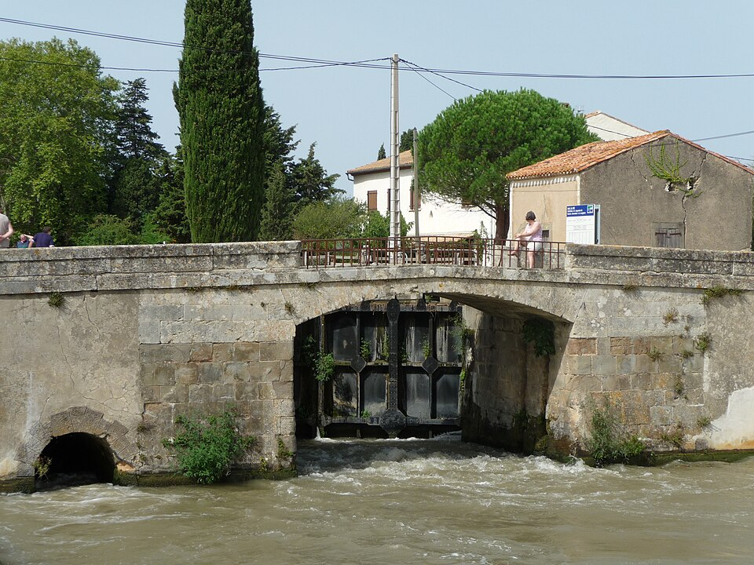 | 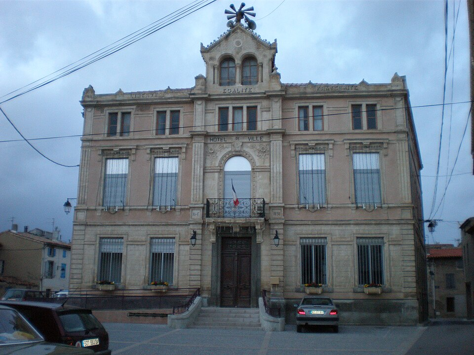 |
| :---: | :---: |
| *Day 1 图1：Homps 基地码头与米迪运河 Homps 船闸实景* | *Day 1 图2：Homps 毗邻的 Olonzac 与 Jouarres 湖畔葡萄园小镇* |

#### Day 2：Homps → La Redorte → Marseillette（航行3小时，过3座船闸，夜宿 Marseillette）
* **当日行程**：向西开启运河之旅，途经 **La Redorte**，观赏建于1693年的 **Épanchoir de l'Argent-Double（11孔石拱泄洪水道桥）**，傍晚停靠在葡萄园环绕的 **Marseillette**。
| 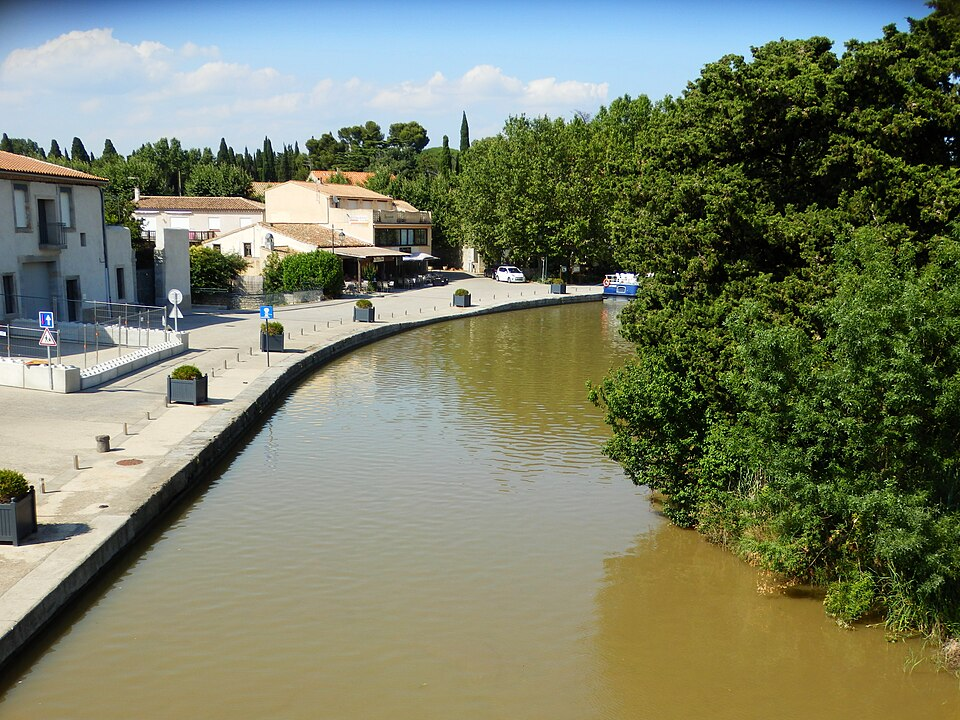 | 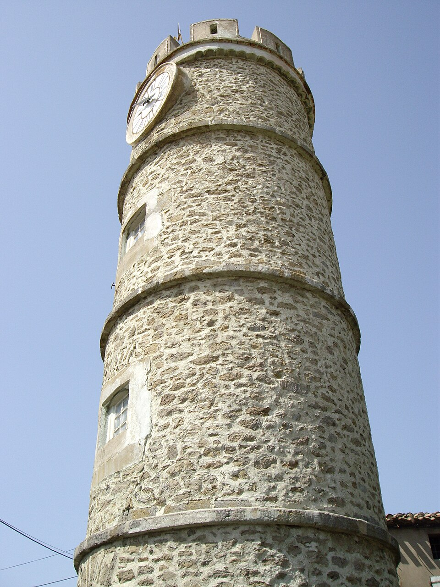 |
| :---: | :---: |
| *Day 2 图1：米迪运河穿过 La Redorte 古镇石桥与水岸* | *Day 2 图2：La Redorte 旁的17世纪11孔泄洪石拱桥（Épanchoir de l'Argent-Double）* |

#### Day 3：Marseillette → Trèbes 美食古镇 → 跨越奥比耶尔水道桥（航行3.5小时，过5座船闸，夜宿 Trèbes）
* **当日行程**：穿过著名的 **Trèbes 三联阶梯船闸**，停靠在 Trèbes 品尝正宗砂锅油封鸭（Cassoulet），下午开船驶过1686年建成的 **Pont-canal de l'Orbiel（奥比耶尔河水道桥）**。
| 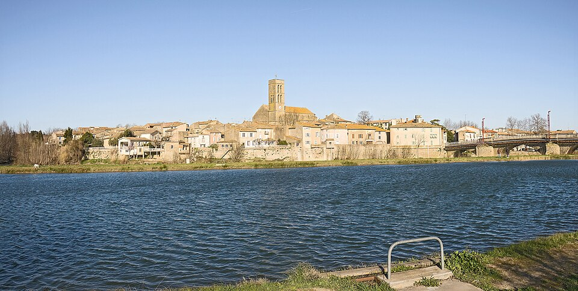 | 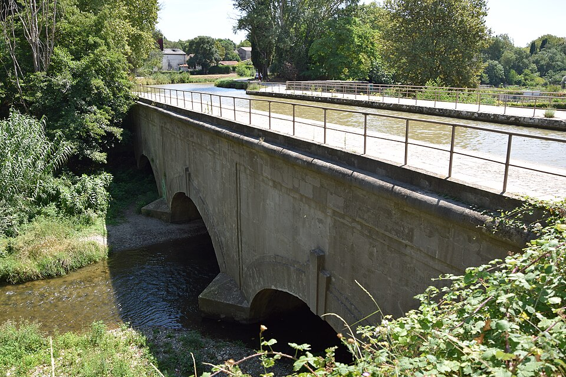 |
| :---: | :---: |
| *Day 3 图1：Trèbes 古镇运河港池与南法瓦顶民居* | *Day 3 图2：米迪运河跨越奥比耶尔河的17世纪石拱水道桥（Orbiel Aqueduct）* |

#### Day 4：Trèbes → Carcassonne 卡尔卡松双层中世纪古堡全天探索（航行2.5小时，过5座船闸，夜宿 Carcassonne）
* **当日行程**：上午驶入 **卡尔卡松（Carcassonne）** 中心港池，下午至夜晚跨过14世纪 **Pont Vieux（老石桥）**，登上拥有52座尖塔的世界遗产 **Cité de Carcassonne（卡尔卡松内城与伯爵城堡）**。
| 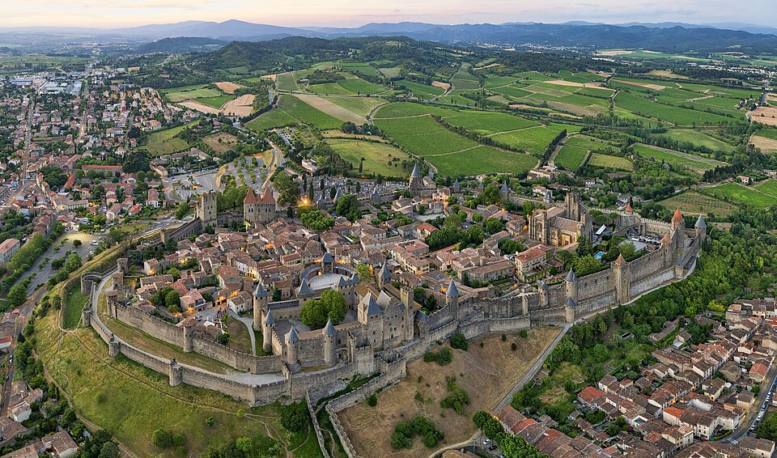 | 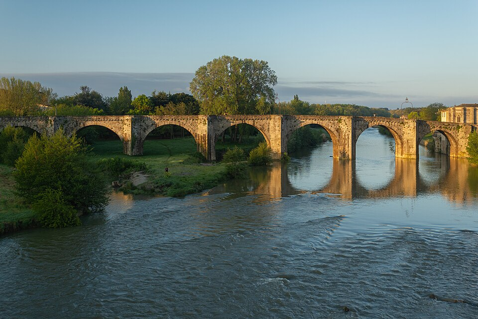 |
| :---: | :---: |
| *Day 4 图1：世界遗产卡尔卡松（Cité de Carcassonne）双层城墙与52座塔楼全景* | *Day 4 图2：从下城区通往卡尔卡松古堡的14世纪老桥（Pont-Vieux de Carcassonne）* |

#### Day 5：Carcassonne 掉头东返 → 针峰雕塑船闸 → Puichéric（航行4.5小时，过11座船闸，夜宿 Puichéric）
* **当日行程**：从卡尔卡松掉头顺流东返，在 **Écluse de l'Aiguille（针峰船闸）** 欣赏守闸人创作的几十件奇趣木雕，夜宿拥有中世纪城堡与罗马式教堂的 **Puichéric**。
| 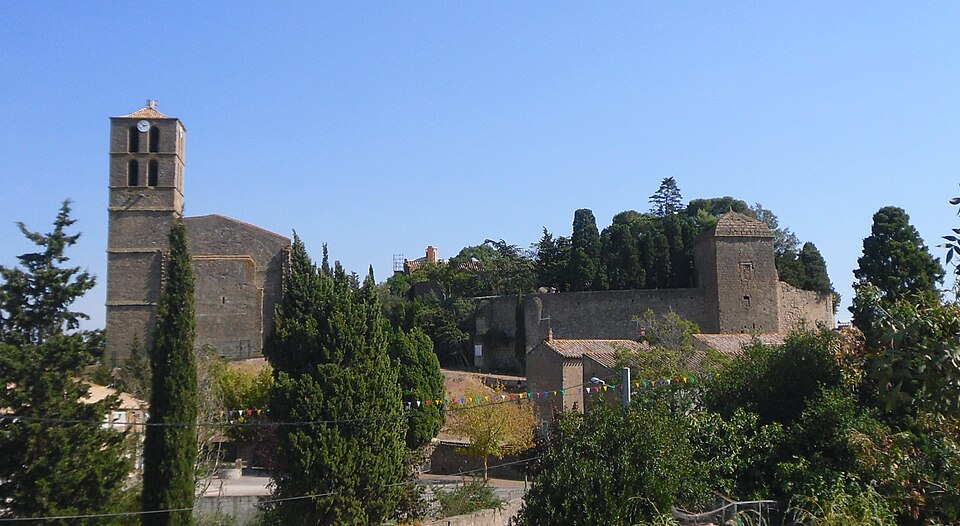 | 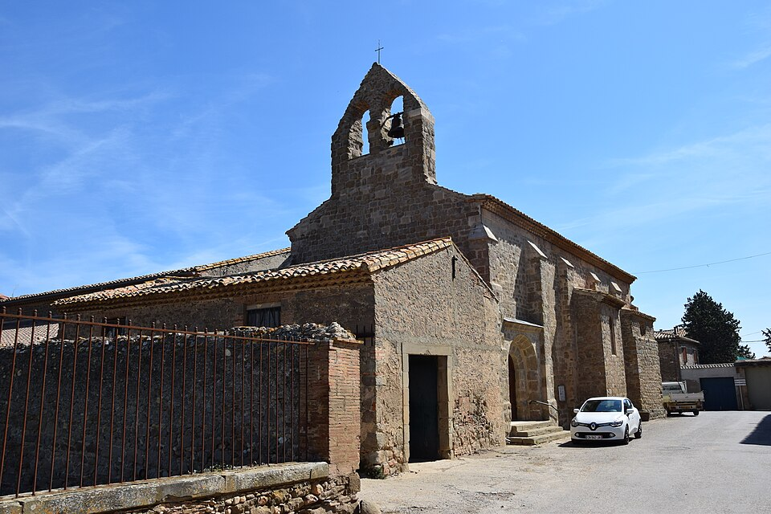 |
| :---: | :---: |
| *Day 5 图1：Puichéric 中世纪教堂与古堡小镇风光* | *Day 5 图2：米迪运河著名的针峰船闸（Écluse de l'Aiguille）与木雕展览* |

#### Day 6：Puichéric → 经 Homps → Argens-Minervois → Paraza 城堡酒庄（航行3小时，过3座船闸，夜宿 Paraza）
* **当日行程**：经过 Homps 继续向东进入“54公里0船闸大平水段（Grand Bief）”，绕过 **Argens-Minervois** 古堡弯道，停靠在17世纪 **Château de Paraza（帕拉扎城堡酒庄）** 脚下品酒。
| 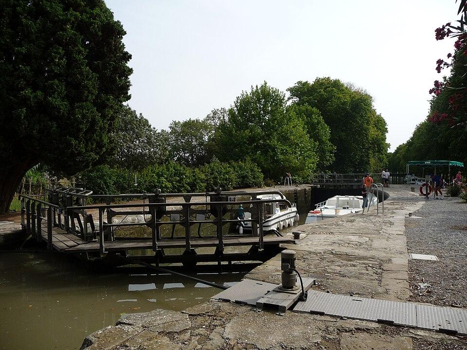 | 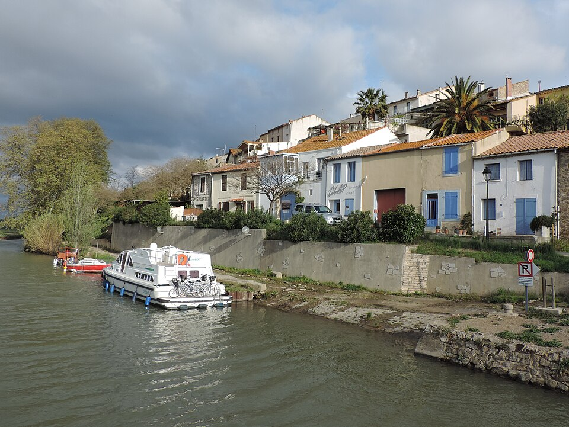 |
| :---: | :---: |
| *Day 6 图1：米迪运河在 Argens-Minervois 小镇与船闸处的优美河湾* | *Day 6 图2：俯瞰米迪运河水道的 Paraza 古村与帕拉扎城堡酒庄* |

#### Day 7：Paraza → Ventenac 酿酒城堡 → Le Somail 最美石头古村（航行2小时，0船闸，夜宿 Le Somail）
* **当日行程**：全程0船闸轻松巡航，途经水岸边的 **Château de Ventenac** 买酒，下午抵达米迪运河公认最美的17世纪驿站古村 **Le Somail**（逛5万册藏书的古董书店、在古石桥边吃晚餐）。
| 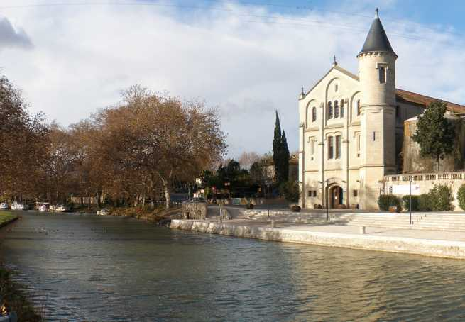 | 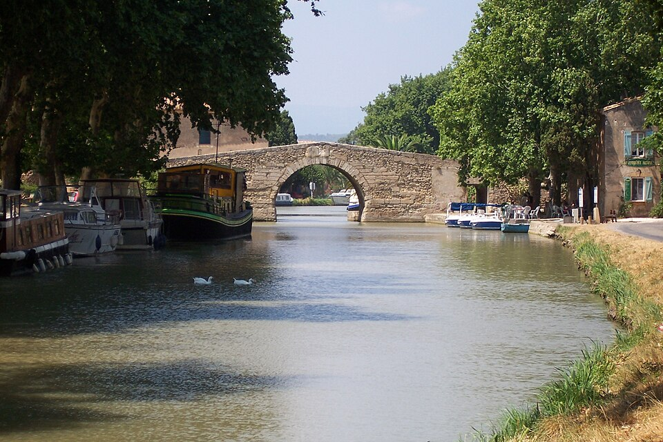 |
| :---: | :---: |
| *Day 7 图1：紧贴米迪运河岸边的 Ventenac-en-Minervois 酿酒城堡* | *Day 7 图2：米迪运河最美古村 Le Somail 的17世纪石拱桥与常春藤水岸* |

#### Day 8：Le Somail 清晨返航 → Homps 还船 & 顺游悬崖古村 Minerve（航行2.5小时，过1座船闸）
* **当日行程**：清晨穿过晨光中的法国梧桐树水道返回 **Homps** 基地于上午9:00还船；随后乘车15分钟顺游卡塔尔派历史名城——矗立在双峡谷天然石桥之上的 **Minerve（米内尔沃）**。
| 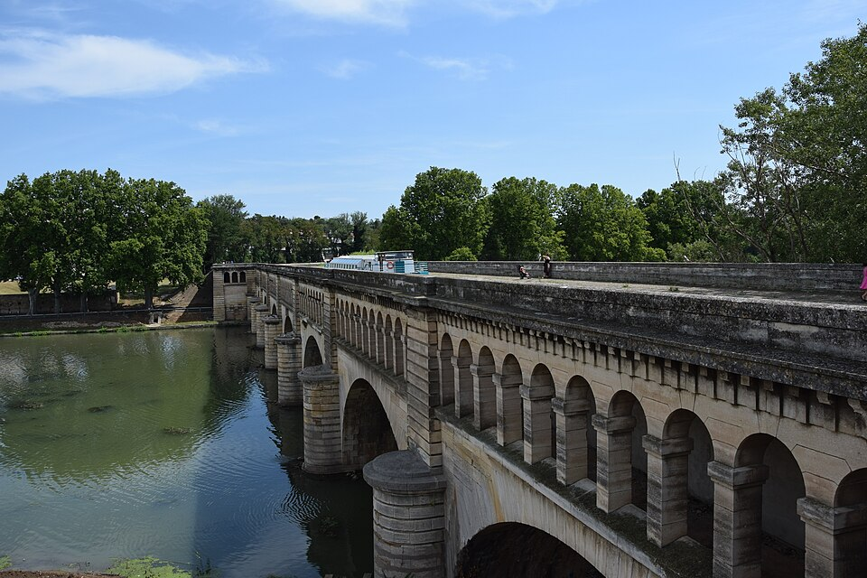 | 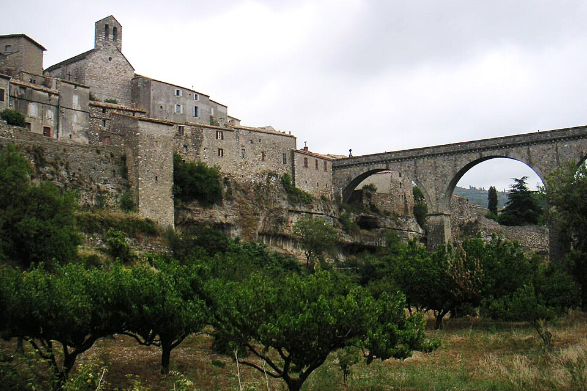 |
| :---: | :---: |
| *Day 8 图1：清晨返航途中米迪运河标志性的百年梧桐树倒影水道* | *Day 8 图2：距离 Homps 仅15分钟车程的法国最美村庄 Minerve 峡谷石桥* |

---

### 航线 2：🇫🇷 法国阿尔萨斯-洛林（Alsace-Lorraine — Hesse 往返 Saverne 与大湖 8天7晚）

#### Day 1：抵达 Hesse 基地登船 → Niderviller 陶瓷古镇与475米短隧道（航行1.5小时，0船闸，夜宿 Niderviller）
* **当日行程**：下午在洛林高原的 **Hesse** 基地取船，东行体验第一次开船钻山洞——穿过475米长的 **Niderviller 运河隧道**，停靠在拥有百年皇家陶瓷工坊的 **Niderviller**。
| 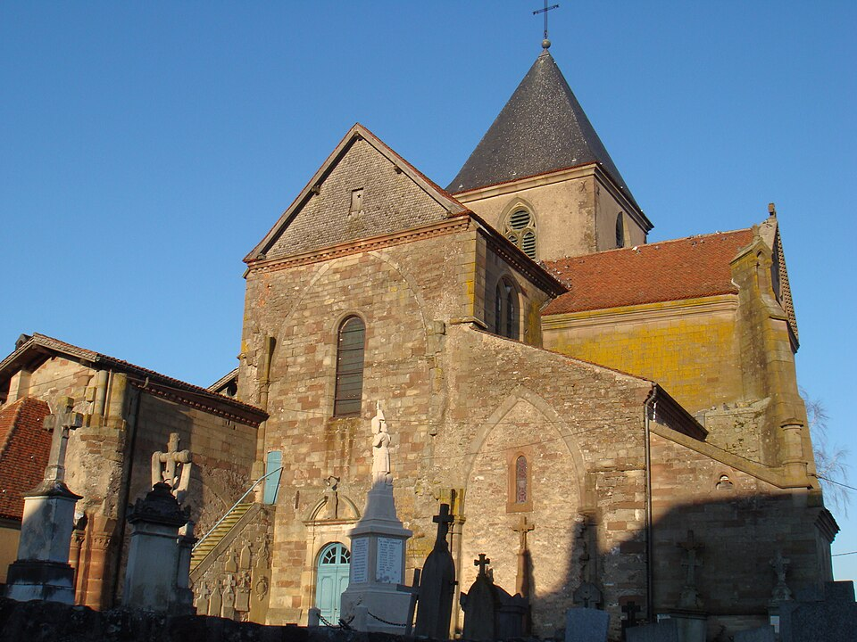 | 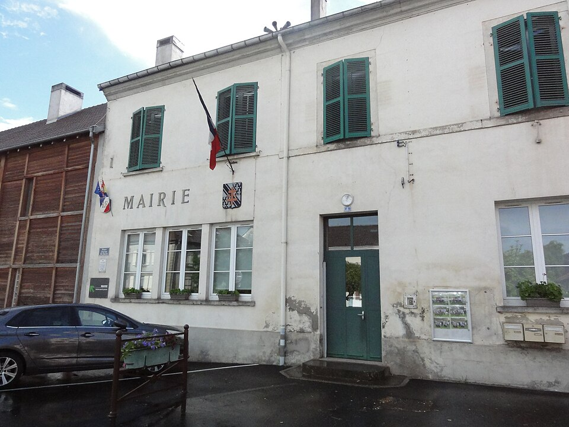 |
| :---: | :---: |
| *Day 1 图1：出发基地 Hesse 小镇与历史悠久的本笃会修道院教堂* | *Day 1 图2：Niderviller 陶瓷古镇与穿山运河隧道水道* |

#### Day 2：Niderviller → 2.3公里长隧道 → Arzviller 巨型斜坡升船机（航行2小时，过1座升船机，夜宿 Arzviller 谷底）
* **当日行程**：开船穿过长达2,306米的 **Arzviller 穿山大隧道**，随后驶入欧洲工程奇迹 **Saint-Louis-Arzviller 斜坡升船机**——游船开进巨型钢制水箱，沿41度山坡横向滑降44.5米高度（一次替代17座传统船闸！）。
| 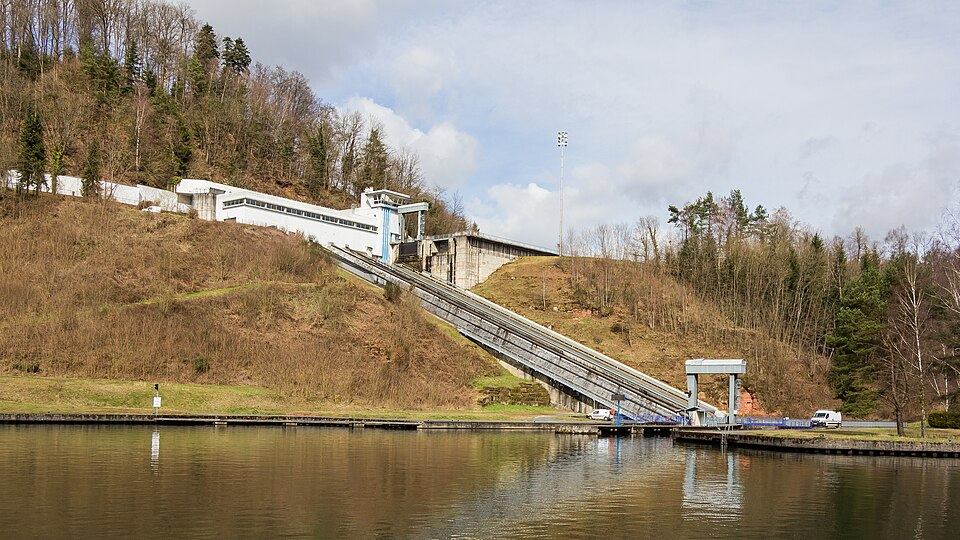 | 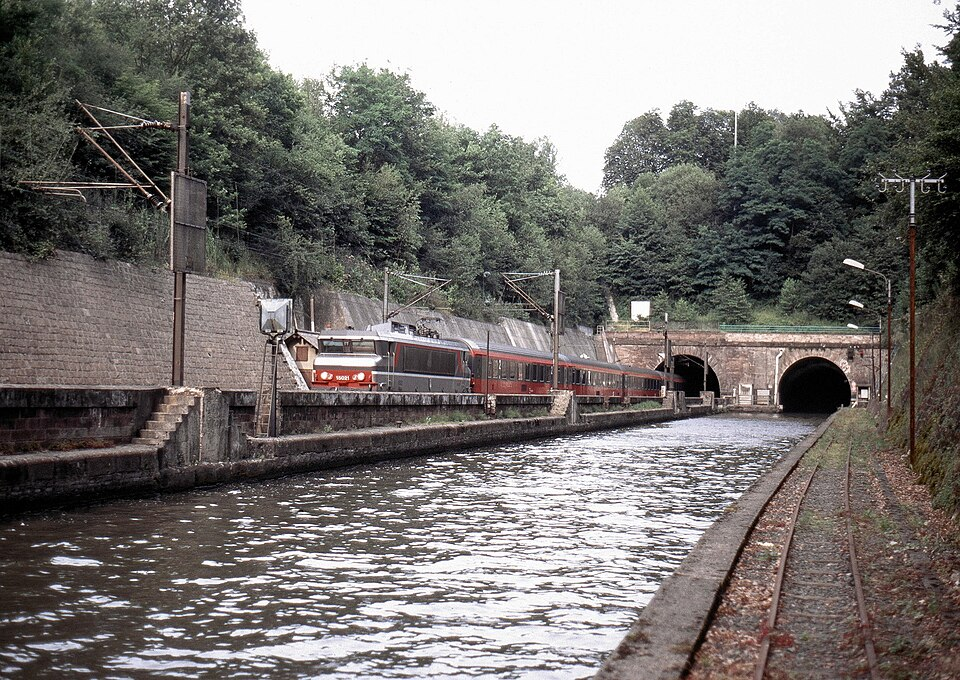 |
| :---: | :---: |
| *Day 2 图1：Saint-Louis-Arzviller 41度斜坡横向升船机巨型水箱轨道实景* | *Day 2 图2：孚日山脉森林环抱的 Arzviller 山谷与隧道出口* |

#### Day 3：Arzviller → 玻璃吹制工坊 → Lutzelbourg 红砂岩悬崖古堡（航行2小时，过5座船闸，夜宿 Lutzelbourg）
* **当日行程**：上午参观升船机旁的 **Lehrer 水晶玻璃工坊**，随后顺着幽深的孚日山红砂岩峡谷东行，停靠在 **Lutzelbourg（吕策尔堡）**，带孩子们爬上山顶11世纪古堡废墟俯瞰运河。
| 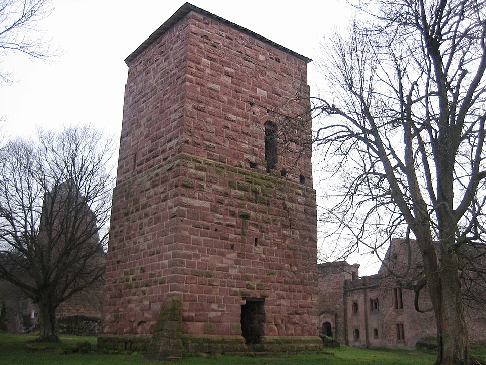 | 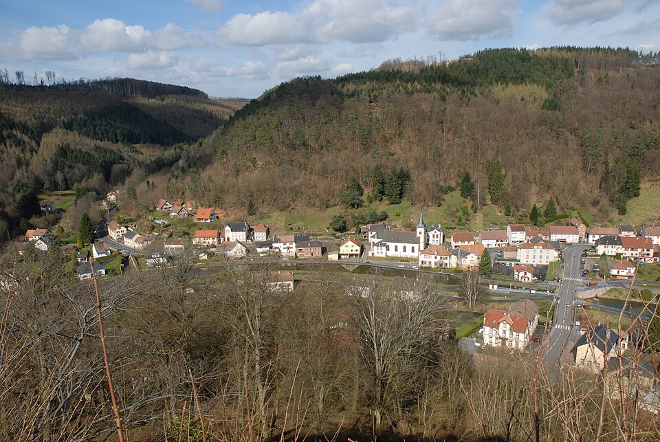 |
| :---: | :---: |
| *Day 3 图1：矗立在运河上方红砂岩峭壁顶端的11世纪吕策尔堡废墟（Château de Lutzelbourg）* | *Day 3 图2：峡谷底部的 Lutzelbourg 运河港池与彩色阿尔萨斯民居* |

#### Day 4：Lutzelbourg → Saverne 萨韦尔纳罗汉宫正门港池 & 鹰堡（航行3小时，过11座船闸，夜宿 Saverne）
* **当日行程**：驶出峡谷进入“阿尔萨斯玫瑰之城” **Saverne**，游艇直接停泊在宏伟的18世纪 **Château des Rohan（罗汉宫）** 巴洛克宫殿正门前！下午登顶被称为“阿尔萨斯之眼”的 **Château du Haut-Barr** 悬崖城堡。
| 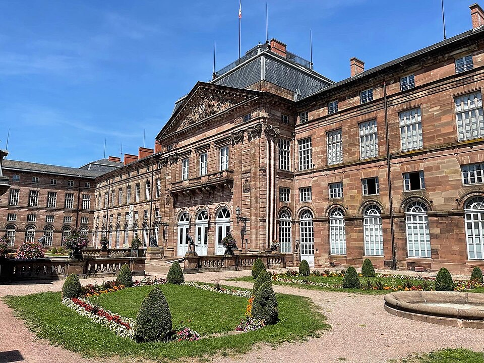 | 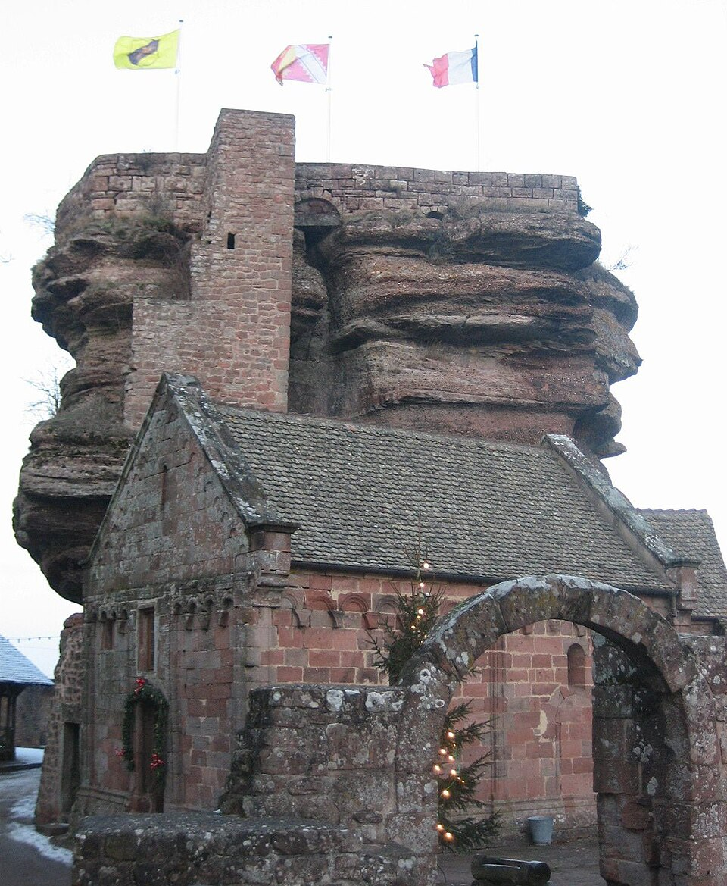 |
| :---: | :---: |
| *Day 4 图1：游艇直接停泊在萨韦尔纳罗汉宫（Château des Rohan）宏伟的红砂岩立面正前方* | *Day 4 图2：萨韦尔纳上方三座巨型红砂岩山崖相连的中世纪城堡（Château du Haut-Barr）* |

#### Day 5：Saverne → 东探 Hochfelden 啤酒古镇 → 掉头返抵 Steinbourg / Lutzelbourg（航行4.5小时，过14座船闸）
* **当日行程**：向东深入阿尔萨斯平原啤酒重镇 **Hochfelden**（参观1640年创立的法国最古老独立啤酒厂 Meteor），随后掉头西返，伴着孚日山落日回到峡谷。
| 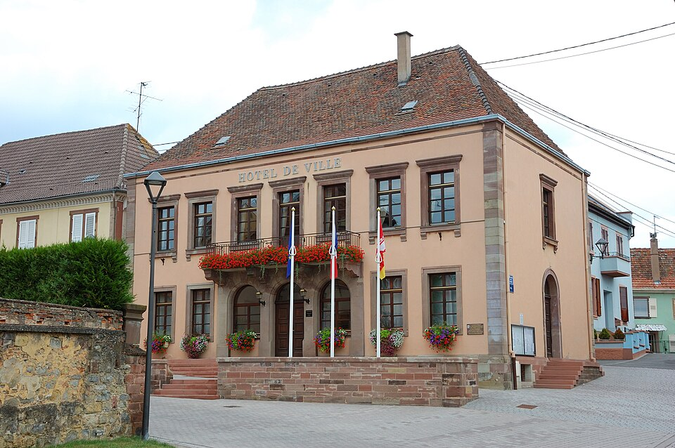 | 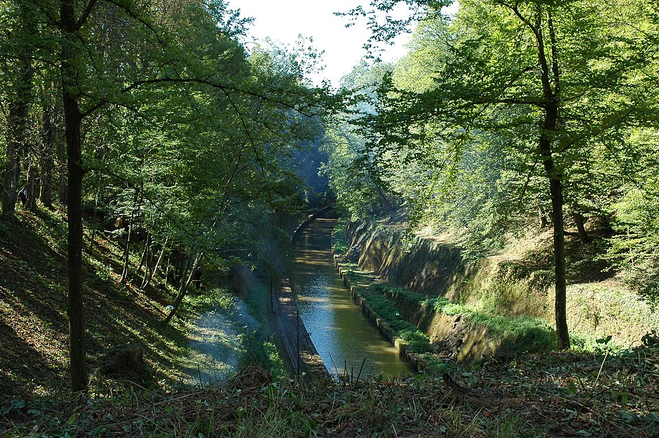 |
| :---: | :---: |
| *Day 5 图1：阿尔萨斯平原百年啤酒名镇 Hochfelden 建筑与街景* | *Day 5 图2：连接阿尔萨斯与洛林的马恩-莱茵运河（Marne-Rhine Canal）绿荫水道* |

#### Day 6：乘升船机重返山顶 & 远眺 Dabo 悬崖教堂 → Xouaxange / Sarrebourg（航行3.5小时，过5闸+1升船机）
* **当日行程**：再次乘坐 Arzviller 斜坡升船机升回山顶，岸上远眺耸立在647米孤峰巨石顶端的 **Rocher de Dabo（达博岩圣利奥教堂）**，傍晚停靠 **Xouaxange**，顺访邻近 **Sarrebourg** 欣赏夏加尔12米高的《和平》彩绘玻璃窗。
| 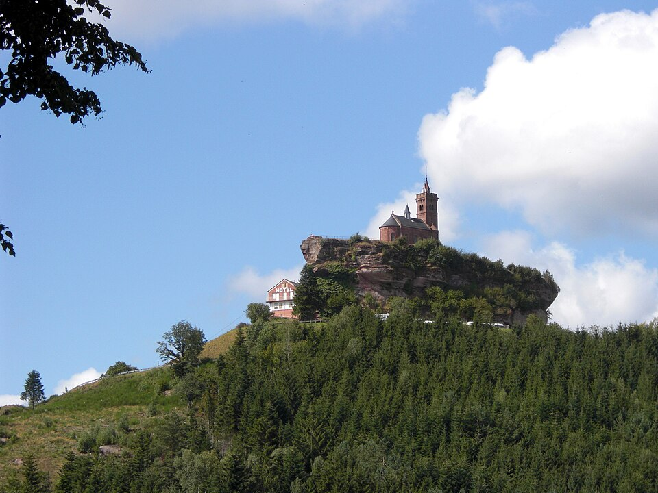 | 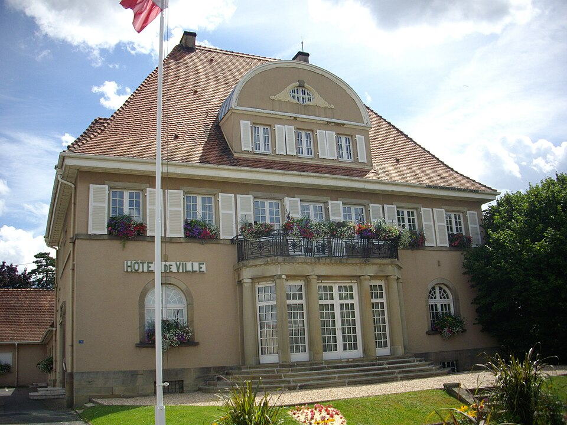 |
| :---: | :---: |
| *Day 6 图1：升船机山顶南侧耸立在647米红砂岩巨石之巅的达博岩教堂（Rocher de Dabo）* | *Day 6 图2：洛林历史名城 Sarrebourg 的13世纪哥特式圣方济各礼拜堂（内藏夏加尔巨幅彩窗）* |

#### Day 7：Xouaxange → 经 Hesse → Étang de Gondrexange 森林大湖与 Réchicourt（航行3小时，过1座船闸，夜宿大湖）
* **当日行程**：向西驶入面积达700公顷的 **Étang de Gondrexange（贡德雷克桑热森林大湖）**，游艇直接穿过湖心水道，白天在清澈湖水里游泳、钓鱼，探访西端的 **Réchicourt-le-Château**。
| 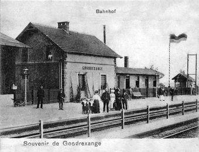 | 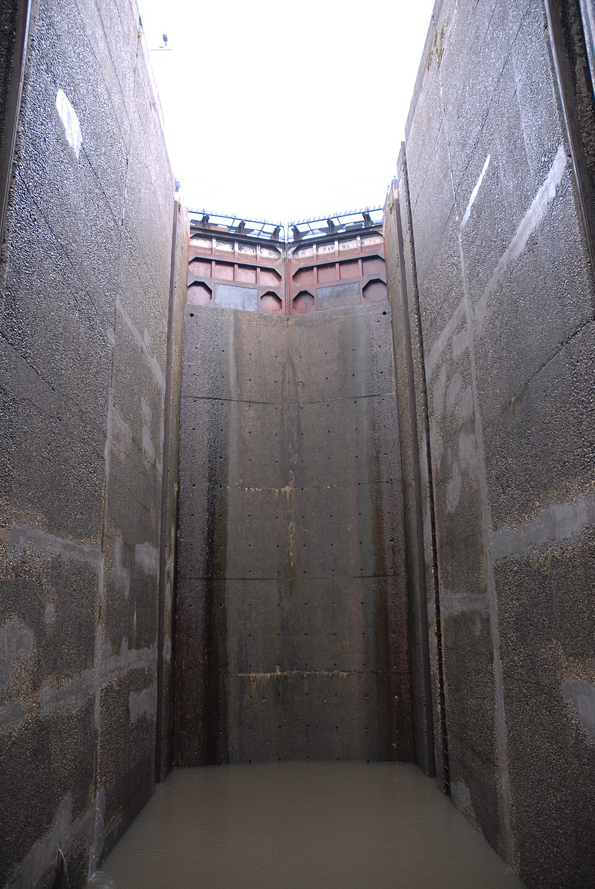 |
| :---: | :---: |
| *Day 7 图1：马恩-莱茵运河直接横穿而过的 Gondrexange 天然森林大湖* | *Day 7 图2：大湖西端的 Réchicourt-le-Château 城堡与小镇风光* |

#### Day 8：从大湖交汇口清晨返航 → Hesse 还船 & 顺游 Phalsbourg 沃邦星形要塞（航行1.5小时，过1座船闸）
* **当日行程**：清晨从 **萨尔运河（Canal des Houillères de la Sarre）** 与马恩-莱茵运河十字交汇湖口返回 **Hesse** 还船；随后乘车15分钟游览军事工程大师沃邦设计的 **Phalsbourg（法尔斯堡）** 古城门。
| 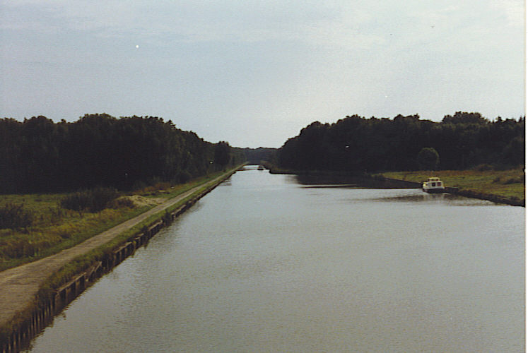 | 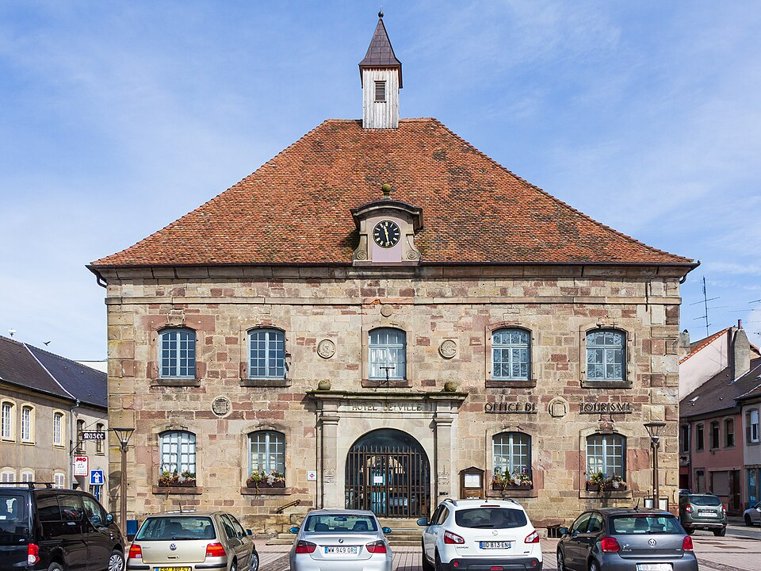 |
| :---: | :---: |
| *Day 8 图1：Gondrexange 大湖处的萨尔运河森林水道* | *Day 8 图2：距离基地15分钟车程的沃邦星形军事要塞 Phalsbourg 城门* |

---

### 航线 3：🇬🇧 英国北威尔士窄船（UK Llangollen Canal — Trevor 往返兰戈伦与惠特彻奇 8天7晚）

#### Day 1：Trevor 登船培训 → 贴壁逆流西行 → Llangollen 古镇港池（航行2小时，0船闸，夜宿 Llangollen）
* **当日行程**：下午在 **Trevor** 登船，学习如何站在船尾用传统木舵柄（Tiller）操控21米全钢窄船，沿着贴山悬崖开凿的狭窄水道西行直达威尔士古镇 **Llangollen**，在建于1345年的迪河古石桥旁吃水车磨坊酒馆晚餐。
| 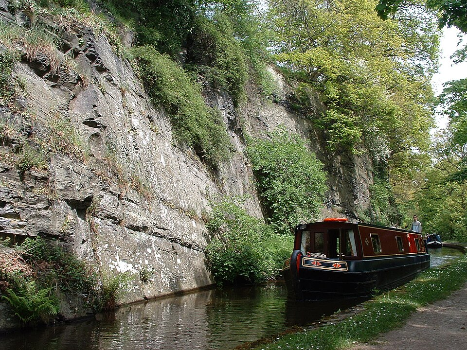 | 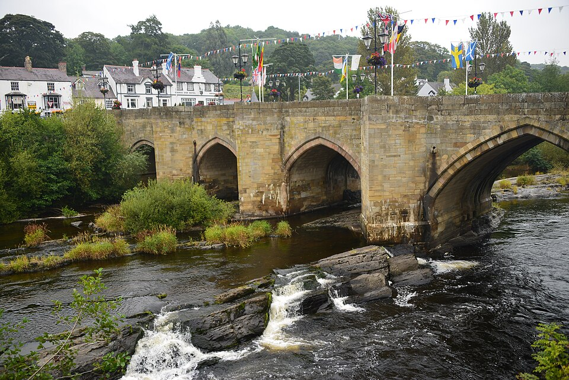 |
| :---: | :---: |
| *Day 1 图1：兰戈伦运河（Llangollen Canal）穿行于北威尔士翠绿山谷* | *Day 1 图2：兰戈伦古镇建于14世纪的跨迪河四孔石桥（Llangollen Bridge）* |

#### Day 2：马蹄瀑布与蒸汽火车 → 飞越38米高空 Pontcysyllte 水道桥（航行3小时，0船闸，夜宿 Chirk Bank）
* **当日行程**：上午带孩子们徒步至运河源头 **Horseshoe Falls（马蹄形拦河坝瀑布）** 并乘坐 **Llangollen 复古蒸汽火车**；下午迎来全周最高潮——开着窄船在 **38米高空** 无护栏水槽边缘飞越世界遗产 **Pontcysyllte Aqueduct（庞特卡萨尔特高空水道桥）**！
| 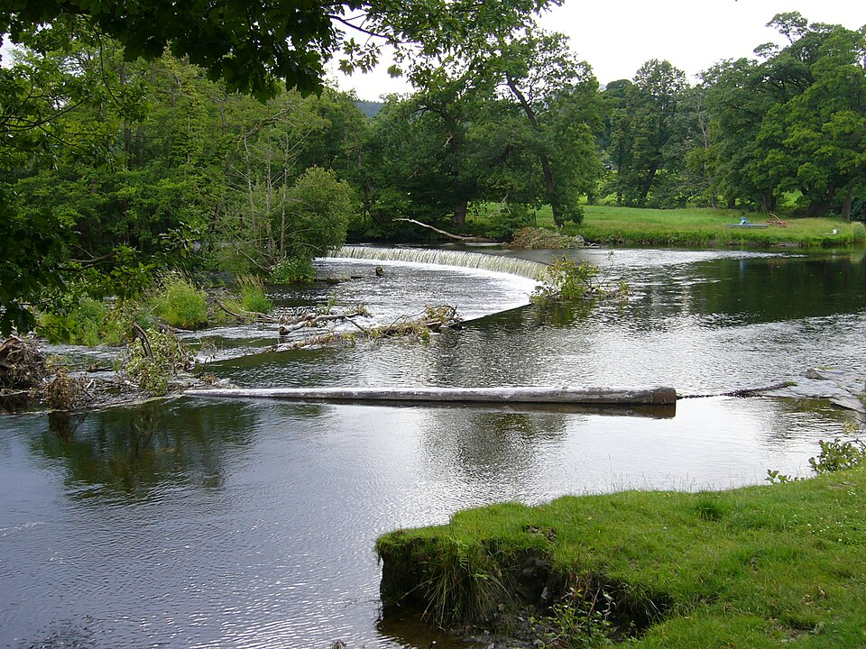 | 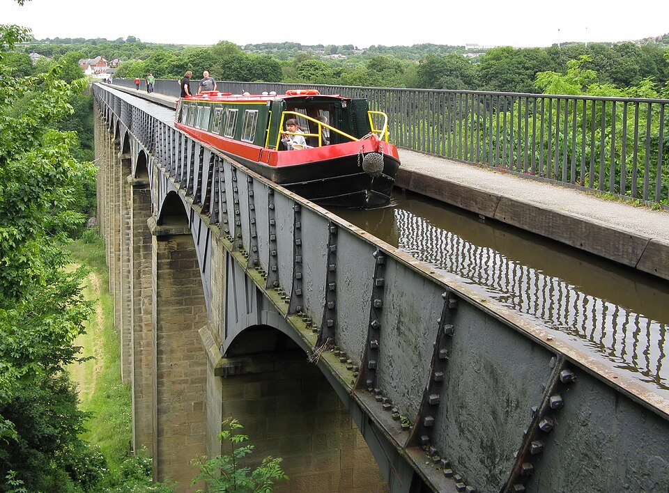 |
| :---: | :---: |
| *Day 2 图1：兰戈伦运河的水源起点——托马斯·特尔福德设计的马蹄瀑布（Horseshoe Falls）* | *Day 2 图2：世界遗产庞特卡萨尔特高空水道桥（Pontcysyllte Aqueduct，高达38米、长307米）* |

#### Day 3：跨越英威边界 Chirk 水道桥 & 探访1295年彻克古堡 → New Marton 船闸（航行3.5小时，过2座船闸）
* **当日行程**：上午穿过21米高的 **Chirk Aqueduct（彻克水道桥，桥中央即英格兰与威尔士分界线）**，登岸游览保存完好的中世纪边境要塞 **Chirk Castle（彻克城堡）**，下午在 New Marton 全家人亲手摇柄开闸推门。
| 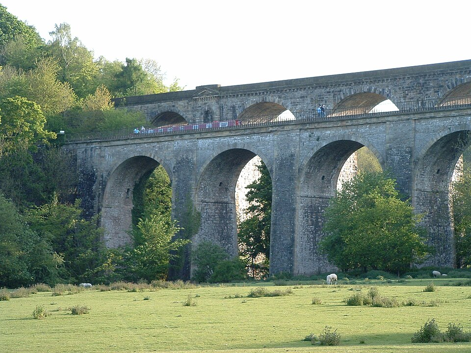 | 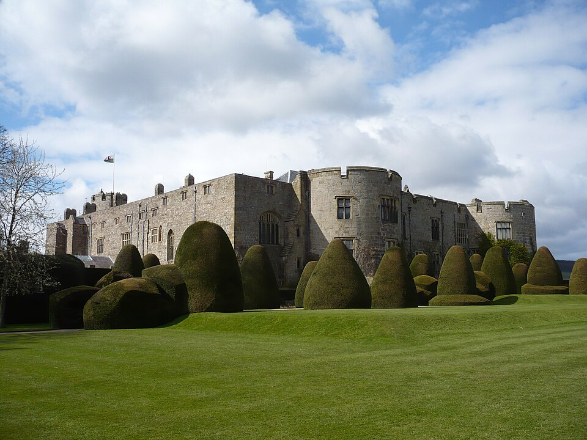 |
| :---: | :---: |
| *Day 3 图1：彻克水道桥（Chirk Aqueduct）与并排耸立的维多利亚时代高架铁路桥双桥奇观* | *Day 3 图2：建于1295年的国家信托中世纪古堡——彻克城堡（Chirk Castle）* |

#### Day 4：驶入什罗普郡天鹅湖区 Ellesmere → 穿越 Whixall 万年泥炭荒原（航行4小时，0船闸，夜宿 Whixall）
* **当日行程**：上午停靠“什罗普郡小湖区” **Ellesmere**，环绕冰川大湖 **The Mere** 喂天鹅、逛古镇；下午驶入 **Fenn's & Whixall Moss 国家级泥炭荒原保护区**，孩子们一路跳下船手拉配重木梁升起多座白色木吊桥（Lift Bridges）。
| 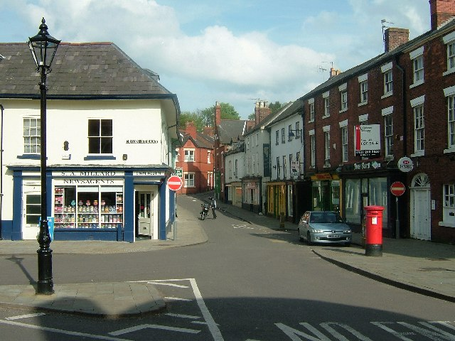 | 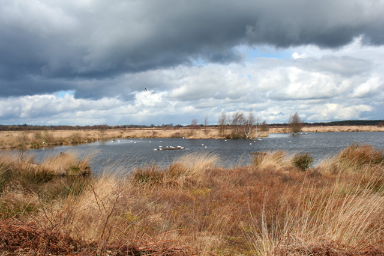 |
| :---: | :---: |
| *Day 4 图1：埃尔斯米尔冰川湖（The Mere, Ellesmere）与维多利亚湖畔花园* | *Day 4 图2：运河穿行于原始静谧的 Whixall Moss 万年泥炭荒原国家级自然保护区* |

#### Day 5：抵达塔钟之乡 Whitchurch & 观赏 Grindley Brook 阶梯船闸 → 掉头西返（航行4小时，0船闸）
* **当日行程**：驶入英国百年塔钟制造之乡 **Whitchurch（惠特彻奇）** 支线，步行前往不远处的 **Grindley Brook** 观看热闹的三级连环阶梯船闸运作，随后掉头西返夜宿森林湖畔。
| 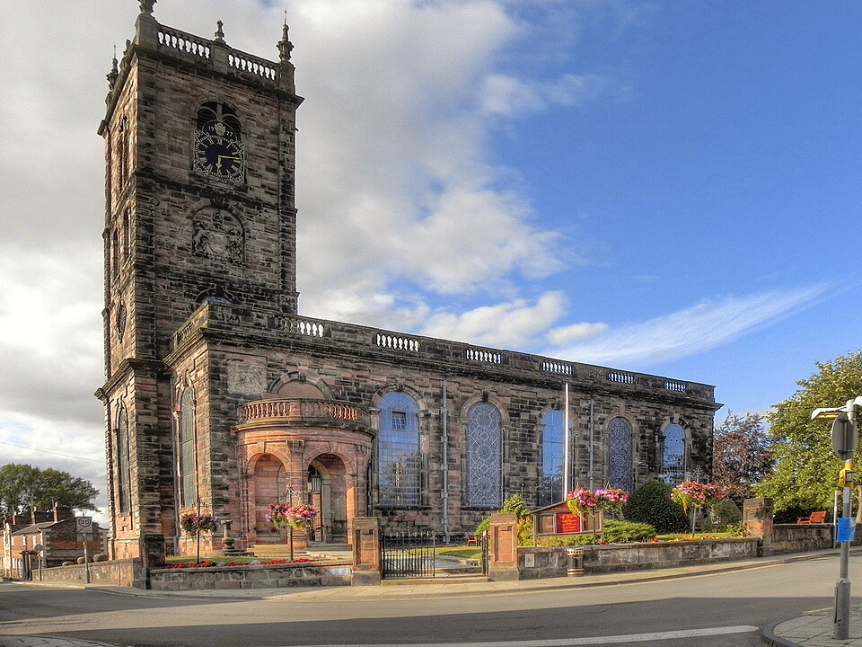 | 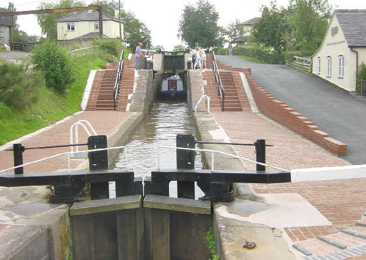 |
| :---: | :---: |
| *Day 5 图1：惠特彻奇古镇（Whitchurch, Shropshire）历史街区与教堂高塔* | *Day 5 图2：惠特彻奇旁的 Grindley Brook 连环阶梯窄船闸与守闸人小屋* |

#### Day 6：穿过什罗普郡田园牧场 → Hindford 酒馆与13世纪天鹅护城河古堡（航行4小时，0船闸，夜宿 Hindford）
* **当日行程**：慢速穿过如《指环王》夏尔郡般的翠绿牧场，傍晚停靠在全线最著名的乡村酒馆 **The Jack Mytton Inn (Hindford)** 门前，顺访旁边拥有天鹅护城河双塔门的 **Whittington Castle（威廷顿城堡）**。
| 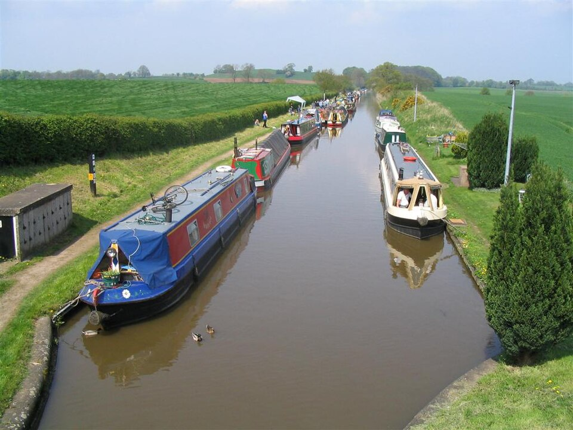 | 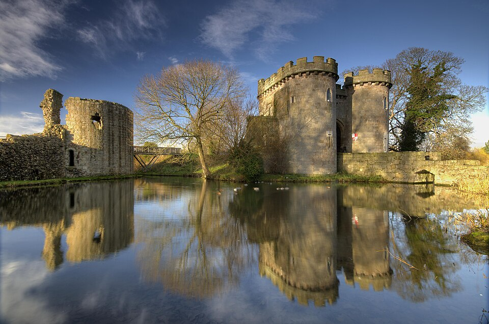 |
| :---: | :---: |
| *Day 6 图1：什罗普郡联合运河水系（Shropshire Union & Ellesmere Canal）典型的砖石拱桥与彩绘窄船* | *Day 6 图2：距离 Hindford 仅数分钟、建于13世纪的威廷顿水上护城河古堡（Whittington Castle）* |

#### Day 7：Hindford → 钻过421米漆黑 Chirk 隧道 → 二次飞越水道桥返回 Trevor Basin（航行4小时，过2座船闸）
* **当日行程**：开启船头探照灯驶过421米长、带木制纤道扶手的 **Chirk Tunnel（彻克山洞隧道）**，再次从38米高空飞越庞特卡萨尔特水道桥，傍晚回到 **Trevor Basin** 基地港池。
| 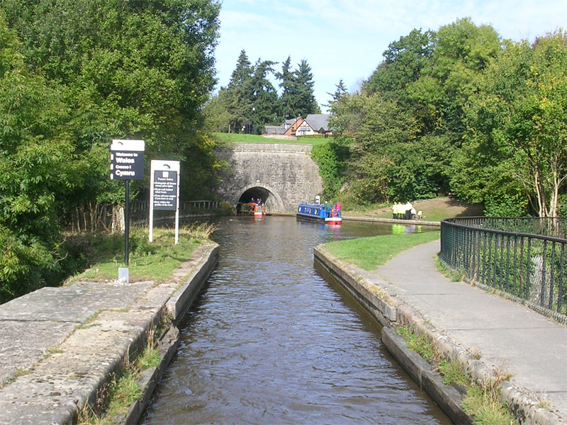 | 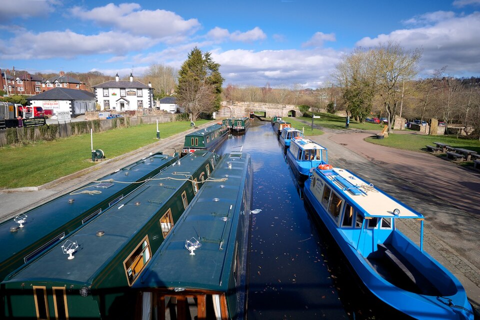 |
| :---: | :---: |
| *Day 7 图1：兰戈伦运河长达421米的 Chirk 穿山隧道（Chirk Tunnel）南口* | *Day 7 图2：庞特卡萨尔特高空水道桥北端的 Trevor Basin 历史港池基地* |

#### Day 8：Trevor 清晨还船 & 登顶 Dinas Brân 王公古堡与十字谷修道院（离船后岸上精华）
* **当日行程**：上午9:00–9:30办妥还船手续后，带孩子们登上兰戈伦山顶的13世纪威尔士古堡废墟 **Castell Dinas Brân** 俯瞰整条运河水道，并参观山谷中建于1201年的 **Valle Crucis Abbey（十字谷修道院）**。
| 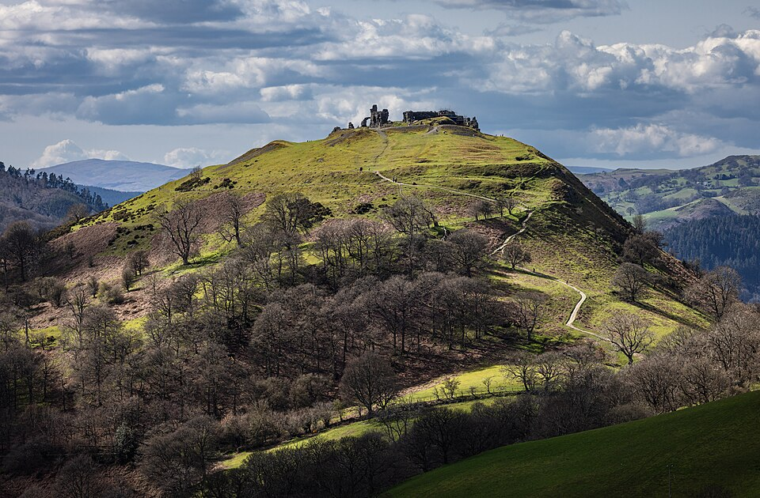 | 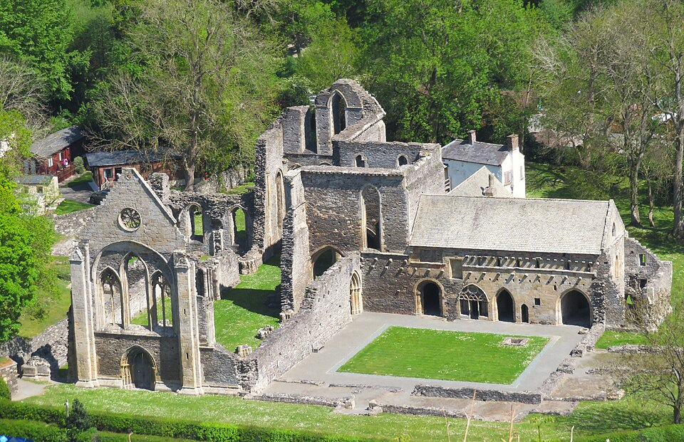 |
| :---: | :---: |
| *Day 8 图1：矗立在兰戈伦运河山谷之巅的中世纪古堡遗址 Castell Dinas Brân* | *Day 8 图2：建于1201年的威尔士哥特式古迹——十字谷修道院（Valle Crucis Abbey）* |

---

### 航线 4：🏴󠁧󠁢󠁳󠁣󠁴󠁿 苏格兰喀里多尼亚运河与尼斯湖（Scotland Caledonian Canal — Laggan 往返 8天7晚）

#### Day 1：Laggan 基地登船 → 驶入奥伊赫湖 Loch Oich 与麦克唐纳古堡（航行1.5小时，0船闸，夜宿 Loch Oich）
* **当日行程**：下午在 **Laggan** 取船，穿过松林参天的 Laggan Avenue 水道驶入苏格兰大峡谷海拔最高点的天然湖泊 **Loch Oich（奥伊赫湖）**，停靠在17世纪氏族古堡 **Invergarry Castle** 湖岸旁。
| 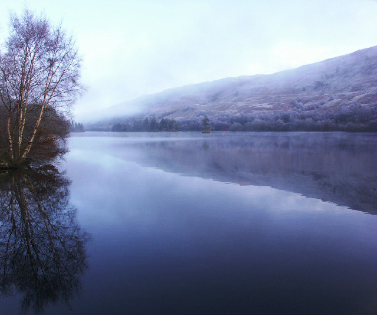 | 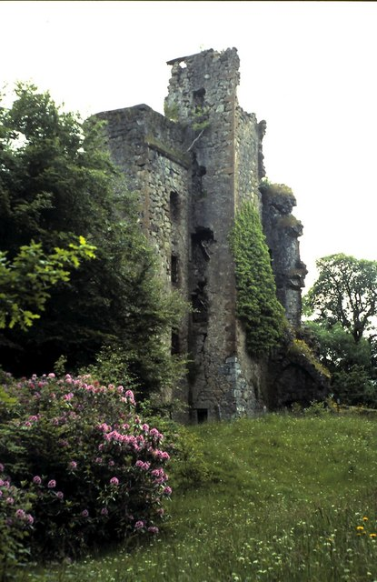 |
| :---: | :---: |
| *Day 1 图1：苏格兰大峡谷群山环抱的天然冰川湖——奥伊赫湖（Loch Oich）* | *Day 1 图2：奥伊赫湖岸边麦克唐纳家族的17世纪古堡废墟（Invergarry Castle）* |

#### Day 2：Loch Oich → 维多利亚古桥 Bridge of Oich → 奥古斯都堡五级船闸（航行2.5小时，过2座船闸，夜宿 Fort Augustus）
* **当日行程**：穿过 Aberchalder 旋转桥，欣赏1854年建成的铁索吊桥 **Bridge of Oich**，经过 Cullochy 与 Kytra 船闸，傍晚抵达尼斯湖南端门户 **Fort Augustus（奥古斯都堡）**，看著名的5级连环大船闸。
|  |  |
| :---: | :---: |
| *Day 2 图1：横跨奥伊赫河的1854年维多利亚悬索古桥（Bridge of Oich）* | *Day 2 图2：奥古斯都堡（Fort Augustus）小镇中心直通尼斯湖的5级阶梯大船闸* |

#### Day 3：纵贯传奇深水大湖 Loch Ness（尼斯湖）→ 仰望厄克特城堡（航行3小时，过5座船闸，夜宿 Drumnadrochit）
* **当日行程**：在守闸员协助下通过奥古斯都堡5级船闸，正式驶入长37公里、水深达230米的 **Loch Ness（尼斯湖）**！下午把游艇开到 **Urquhart Castle（厄克特城堡）** 悬崖正下方拍照，夜宿 Drumnadrochit 港池并参观尼斯湖水怪中心。
|  |  |
| :---: | :---: |
| *Day 3 图1：壮阔深邃的苏格兰尼斯湖（Loch Ness）高地峡谷全景* | *Day 3 图2：矗立在尼斯湖西岸岬角之上的13世纪厄克特城堡废墟（Urquhart Castle）* |

#### Day 4：穿越尼斯湖东北端 → Dochgarroch 船闸 → 高地首府因弗内斯 Inverness（航行2.5小时，过1座船闸）
* **当日行程**：驶出尼斯湖进入高地首府 **Inverness（因弗内斯，停靠 Seaport / Muirtown 码头）**，登岸游览红砂岩 **Inverness Castle（因弗内斯城堡）**、逛维多利亚拱廊市场，晚上听苏格兰风笛吃高地牛排。
|  |  |
| :---: | :---: |
| *Day 4 图1：俯瞰尼斯河的苏格兰高地首府地标——因弗内斯城堡（Inverness Castle）* | *Day 4 图2：因弗内斯郊外的喀里多尼亚运河水道与远方高地群山* |

#### Day 5：Inverness 掉头返航横跨尼斯湖 → 探秘 Foyers 森林大瀑布 → 奥古斯都堡修道院（航行4小时，过1座船闸）
* **当日行程**：掉头向西南横跨尼斯湖，中途停靠东岸的 **Foyers 码头**，带孩子们穿越红松森林去看落差50米的 **Falls of Foyers（福耶斯大瀑布）**，傍晚回到奥古斯都堡参观 **Fort Augustus Abbey**。
|  |  |
| :---: | :---: |
| *Day 5 图1：尼斯湖东岸森林深处落差50米的福耶斯大瀑布（Falls of Foyers）* | *Day 5 图2：尼斯湖南岸宏伟的奥古斯都堡本笃会修道院（Fort Augustus Abbey）* |

#### Day 6：奥古斯都堡 → 穿越洛希大湖 Loch Lochy → Gairlochy 正对英国最高峰本尼维斯山（航行4.5小时，过9座船闸）
* **当日行程**：穿过奥伊赫湖与 Laggan 双闸，驶入长16公里的 **Loch Lochy（洛希湖）**，傍晚停泊在西南端的 **Gairlochy** 船闸——船头正对着海拔1,345米的英国第一高峰 **Ben Nevis（本尼维斯山）**！
|  |  |
| :---: | :---: |
| *Day 6 图1：被陡峭高地山脉环抱的洛希湖（Loch Lochy）天然航道* | *Day 6 图2：从 Gairlochy 运河段远眺英国最高峰——本尼维斯山（Ben Nevis）* |

#### Day 7：Gairlochy → Banavie 海神阶梯8级船闸 & 《哈利·波特》霍格沃茨蒸汽火车（航行1.5小时，0船闸）
* **当日行程**：抵达运河西端高潮 **Banavie**，观赏全英最高、一次升降19.5米的8级连环船闸 **Neptune's Staircase（海神阶梯）**！下午从旁边的威廉堡（Fort William）搭乘《哈利·波特》原型 **Jacobite 蒸汽火车** 驶过 **Glenfinnan 21孔高架桥**。
|  |  |
| :---: | :---: |
| *Day 7 图1：全英最壮观的8级连环船闸——Banavie“海神阶梯”（Neptune's Staircase）* | *Day 7 图2：《哈利·波特》霍格沃茨特快列车取景地——格伦芬南高架桥（Glenfinnan Viaduct）* |

#### Day 8：穿越 Loch Lochy 清晨返航 → Laggan 还船 & 顺访高地突击队纪念碑（航行2.5小时，过1座船闸）
* **当日行程**：清晨穿过晨雾中的洛希湖返回 **Laggan** 基地还船，返程途中停靠 Spean Bridge 瞻仰俯瞰大峡谷山脊的 **Commando Memorial（二战英国突击队铜像纪念碑）**。
|  |  |
| :---: | :---: |
| *Day 8 图1：Spean Bridge 与 Laggan 山谷高地风光* | *Day 8 图2：俯瞰本尼维斯山与大峡谷的英国突击队纪念碑（Commando Memorial）* |

---

### 航线 5：🇮🇹 意大利威尼斯泻湖与弗留利（Italy Venetian Lagoon — Casale sul Sile 往返 8天7晚）

#### Day 1：Casale sul Sile 登船 → 西莱河自然公园南下 → 古罗马遗址 Quarto d'Altino（航行1.5小时，0船闸）
* **当日行程**：下午在威尼斯北郊 **Casale sul Sile** 登船，顺着碧绿清澈、天鹅成群的 **River Sile（西莱河自然公园）** 蜿蜒南下，夜宿威尼斯人古罗马发源地 **Quarto d'Altino**。
|  |  |
| :---: | :---: |
| *Day 1 图1：水草丰美、绿树成荫的西莱河自然公园（River Sile）水道* | *Day 1 图2：Quarto d'Altino 古罗马遗址与西莱河畔风光* |

#### Day 2：驶入威尼斯泻湖 → 千年古岛 Torcello → 直接停靠彩色岛 Burano 过夜！（航行2.5小时，过1座船闸）
* **当日行程**：通过 Portegrandi 船闸正式驶入蔚蓝开阔的 **威尼斯泻湖**！先登岸游览威尼斯文明摇篮 **Torcello（托尔切洛岛，看公元639年拜占庭镶嵌画大教堂与恶魔桥）**，傍晚把游艇直接停在 **Burano（布拉诺彩色岛）** 公共码头过夜！
|  |  |
| :---: | :---: |
| *Day 2 图1：托尔切洛岛（Torcello）千年钟楼、运河与著名的无护栏“恶魔桥”* | *Day 2 图2：傍晚游客散去后，把自驾游艇停在五彩斑斓的布拉诺彩色岛（Burano）过夜* |

#### Day 3：漫步 Mazzorbo 水上葡萄园 → 玻璃岛 Murano 看吹玻璃 → 夜宿 Sant'Erasmo（航行1.5小时，0船闸）
* **当日行程**：清晨跨过木桥逛与彩色岛相连的 **Mazzorbo（马佐博岛 Venissa 围墙葡萄园）**，随后开船前往 **Murano（穆拉诺玻璃岛）** 带孩子们看工匠现场吹制彩绘水晶玻璃，夜宿宁静的田园岛 **Sant'Erasmo**。
|  |  |
| :---: | :---: |
| *Day 3 图1：与彩色岛一桥之隔的马佐博岛（Mazzorbo）水道与古钟楼* | *Day 3 图2：世界玻璃艺术之都穆拉诺岛（Murano）大运河与白色灯塔* |

#### Day 4：乘水上巴士畅游威尼斯本岛圣马可广场 → 下午开船去 Lido 丽都金沙滩游泳（航行1.5小时，0船闸）
* **当日行程**：上午从停泊点乘15分钟水上巴士（Vaporetto）直达 **威尼斯本岛圣马可广场（Piazza San Marco）**，游览总督宫、圣马可大教堂与里亚托桥；下午开着自己的游艇停靠 **Lido di Venezia（丽都岛）**，带3个孩子在亚得里亚海沙滩畅游！
|  |  |
| :---: | :---: |
| *Day 4 图1：威尼斯心脏——圣马可广场（Piazza San Marco）、圣马可大教堂与钟楼* | *Day 4 图2：威尼斯丽都岛（Lido di Venezia）绵延的亚得里亚海金沙滩与摩尔式宫殿酒店* |

#### Day 5：沿着 Pellestrina 海堤南下 → 抵达“南方小威尼斯”海鲜名城 Chioggia（航行2.5小时，0船闸）
* **当日行程**：沿着分隔泻湖与大海的 **Pellestrina（佩莱斯特里纳彩色渔村岛）** 内侧木桩航道南下，停靠在泻湖南端最具烟火气的千年渔港 **Chioggia（基奥贾）**，在维戈桥旁吃炭烤海鲜拼盘。
|  |  |
| :---: | :---: |
| *Day 5 图1：佩莱斯特里纳岛（Pellestrina）水岸边的彩色渔民房屋与渔船* | *Day 5 图2：被称为“小威尼斯”的千年海鲜渔港基奥贾（Chioggia）主运河与维戈石桥* |

#### Day 6：驶入布伦塔贵族运河 Brenta Canal → Dolo 水磨坊与 Villa Pisani 总督夏宫大迷宫（航行3.5小时，过3座船闸）
* **当日行程**：驶入威尼斯贵族避暑水道 **Brenta Canal（布伦塔河）**，停靠在16世纪水车古镇 **Dolo**，并参观全线最华丽的威尼斯总督宫殿 **Villa Pisani (Stra)**——带孩子们挑战欧洲最著名的花园树篱迷宫！
|  |  |
| :---: | :---: |
| *Day 6 图1：布伦塔运河上的16世纪水车磨坊古镇 Dolo 与椭圆形古船坞（Squero）* | *Day 6 图2：布伦塔运河畔最奢华的威尼斯总督水上夏宫——皮萨尼别墅（Villa Pisani, Stra）* |

#### Day 7：重返北泻湖盐沼红鹤保护区 → 抵达海滨度假胜地 Jesolo（航行4小时，过2座船闸，夜宿 Jesolo）
* **当日行程**：从布伦塔河顺流重返威尼斯泻湖，穿过栖息着成群粉红火烈鸟（红鹤）的北泻湖盐沼水道，傍晚抵达海滨度假小镇 **Jesolo（耶索洛）**。
|  |  |
| :---: | :---: |
| *Day 7 图1：威尼斯北泻湖（Venetian Lagoon）标志性的木桩航道与日落湿地* | *Day 7 图2：耶索洛（Lido di Jesolo）长达15公里的亚得里亚海黄金海岸线* |

#### Day 8：沿西莱河逆流返回 Casale sul Sile 还船 & 顺游提拉米苏发源地水城 Treviso（航行2小时，过1座船闸）
* **当日行程**：清晨沿着宁静的西莱河逆流返回 **Casale sul Sile** 基地还船；随后乘车15分钟前往提拉米苏（Tiramisù）和 Prosecco 气泡酒的故乡——中世纪水城 **Treviso（特雷维索）** 午餐。
|  |  |
| :---: | :---: |
| *Day 8 图1：出发与还船基地 Casale sul Sile 河畔的中世纪卡拉雷西古塔* | *Day 8 图2：距离基地仅15分钟车程、被西莱河环绕的提拉米苏故乡——特雷维索古城（Treviso）* |

---

### 航线 6：🇬🇧 英国泰晤士河皇家航线（England River Thames — Chertsey 往返温莎与亨利 8天7晚）

#### Day 1：Chertsey 登船培训 → 东探亨利八世都铎皇宫 Hampton Court Palace（航行2.5小时，过3座船闸）
* **当日行程**：从伦敦希思罗机场旁15分钟车程的 **Chertsey** 取船，穿过1785年建成的白色七孔石拱桥 **Chertsey Bridge**，向东顺流停泊在都铎王朝皇宫 **Hampton Court Palace（汉普顿宫）** 河畔。
|  |  |
| :---: | :---: |
| *Day 1 图1：泰晤士河 Chertsey 基地旁的18世纪七孔石拱桥（Chertsey Bridge）* | *Day 1 图2：游艇直接停泊在亨利八世的汉普顿宫（Hampton Court Palace）红砖宫殿岸边* |

#### Day 2：汉普顿宫西行 → 1215年《大宪章》签署地 Runnymede → 夜宿温莎城堡脚下！（航行4小时，过5座船闸）
* **当日行程**：逆流西上，中途停靠人类宪政史圣地 **Runnymede（兰尼米德《大宪章》草甸）**，傍晚当游艇转过河湾，宏伟的 **Windsor Castle（温莎城堡）** 赫然矗立在船头！直接把船停在温莎河畔过夜。
|  |  |
| :---: | :---: |
| *Day 2 图1：泰晤士河畔1215年签署《大宪章》的兰尼米德纪念亭（Runnymede）* | *Day 2 图2：英国王室温莎城堡（Windsor Castle）宏伟的圆塔与城堡群* |

#### Day 3：漫步伊顿公学 & 温莎乐高乐园狂欢 → 傍晚巡航至米其林美食村 Bray（航行1.5小时，过2座船闸）
* **当日行程**：上午跨过温莎步行桥游览600年历史的 **Eton College（伊顿公学）** 并带3个孩子去 **温莎乐高乐园（LEGOLAND Windsor）** 畅玩；傍晚开船1.5小时停靠英国米其林三星美食名村 **Bray**。
|  |  |
| :---: | :---: |
| *Day 3 图1：与温莎城堡隔泰晤士河相望的伊顿公学（Eton College）礼拜堂与庭院* | *Day 3 图2：泰晤士河畔静谧优雅的美食名村 Bray 水岸* |

#### Day 4：Bray → Maidenhead 布鲁内尔回音砖桥 → 仰望 Cliveden 悬崖贵族庄园（航行2.5小时，过2座船闸）
* **当日行程**：穿过工程奇才布鲁内尔设计的世界最大跨度扁平红砖拱桥 **Maidenhead Railway Bridge** 与热闹的 Boulter's Lock，沿着森林峡谷河段仰望悬崖之巅的 **Cliveden House（克莱夫登贵族庄园）**，夜宿 Cookham。
|  |  |
| :---: | :---: |
| *Day 4 图1：横跨泰晤士河的1838年布鲁内尔红砖大拱桥（Maidenhead Railway Bridge）* | *Day 4 图2：矗立在泰晤士河白垩悬崖顶端的克莱夫登贵族庄园（Cliveden House）* |

#### Day 5：Cookham → Marlow 白色悬索大桥名镇 → Hurley 千年古修道院草坪岛（航行2.5小时，过3座船闸）
* **当日行程**：驶入天鹅成群的 **Marlow（马洛）**，穿过建于1832年的白色铁链悬索桥 **Marlow Bridge**，下午停泊在泰晤士河最美草坪船闸岛 **Hurley（赫尔利）**，在1135年营业至今的英国最老客栈 *Ye Olde Bell* 晚餐。
|  |  |
| :---: | :---: |
| *Day 5 图1：马洛小镇地标——1832年白色悬索大桥（Marlow Bridge）与全圣堂尖顶* | *Day 5 图2：赫尔利古村（Hurley, Berkshire）宁静的泰晤士河船闸草坪与古修道院遗址* |

#### Day 6：Hurley → Temple Island 神庙小岛 → 皇家赛艇圣地 Henley-on-Thames（航行2小时，过2座船闸）
* **当日行程**：绕过亨利皇家帆船赛（Henley Royal Regatta）起点标志性的 **Temple Island（河心神庙小岛）**，顺着笔直的皇家赛艇河道驶入 **Henley-on-Thames**，带孩子们逛互动感极佳的《柳林风声》与赛艇博物馆。
|  |  |
| :---: | :---: |
| *Day 6 图1：世界赛艇圣地亨利镇（Henley-on-Thames）18世纪五孔石桥与满河游艇* | *Day 6 图2：泰晤士河心标志性的1771年新古典主义神庙小岛（Temple Island）* |

#### Day 7：探访泰晤士最美红砖桥古村 Sonning → 顺流东返夜宿温莎大公园旁（航行5小时，过7座船闸）
* **当日行程**：上午西探泰晤士河最美红砖古桥村落 **Sonning（桑宁）**，随后掉头顺流东返，傍晚停靠在 **Windsor Great Park（温莎大公园）** 河畔，在4.2公里长的皇家大道（The Long Walk）看野生红鹿群。
|  |  |
| :---: | :---: |
| *Day 7 图1：建于1775年的桑宁十一孔红砖古拱桥（Sonning Bridge）与水车磨坊* | *Day 7 图2：温莎大公园（Windsor Great Park）直通温莎城堡的皇家大道全景* |

#### Day 8：穿过 Staines 花岗岩古桥与 Penton Hook 船闸岛 → Chertsey 还船（航行2小时，过3座船闸）
* **当日行程**：清晨顺流穿过1832年建成的 **Staines Bridge** 与生态优美的 **Penton Hook Lock** 河心岛，上午9:00返回 **Chertsey** 基地还船，15分钟出租车即达伦敦希思罗机场。
|  |  |
| :---: | :---: |
| *Day 8 图1：泰晤士河 Penton Hook 船闸与三道溢流堰生态小岛* | *Day 8 图2：横跨泰晤士河的1832年白色花岗岩三拱大桥（Staines Bridge）* |

---

### 航线 7：🇳🇱 荷兰风车与湖区（Netherlands — Vinkeveen 往返阿姆斯特丹、乌得勒支与高达 8天7晚）

#### Day 1：Vinkeveen 基地登船 → 芬克芬翡翠大湖绿洲岛游泳烧烤 → Abcoude（航行1.5小时，0船闸）
* **当日行程**：在阿姆斯特丹南郊 **Vinkeveen** 登船，直接开进水清见底的 **Vinkeveense Plassen（芬克芬湖区）** 在湖心绿洲岛游泳，傍晚停靠田园风车小镇 **Abcoude**。
|  |  |
| :---: | :---: |
| *Day 1 图1：水清见底、遍布狭长绿洲度假小岛的芬克芬天然大湖（Vinkeveense Plassen）* | *Day 1 图2：湖区北侧拥有古老木制吊桥与河畔花园的荷兰古镇 Abcoude* |

#### Day 2：途经17世纪星形护城河要塞 Weesp → 驶抵阿姆斯特丹游艇港畅游运河之都（航行2.5小时，过1座船闸）
* **当日行程**：沿着风车摇曳的水道驶入保存完好的星形防御古镇 **Weesp（韦斯普）**，下午停靠阿姆斯特丹中央车站对岸的 **Sixhaven 游艇港**，带孩子们漫游世界遗产 **阿姆斯特丹运河带（Canals of Amsterdam）**。
|  |  |
| :---: | :---: |
| *Day 2 图1：费赫特河畔的17世纪星形要塞古镇 Weesp 与古老八角大风车* | *Day 2 图2：世界遗产阿姆斯特丹运河带（Canals of Amsterdam）阶梯山墙房屋与拱桥* |

#### Day 3：探访水上四塔中世纪城堡 Muiderslot → 费赫特河贵族庄园水道 Loenen（航行3小时，过1座船闸）
* **当日行程**：上午开船至费赫特河入湖口，登岸游览建于1280年的荷兰最美水上中世纪城堡 **Muiderslot（穆伊登城堡）**；下午顺着17世纪荷兰黄金时代富商夏宫林立的 **River Vecht（费赫特河）** 南下至风车村 **Loenen**。
|  |  |
| :---: | :---: |
| *Day 3 图1：四面环水、带吊桥与四角圆塔的13世纪穆伊登中世纪城堡（Muiderslot）* | *Day 3 图2：费赫特河（River Vecht）畔的 Loenen 古村、开启桥与17世纪富商花园夏宫* |

#### Day 4：途经 Slot Zuylen 水上古堡 → 驶入乌得勒支 Utrecht 双层下沉式老运河（航行2.5小时，过1座船闸）
* **当日行程**：沿途看守桥员用钓鱼竿吊着 **荷兰小木鞋** 到船头收过桥费，参观岸边的13世纪贵族城堡 **Slot Zuylen**，下午驶入大学名城 **Utrecht（乌得勒支）**，欣赏举世无双的 **Oudegracht（双层下沉式运河码头）** 与荷兰最高钟楼。
|  |  |
| :---: | :---: |
| *Day 4 图1：乌得勒支北郊护城河环绕的13世纪佐伊伦水上城堡（Slot Zuylen）* | *Day 4 图2：乌得勒支市中心独一无二的双层下沉式老运河（Oudegracht）与临水餐厅* |

#### Day 5：Utrecht → Montfoort 古城门 → Oudewater 16世纪“女巫称重”小镇（航行3.5小时，过2座船闸）
* **当日行程**：转入蜿蜒秀丽的 Hollandse IJssel 河，经过拥有中世纪城门与大风车的 **Montfoort**，停靠在16世纪古镇 **Oudewater**——带3个孩子去1595年神圣罗马帝国特许的 **Heksenwaag（女巫称重所博物馆）** 称体重拿证书！
|  |  |
| :---: | :---: |
| *Day 5 图1：Montfoort 古镇运河畔的中世纪防御城门与八角风车* | *Day 5 图2：Oudewater 小镇中心建于1595年的阶梯山墙建筑——女巫称重博物馆（Heksenwaag）* |

#### Day 6：Oudewater → 抵达世界奶酪与焦糖华夫饼之都 Gouda（高达）（航行2.5小时，过2座船闸，夜宿 Gouda）
* **当日行程**：驶入历史名城 **Gouda（高达）**，游览宛如童话姜饼屋的15世纪哥特式市政厅（Stadhuis）与 **传统高达奶酪集市**，参观拥有72扇巨幅彩绘玻璃窗的 **Sint Janskerk**，品尝现烤热腾腾的 **Stroopwafel（焦糖华夫饼）**。
|  |  |
| :---: | :---: |
| *Day 6 图1：高达（Gouda）市集广场上建于1450年的哥特式市政厅与传统黄轮奶酪集市* | *Day 6 图2：全荷兰最长的教堂——高达圣约翰大教堂（Sint Janskerk）与城内运河* |

#### Day 7：Gouda → Alphen aan den Rijn 珍稀鸟类生态园 → Nieuwkoop 泥炭湖保护区（航行3.5小时，0船闸）
* **当日行程**：穿过 Gouwe 河的多座开启桥北上至 **Alphen aan den Rijn**（船可直接停在世界级鸟类主题公园 **Avifauna** 的专属码头！），傍晚驶入芦苇荡与睡莲环绕的 **Nieuwkoopse Plassen** 天然湖泊区。
|  |  |
| :---: | :---: |
| *Day 7 图1：莱茵河畔阿尔芬（Alphen aan den Rijn）水道与开启吊桥* | *Day 7 图2：水鸟与睡莲栖息的 Nieuwkoopse Plassen 天然泥炭湖泊保护区* |

#### Day 8：沿阿姆斯特尔河支流清晨返航 → Vinkeveen 还船 & 顺游桑斯安斯风车村 Zaanse Schans（航行2小时，过1座船闸）
* **当日行程**：清晨沿着宁静的 **Amstel（阿姆斯特尔河）** 支流田园水道返回 **Vinkeveen** 基地还船；随后乘车30分钟顺游 **Zaanse Schans（桑斯安斯风车村）**，走进还在运转的古老锯木与颜料风车内部。
|  |  |
| :---: | :---: |
| *Day 8 图1：返航途经的阿姆斯特尔河（Amstel）绿草甸与风车倒影* | *Day 8 图2：阿姆斯特丹北郊著名的桑斯安斯风车村（Zaanse Schans）一字排开的古老风车群* |

---

### 航线 8：🇫🇷 法国洛特河（France River Lot — Douelle 往返卡奥尔与最美悬崖古村 8天7晚）

#### Day 1：Douelle 登船 → 驾船穿过1308年世界遗产卡奥尔三塔石桥 Pont Valentré（航行1.5小时，过2座船闸）
* **当日行程**：在 **Douelle** 登船，顺着宽阔清澈的天然翡翠大河 **River Lot（洛特河）** 东行，直接驾船从建于1308年、耸立着三座40米高防御箭塔的世界遗产 **Pont Valentré（瓦朗特雷桥）** 桥洞下穿过！夜宿黑葡萄酒与黑松露之都 **Cahors（卡奥尔）**。
|  |  |
| :---: | :---: |
| *Day 1 图1：游艇直接穿过卡奥尔14世纪三塔防御石桥——瓦朗特雷桥（Pont Valentré）* | *Day 1 图2：卡奥尔古城中心的拜占庭式双穹顶大教堂（Cahors Cathedral）* |

#### Day 2：Cahors → Laroque-des-Arcs 水岸古堡塔 → Vers 古罗马引水渠古村（航行2.5小时，过3座船闸）
* **当日行程**：告别卡奥尔驶入石灰岩大峡谷，经过水岸边耸立着中世纪残塔的 **Laroque-des-Arcs**，下午停靠在清澈山溪汇入洛特河的 **Vers**（岸上有古罗马高架引水渠遗址，河水清澈可直接游泳）。
|  |  |
| :---: | :---: |
| *Day 2 图1：依山傍水、倒映在洛特河碧波中的 Laroque-des-Arcs 中世纪古村* | *Day 2 图2：坐落在山谷溪流交汇处的 Vers 石头古村与钟楼* |

#### Day 3：手摇洛特河峡谷大船闸 → 漫步 Bouziès 百米绝壁人工凿石岩洞纤道（航行3小时，过4座船闸）
* **当日行程**：全家人合力手摇洛特河充满野趣的手动大船闸，穿过两壁高耸入云的天然河湾，停靠在 **Bouziès**——带孩子们走一段1845年在百米垂直石灰岩绝壁半腰人工开凿出的 **Chemin de Halage（绝壁岩洞纤道）**！
|  |  |
| :---: | :---: |
| *Day 3 图1：洛特河（River Lot）两岸高达百米的白色石灰岩悬崖与翡翠河水* | *Day 3 图2：在 Bouziès 垂直悬崖绝壁中人工开凿出的岩洞纤道与巨型壁雕* |

#### Day 4：仰望“全法第一最美悬崖古村” Saint-Cirq-Lapopie & 探秘2.5万年前史前壁画真迹洞穴（航行1小时，过1座船闸）
* **当日行程**：开船转过河湾，仰望挂在河面之上100米绝壁顶端、被法国人票选为“全法第一最美村庄”的 **Saint-Cirq-Lapopie（圣西尔克-拉波皮）**！下午乘车15分钟带孩子进入 **Grotte du Pech Merle（佩什梅尔勒史前洞穴）**，亲眼观看2.5万年前冰河期人类画下的斑点马、猛犸象与手印真迹（非复制品！）。
|  |  |
| :---: | :---: |
| *Day 4 图1：矗立在洛特河上方百米悬崖之巅的“法国最美村庄”——圣西尔克-拉波皮（Saint-Cirq-Lapopie）* | *Day 4 图2：距离码头15分钟车程的 Pech Merle 史前洞穴——2.5万年前冰河期斑点马与手印真迹* |

#### Day 5：探访悬崖炼金术城堡 Château de Cénevières → Larnagol 鹅卵石河滩戏水（航行2.5小时，过3座船闸）
* **当日行程**：继续向东深入上游，登岸参观直接悬挑在洛特河垂直峭壁上的文艺复兴古堡 **Château de Cénevières**（内有16世纪炼金术士实验室），傍晚停泊在静谧如画的 **Larnagol** 古村浅滩游泳、划独木舟。
|  |  |
| :---: | :---: |
| *Day 5 图1：高悬于洛特河悬崖之上的塞内维耶尔文艺复兴城堡（Château de Cénevières）* | *Day 5 图2：上游最宁静的石头古村 Larnagol 与清澈见底的洛特河溢流坝* |

#### Day 6：抵达通航东端终点 Cajarc → 掉头西返畅游凯尔西自然公园峡谷（航行3.5小时，过4座船闸）
* **当日行程**：上午抵达洛特河通航段东端终点——阳光明媚的西南小城 **Cajarc（卡雅克）** 逛集市，下午掉头顺流西返，在 **Causses du Quercy（凯尔西石灰岩高原自然公园）** 峡谷中心过夜看璀璨银河。
|  |  |
| :---: | :---: |
| *Day 6 图1：洛特河通航段东端终点——卡雅克（Cajarc）河湾与群山* | *Day 6 图2：凯尔西自然公园（Causses du Quercy）壮丽的石灰岩峡谷风光* |

#### Day 7：穿过卡奥尔西探下游 → 山巅主教酒庄城堡 Mercuès 与360度马蹄河湾 Luzech（航行4.5小时，过8座船闸）
* **当日行程**：再次穿过卡奥尔瓦朗特雷三塔古桥向西下游巡航，仰望山顶的13世纪主教城堡暨顶级 Malbec 酒庄 **Château de Mercuès**，傍晚停靠在洛特河形成近360度马蹄形大回环的半岛古镇 **Luzech**。
|  |  |
| :---: | :---: |
| *Day 7 图1：俯瞰洛特河谷的山巅城堡酒庄——Château de Mercuès* | *Day 7 图2：被洛特河马蹄形大河湾环抱的半岛古镇 Luzech 与中世纪领主方塔* |

#### Day 8：Luzech 清晨返航 → Douelle 还船 & 顺游万丈绝壁朝圣奇城 Rocamadour（航行1.5小时，过2座船闸）
* **当日行程**：清晨沿着镜面般的葡萄园河道返回 **Douelle** 基地还船；随后乘车45分钟顺道游览同在洛特省、层层叠叠挂在120米垂直悬崖峭壁上的世界级奇观——**Rocamadour（罗卡马杜尔天空之城）**。
|  |  |
| :---: | :---: |
| *Day 8 图1：出发与还船基地 Douelle 宁静的洛特河湾与古石桥* | *Day 8 图2：还船后必顺游的洛特省第一奇观——镶嵌在万丈绝壁上的罗卡马杜尔古城（Rocamadour）* |

---

### 航线 9：🇧🇪 比利时根特与布鲁日·佛兰德斯运河（Belgium Flanders — Nieuwpoort 往返布鲁日与根特 8天7晚）

#### Day 1：Nieuwpoort 北海沙滩与六水道船闸群登船 → 南探 Diksmuide 和平高塔（航行1.5小时，过1座船闸）
* **当日行程**：上午先带孩子们在 **Nieuwpoort（新波尔特）** 北海沙滩玩沙，下午在著名的 **Ganzepoot（汇集6条运河的百年巨型放射状船闸群与阿尔贝一世国王圆形纪念碑）** 旁取船，顺着伊瑟尔河南下停靠历史名镇 **Diksmuide**。
|  |  |
| :---: | :---: |
| *Day 1 图1：新波尔特（Nieuwpoort）地标——阿尔贝一世国王纪念碑与六水道汇流船闸群* | *Day 1 图2：伊瑟尔河畔 Diksmuide 小镇高耸的84米一战和平纪念塔（Yser Tower）* |

#### Day 2：经 Plassendale 古船闸与 Oudenburg → 驶过风车堤岸直入布鲁日古城！（航行3.5小时，过2座船闸）
* **当日行程**：北返转入 Plassendale 运河，经过古罗马修道院小镇 **Oudenburg**，下午迎来高光时刻——开着自己的游艇驶过 **Bruges（布鲁日）** 外环护城河畔的四座古老风车，直接停靠进布鲁日古城内的 **Coupure 游艇码头**！
|  |  |
| :---: | :---: |
| *Day 2 图1：途经历史悠久的 Oudenburg 古镇与17世纪运河船闸* | *Day 2 图2：世界遗产“北方威尼斯”布鲁日（Bruges）古运河与阶梯山墙倒影* |

#### Day 3：全天深度漫游布鲁日钟楼、玫瑰码头与巧克力工坊 → 傍晚东行至 Beernem（航行1.5小时，0船闸）
* **当日行程**：全天步行探索 **布鲁日老城**：攀登83米高的 **Belfry of Bruges（布鲁日钟楼）**、在明信片机位 **Rozenhoedkaai（玫瑰码头）** 与天鹅成群的 **Begijnhof（贝居安修女院）** 拍照、带3个孩子逛 Choco-Story 巧克力博物馆，傍晚开船1.5小时至宁静的 **Beernem**。
|  |  |
| :---: | :---: |
| *Day 3 图1：布鲁日市集广场中央83米高的中世纪钟楼（Belfry of Bruges）* | *Day 3 图2：布鲁日世界遗产贝居安修女院（Begijnhof）与宁静的天鹅运河* |

#### Day 4：顺着根特-奥斯坦德运河东行 → 驶入中世纪双子星名城 Ghent（根特）市中心！（航行3.5小时，0船闸）
* **当日行程**：沿着绿树成荫、0船闸的 **Ghent–Ostend Canal（根特-奥斯坦德运河）** 轻松东行，直接驶入佛兰德斯历史首府 **Ghent（根特）** 市中心游艇港！傍晚漫步于全欧洲最美的中世纪行会码头 **Graslei（香草河岸）** 喝比利时啤酒看夜景。
|  |  |
| :---: | :---: |
| *Day 4 图1：连接布鲁日与根特的根特-奥斯坦德运河（Ghent–Ostend Canal）绿荫水道* | *Day 4 图2：根特市中心举世闻名的中世纪阶梯山墙行会码头——香草河岸（Graslei）* |

#### Day 5：攻占根特1180年水上石头城堡 Gravensteen & 圣巴夫大教堂 → 傍晚转入利斯河（航行1.5小时，过1座船闸）
* **当日行程**：上午带3个孩子攻占四面被运河护城河环绕的12世纪骑士城堡 **Gravensteen（格拉文斯丁伯爵城堡）**，并去 **St Bavo's Cathedral（圣巴夫主教座堂）** 瞻仰镇国之宝《神秘的羔羊》；傍晚开船转入柔美的支流利斯河。
|  |  |
| :---: | :---: |
| *Day 5 图1：根特市中心四面环绕运河护城河的1180年格拉文斯丁伯爵石头城堡（Gravensteen）* | *Day 5 图2：收藏凡·艾克《根特祭坛画》的圣巴夫主教座堂（St Bavo's Cathedral）89米哥特式高塔* |

#### Day 6：巡航比利时最美天然“画家之河” River Lys (Leie) & 探访奥伊东克水上城堡（航行3小时，过1座船闸）
* **当日行程**：在禁止货船通行、九曲十八弯的 **River Lys / Leie（利斯河）** 上慢速巡航，两岸全是佛兰德斯印象派画家的花园别墅，登岸参观建于1595年、拥有洋葱顶四塔与天鹅护城河的 **Ooidonk Castle（奥伊东克城堡）**，夜宿 Deinze。
|  |  |
| :---: | :---: |
| *Day 6 图1：蜿蜒穿过草甸与画室花园的比利时最美天然河流——利斯河（River Leie / Lys）* | *Day 6 图2：利斯河畔华丽的16世纪文艺复兴水上古堡——奥伊东克城堡（Ooidonk Castle）* |

#### Day 7：从利斯河重返布鲁日外围风车古村 Damme → 西行探访文艺复兴广场 Veurne（航行4.5小时，过1座船闸）
* **当日行程**：顺着利斯河连接渠重返布鲁日，顺访布鲁日北侧白杨树夹道的田园风车古镇 **Damme（达默）**，随后西行至拥有全比利时最完整17世纪西班牙-佛兰德斯风格广场的 **Veurne（弗尔纳）**。
|  |  |
| :---: | :---: |
| *Day 7 图1：布鲁日近郊白杨树夹道、停着复古游船的田园古镇达默（Damme）运河* | *Day 7 图2：西佛兰德斯明珠——弗尔纳古镇（Veurne）17世纪文艺复兴阶梯山墙广场* |

#### Day 8：清晨返回 Nieuwpoort 还船 & 体验北海海岸电车与伊佩尔哥特呢绒大厅（航行1.5小时，过1座船闸）
* **当日行程**：清晨返回 **Nieuwpoort** 基地还船；上午带孩子们乘坐全世界最长的海滨有轨电车 **Belgian Coast Tram** 沿着北海沙滩兜风，或乘车25分钟前往 **Ypres（伊佩尔）** 参观宏伟的13世纪哥特式呢绒大厅（Cloth Hall）。
|  |  |
| :---: | :---: |
| *Day 8 图1：沿着比利时北海黄金海岸线穿行的海岸有轨电车（Belgian Coast Tram）* | *Day 8 图2：距离基地25分钟车程的伊佩尔中世纪哥特式呢绒大厅与钟楼（Cloth Hall, Ypres）* |

---

### 航线 10：🇫🇷 法国勃艮第（Burgundy — 尼维尔内运河 Canal du Nivernais & 约讷河 River Yonne 8天7晚）

> [!TIP]
> **勃艮第双线选线指南（北线 vs 南/中心线）**：
> * **北线（Migennes / Joigny ↔ 奥塞尔 Auxerre ↔ 尼维尔内运河 Canal du Nivernais）**：被公认为**全法国自然风光最秀美、船闸最轻松的勃艮第航线**！从巴黎 Bercy 火车站乘直达火车仅需 **1小时20分钟** 即可抵达 **Migennes** 基地，一路串联中世纪主教名城 **奥塞尔（Auxerre）**、白葡萄酒之王 **夏布利（Chablis）**、黑皮诺名村 **伊朗西（Irancy）**、世界遗产朝圣山城 **韦兹莱（Vézelay）** 与 **索苏瓦攀岩悬崖（Rochers du Saussois）**，8天7晚往返仅约34座鲜花盛开的浪漫船闸。
> * **南/中心线（Saint-Jean-de-Losne 索恩河与勃艮第中心运河）**：拥有**全欧洲最便宜的5星级 *Vision 3* 报价（7晚仅 £2,489.00 GBP / \$3,360.15 USD）**，河道宽阔如湖（索恩河段几乎无船闸），或转入 **Canal du Centre** 穿梭于 **Santenay / Chagny（伯恩丘 Côte de Beaune 顶级特级园产区）**。以下为您呈现公认颜值最高的 **尼维尔内运河与约讷河（Migennes 出发）8天7晚逐日双图行程**：

#### Day 1：抵达勃艮第北门户 Migennes 基地登船 → 顺约讷河首航至 Bassou（航行1.5小时，过2座船闸）
* **当日行程**：下午在勃艮第运河与约讷河交汇处的 **Migennes（米热讷）** 基地办理登船并完成实操培训；傍晚解缆驶入清澈宽阔的天然河流 **River Yonne（约讷河）**，在绿树掩映的河畔小村 **Bassou** 停泊过夜，品尝正宗勃艮第红酒炖牛肉（Bœuf Bourguignon）。
|  |  |
| :---: | :---: |
| *Day 1 图1：勃艮第运河与约讷河交汇处的米热讷（Migennes）游艇基地与运河港湾实景* | *Day 1 图2：水波平缓、两岸白杨与草甸环绕的勃艮第约讷河（River Yonne）天然航道* |

#### Day 2：顺约讷河南下驶入勃艮第传奇历史名城 Auxerre（奥塞尔）主教座堂倒影码头！（航行3.5小时，过6座船闸）
* **当日行程**：上午顺着约讷河蜿蜒南下，中午时分迎面撞见勃艮第最震撼的水上天际线——直接把船停在 **Auxerre（奥塞尔）** 老城河畔码头！岸上即是高耸的13世纪哥特式 **奥塞尔圣埃蒂安大教堂（Cathédrale Saint-Étienne d'Auxerre）**、拥有全法最古老9世纪地下壁画的 **圣日耳曼修道院** 以及15世纪金字钟楼木筋房老街。
|  |  |
| :---: | :---: |
| *Day 2 图1：游艇直接停靠在奥塞尔（Auxerre）老城约讷河畔，仰望圣日耳曼修道院与中世纪老城天际线* | *Day 2 图2：耸立于约讷河岸之上的哥特式杰作——奥塞尔圣埃蒂安主教座堂（Auxerre Cathedral）* |

#### Day 3：正式驶入“全法最美花园运河”尼维尔内运河（Canal du Nivernais）→ Bailly 万年地下酒窖与 Chablis（夏布利）特级园品鉴（航行2.5小时，过5座船闸）
* **当日行程**：从奥塞尔南下正式进入 **Canal du Nivernais（尼维尔内运河）**，停靠在 **Bailly（巴伊）** 码头，步行走进深入地下4公顷的中世纪采石场溶洞酒窖 **Caves de Bailly-Lapierre** 品尝勃艮第起泡酒（Crémant de Bourgogne）；下午骑车或乘车15分钟前往干白圣地 **Chablis（夏布利）** 特级园酒庄，夜宿 **Vincelottes**。
|  |  |
| :---: | :---: |
| *Day 3 图1：被誉为全法国最美乡村运河的尼维尔内运河（Canal du Nivernais）鲜花船闸与林荫水道* | *Day 3 图2：距离运河仅15分钟车程的世界级干白葡萄酒产区——勃艮第夏布利（Chablis）葡萄园与陈年酒窖* |

#### Day 4：穿过双河交汇中世纪城门古镇 Cravant → Accolay 支渠与世界遗产朝圣圣山 Vézelay（韦兹莱）（航行2.5小时，过5座船闸）
* **当日行程**：航行经过约讷河与库尔河交汇处的14世纪城墙古堡镇 **Cravant（克拉旺）**，转入风景如画的支渠抵达 **Accolay / Vermenton**；下午专车20分钟登顶联合国世界文化遗产 **Vézelay（韦兹莱）**，瞻仰12世纪罗曼式巅峰之作 **圣玛丽-玛德琳大教堂（Basilique Sainte-Marie-Madeleine）**。
|  |  |
| :---: | :---: |
| *Day 4 图1：尼维尔内运河畔保留着14世纪中世纪城门塔楼与护城河的克拉旺古镇（Cravant）* | *Day 4 图2：耸立于山巅的联合国世界遗产——韦兹莱圣玛丽-玛德琳大教堂（Vézelay Abbey）* |

#### Day 5：探秘史前溶洞与悬崖顶上的14世纪石头古村 Mailly-le-Château（航行3小时，过6座船闸）
* **当日行程**：告别 **Vermenton（维尔芒通）** 码头继续南下，途经拥有长毛象壁画与水晶钟乳石的 **Grottes d'Arcy-sur-Cure（阿尔西史前溶洞，孩子们最爱！）**，傍晚停靠在高踞于约讷河35米石灰岩峭壁之上的14世纪设防古镇 **Mailly-le-Château（马伊勒沙托）** 脚下，走过中世纪五孔古石桥登顶看日落。
|  |  |
| :---: | :---: |
| *Day 5 图1：尼维尔内运河支渠尽头的宁静水乡维尔芒通（Vermenton）古镇与石桥* | *Day 5 图2：高踞于约讷河悬崖之上、脚下横跨15世纪古石桥的马伊勒沙托（Mailly-le-Château）* |

#### Day 6：震撼仰望50米高 Rochers du Saussois 白垩绝壁 → 抵达折返点 Châtel-Censoir（航行2.5小时，过5座船闸）
* **当日行程**：今日迎来尼维尔内运河最壮观的自然奇景——游船贴着拔河而起50多米高、布满攀岩者的 **Rochers du Saussois（索苏瓦垂直白垩岩绝壁）** 缓缓穿行！中午抵达建在山坡上的千年木材漂流古镇 **Châtel-Censoir（沙泰尔桑苏瓦）** 游艇港，下午调头开启回程。
|  |  |
| :---: | :---: |
| *Day 6 图1：尼维尔内运河最震撼的自然奇观——拔水而起50米高的索苏瓦攀岩悬崖（Rochers du Saussois）* | *Day 6 图2：尼维尔内运河核心折返点——依山而建的沙泰尔桑苏瓦古镇（Châtel-Censoir）与罗马式教堂* |

#### Day 7：顺流北返 → 停靠鲜花水岸 Vincelles & 骑行探访黑皮诺与樱桃谷古村 Irancy（伊朗西）（航行3.5小时，过7座船闸）
* **当日行程**：顺流北返停靠在树影婆娑的 **Vincelles（旺塞勒）** 鲜花码头；下午骑自行车（仅4公里）进入被圆形山谷环抱的勃艮第红酒与樱桃名村 **Irancy（伊朗西）**，在老酒农的石头酒窖里品尝果香浓郁的 Irancy 黑皮诺干红。
|  |  |
| :---: | :---: |
| *Day 7 图1：尼维尔内运河旺塞勒（Vincelles）绿树成荫的游艇停泊岸线与传统农舍* | *Day 7 图2：被葡萄园与樱桃林梯田360度环抱的勃艮第黑皮诺古村——伊朗西（Irancy）* |

#### Day 8：清晨驶回 Migennes / Laroche-Saint-Cydroine 还船 & 顺访勃艮第文艺复兴水上宫殿 Château de Tanlay（航行2.5小时，过4座船闸）
* **当日行程**：清晨穿过奥塞尔北侧船闸，经过拥有罗马式八角钟楼的 **Laroche-Saint-Cydroine**，返回 **Migennes** 基地还船；下船后强烈推荐顺路探访近在咫尺的勃艮第运河文艺复兴杰作——四面被宽阔护城河环绕的 **坦莱水上城堡（Château de Tanlay）**，圆满结束勃艮第酒庄与河谷之旅！
|  |  |
| :---: | :---: |
| *Day 8 图1：紧邻 Migennes 基地的拉罗什-圣西德鲁瓦纳（Laroche-Saint-Cydroine）河湾与罗马式教堂* | *Day 8 图2：勃艮第运河畔四面环绕护城河的16世纪文艺复兴明珠——坦莱水上城堡（Château de Tanlay）* |
