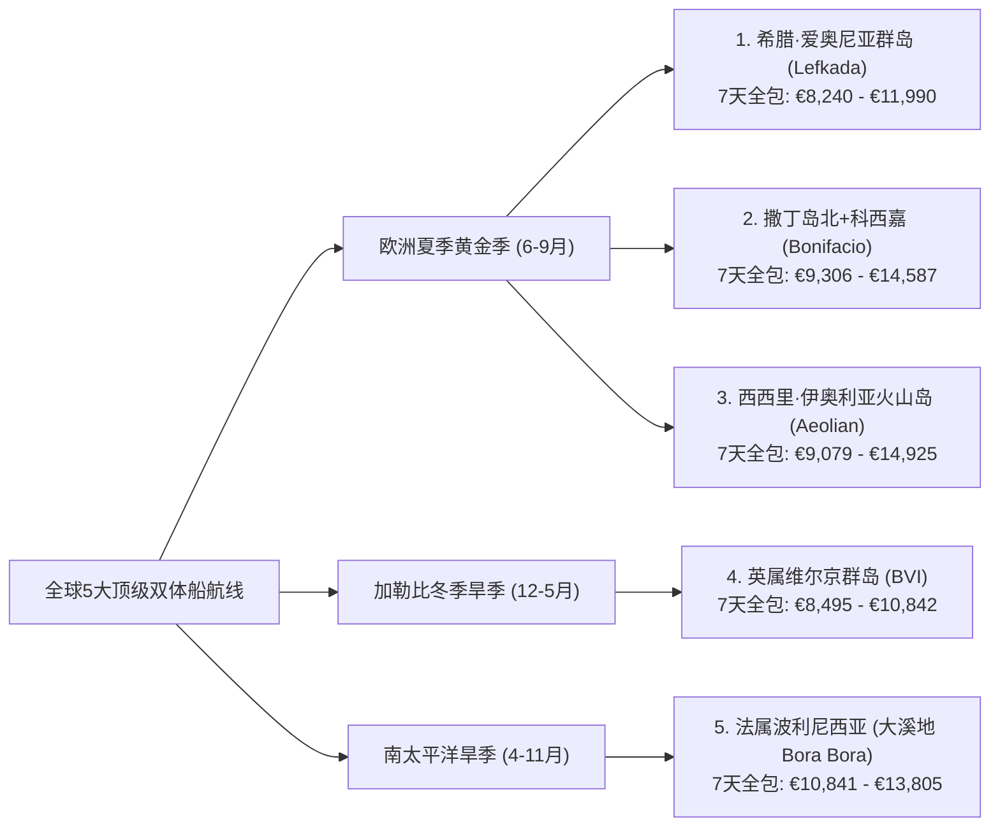

# ⛵ 全球与欧洲双体帆船（4卧 Catamaran + 船长）硬核指南与航线百科全书

本档案完整收录关于**全球与欧洲 4 卧双体帆船（4-Cabin Catamaran，40–45 英尺）+ 雇佣专业船长（Skipper）7 天包船旅行**的全部深度调研成果，涵盖：
1. **[第一部分：全球 Top 5 最值得体验的双体帆船航线规划书（含 7 天全包报价拆解 & 每日详细行程）](#part-1)**
2. **[第二部分：欧洲媲美/超越克罗地亚的 4 大神仙替代航线深度对比（为何排除基克拉泽斯强风区）](#part-2)**
3. **[第三部分：希腊·莱夫卡达（Lefkada）南爱奥尼亚海经典 7 天航线：沿途 8 大古镇/海湾详解（每站 2 张实景图）](#part-3)**
4. **[第四部分：撒丁岛北+科西嘉（Bonifacio）、土耳其戈杰克（Göcek）、西西里火山群岛（Aeolian）7 天航线沿途站点详解（每站 2 张实景图）](#part-4)**
5. **[第五部分：加勒比海 BVI（英属维尔京群岛）vs 欧洲地中海航线六维 PK 与实景攻略](#part-5)**
6. **[第六部分：放眼全球——除欧洲与 BVI 外的 6 大世界级双体帆船圣地全览](#part-6)**
7. **[第七部分：欧洲夏季（6–9月）4 卧双体帆船 + 船长 + 港口 + 燃油 7 天实时全包价格普查、租船平台名录与 26 艘代表性样船核验表](#part-7)**

---

# 第一部分：全球 Top 5 最值得体验的双体帆船航线规划书（含报价拆解 & 每日行程）

> **适用船型基准**：**4 卧双体帆船（4-Cabin Catamaran，40–45 英尺，如 Lagoon 42 / Bali 4.2 / Fountaine Pajot Astrea 42 / Bali Catspace，适合 6–8 人）** + **雇佣专业船长（Skipper）**，租期 **7 天（周六 17:00 登船 — 下周六 09:00 离船）**。  
> **核心选线标准**：以已体验过克罗地亚（斯普利特/杜布罗夫尼克线）的进阶航海玩家为基准，在全球范围内精选**综合体验能与克罗地亚媲美甚至在单项上超越**的 **5 条殿堂级航线**，覆盖**欧洲夏季黄金季（3条）**、**加勒比冬季旱季（1条）**与**南太平洋终极天堂（1条）**。

---

## 一、 五大殿堂级航线横向总览与全包预算对比

### 7天全包落地总价六维拆解总表（单位：欧元 €，基于 2027 实时船价）

$$\text{7天落地总价} = \text{① 裸船周租金} + \text{② 专业船长费} + \text{③ 船长伙食与小费} + \text{④ 必选基地杂费} + \text{⑤ 7天港口/浮球费} + \text{⑥ 7天燃油费}$$

| 费用细项 | **1. 希腊·莱夫卡达** *(爱奥尼亚群岛南线)* | **2. 撒丁岛北+科西嘉** *(La Maddalena & Bonifacio)* | **3. 西西里·火山群岛** *(Aeolian Islands)* | **4. 英属维尔京群岛** *(加勒比海 BVI)* | **5. 法属波利尼西亚** *(大溪地 Bora Bora)* |
| :--- | :--- | :--- | :--- | :--- | :--- |
| **最佳出行月份** | **6月 / 9月**（7-8月次之） | **6月中下旬 / 9月上中旬** | **6月 / 9月**（5月/10月亦佳） | **12月 – 次年5月**（6月特惠） | **4月 – 11月**（6-9月极佳） |
| **① 裸船7天租金（平旺季）** | **€5,650 – €6,800** | **€5,356 – €6,800** | **€5,329 – €5,733** | **€3,985 – €4,484** *(6月)* | **€7,591 – €8,500** *(6月)* |
| **① 裸船7天租金（最高峰）** | **€7,885 – €9,000** *(8月)* | **€7,577 – €9,800** *(8月)* | **€8,156 – €10,460** *(8月)* | **€5,496 – €6,192** *(2月)* | **€8,900 – €9,965** *(7-8月)* |
| **② 专业船长费（7天）** | **€1,400 – €1,470** *(€200–210/天)* | **€1,750 – €1,897** *(€250–271/天)* | **€1,600 – €1,785** *(€229–255/天)* | **€2,170** *(€310/天)* | **€1,750 – €1,960** *(€250–280/天)* |
| **③ 船长伙食 & 离船小费** | **€400** *(伙食€250+小费€150)* | **€450** *(伙食€280+小费€170)* | **€450** *(伙食€280+小费€170)* | **€1,100** *(伙食€300+美式15%小费€800)* | **€500** *(伙食€300+小费€200)* |
| **④ 必选基地杂费** *(Charter Pack/清洁/税)* | **€350 – €480** *(全欧最低清洁费)* | **€600 – €690** *(含床品毛巾及国家公园许可)* | **€600 – €650** *(Transit Log 必选包)* | **€680** *(清洁€485+巡航税/救援费)* | **€450 – €550** *(末期清洁及床品包)* |
| **⑤ 7天港口 / 浮球停泊费** | **€120 – €220** *(市政码头€20/晚+餐厅免费栈桥)* | **€800 – €1,300** *(Bonifacio及撒丁岛码头较贵)* | **€750 – €1,100** *(火山岛私人浮球€120–200/晚)* | **€280 – €350** *(每晚挂官方浮球 €40–50)* | **€200 – €350** *(泻湖浮球/锚泊为主)* |
| **⑥ 7天燃油费（柴油+汽油）** | **€320 – €420** | **€350 – €450** | **€350 – €480** | **€280 – €350** | **€350 – €480** |
| **💰 平旺季 7天全包总价** | **€8,240 – €9,690** | **€9,306 – €11,587** | **€9,079 – €10,198** | **€8,495 – €9,134** *(5-6月)* | **€10,841 – €12,340** |
| **💰 最高峰 7天全包总价** | **€10,475 – €11,990** | **€11,527 – €14,587** | **€11,906 – €14,925** | **€10,006 – €10,842** *(1-3月)* | **€12,150 – €13,805** |
| **👥 8人平摊人均（平旺季）** | **€1,030 – €1,210 / 人** | **€1,160 – €1,450 / 人** | **€1,135 – €1,275 / 人** | **€1,060 – €1,140 / 人** | **€1,355 – €1,540 / 人** |

> **💡 铺位与押金险（Damage Waiver）关键提示**：
> 1. **4+1 / 4+2 船首船员舱**：雇佣专业船长必须提供独立床位。若 8 位乘客希望住满 4 间主客舱且客厅沙龙不睡人，选船时务必确认带有 **船首独立船长舱（Forepeak Cabin，标注为 `4+1` 或 `4+2` Cabins）**。
> 2. **免赔押金险**：上述航线的可退还信用卡预授权押金（Security Deposit）通常为 **€3,000 – €4,500**。建议在基地或预订平台加购 **€350 – €500/周 的免赔押金险（Damage Waiver）**，将刮蹭自负额降至 €0–€300。

---

## 二、 航线 1：希腊 · 爱奥尼亚群岛南线（Lefkada 经典 7 天环线）

> **定位**：**欧洲综合体验与性价比之王**——拥有克罗地亚同款的平静内海与威尼斯风情古镇，但海底为白色石灰岩，海水呈现更惊艳的“荧光牛奶蓝”，且码头与餐饮消费比克罗地亚低 30% 以上。

| 代表景观：凯法利尼亚岛 Fiskardo 威尼斯彩色古港 | 代表景观：伊萨卡岛 Kioni 马蹄形海湾古镇 |
| :---: | :---: |
|  |  |

### 1. 代表性实时船源与精确报价拆解
* **推荐船源 1（经典热门款）**：[Boataround — Lagoon 42 "La Mar" (Ionian Charter 运营，Lefkas Marina)](https://www.boataround.com/boat/lagoon-42-la-mar-1?checkIn=2027-06-19&checkOut=2027-06-26)
  * **6月（06-19 至 06-26）裸船价**：**€6,800**（原价 €8,500，8折）｜ **8月旺季**：**€9,000** ｜ **9月**：**€7,650**
  * **必选杂费**：清洁费 €350 + 床品毛巾 €15/人（8人 €120）+ 舷外机油 €10 = **€480**
  * **船长费**：**€200/天 × 7 = €1,400**（另加船长伙食与小费约 €400）
  * **港口与燃油**：7天港口费约 **€150**（多停餐厅免费栈桥或 €20 市政码头）+ 燃油费 **€350**
  * **👉 6月 7天全包落地总价**：**€9,580**（8人平摊 **€1,197/人**）
* **推荐船源 2（2025准新船）**：[Boataround — Bali Catspace "One Flirt" (2025年，Lefkas Marina)](https://www.boataround.com/boat/bali-catspace-one-flirt?checkIn=2027-06-19&checkOut=2027-06-26)（6月裸船 **€6,555**，9月 **€6,460**，Transit log **€360**，6月7天全包约 **€9,215**）

### 2. 7天每日详细行程表（总航程约 85 海里，日均航行 2 小时）

| 天数 | 航段路线 | 距离 / 航时 | 日间游泳/玩水亮点 | 夜晚停靠古镇 & 餐饮停泊攻略 |
| :--- | :--- | :--- | :--- | :--- |
| **Day 1 (周六)** | **Lefkas Marina $\rightarrow$ Meganisi (Spartochori)** | 11 NM / 1.5h | 17:00 登船起航，穿行莱夫卡达静水运河与尼德里海峡 | 停靠 **梅加尼西岛 Spilia Bay** *Taverna Spilia* 私家木栈桥（吃饭免停船费），步行上山逛鲜花簇拥的悬崖古村 **Spartochori** 看日落 |
| **Day 2 (周日)** | **Meganisi $\rightarrow$ Kalamos / Kastos** | 12 NM / 2.0h | 探访二战潜艇藏身的 **Papanikolis 巨型海蚀洞**，在无人小岛 Formikoula 浮潜 | 停靠松林高山环抱的隐世古镇 **Kalamos**（港务长 George 协助系缆），或在对岸 **Kastos 岛** 百年石风车下喝日落鸡尾酒 |
| **Day 3 (周一)** | **Kalamos $\rightarrow$ Atokos $\rightarrow$ Ithaca (Kioni)** | 15 NM / 2.5h | 停靠无人岛 **Atokos（One House Bay 猪岛）**，在透明果冻海里与野生游泳小黑猪互动 | 夜泊爱奥尼亚最浪漫的马蹄湾古镇 **伊萨卡岛 Kioni**，去水边的 *Calypso* 餐厅吃慢炖羊腿与白葡萄酒海鲜 |
| **Day 4 (周二)** | **Kioni $\rightarrow$ Vathy $\rightarrow$ Kefalonia (Fiskardo)** | 14 NM / 2.0h | 午间在仅能乘船抵达的 **Gidaki 牛奶蓝海滩** 游泳，顺访伊萨卡首府 **Vathy 峡湾** | 夜泊颜值巅峰 **凯法利尼亚岛 Fiskardo**（18世纪威尼斯巴洛克彩色古港），去名店 *Tassia* 吃现捞海鲜大餐、逛精品街 |
| **Day 5 (周三)** | **Fiskardo $\rightarrow$ Assos $\rightarrow$ Lefkada (Sivota)** | 18 NM / 2.5h | 白天锚泊在 **Assos 威尼斯古堡马蹄湾**，划桨板上岸喝冰咖啡；远眺 **Myrtos 悬崖海滩** | 北上返航停靠莱夫卡达南端 **Sivota 天然口袋峡湾**，直接系泊在 *12 Gods* 或 *Stavros* 海鲜餐厅浮桥（免停船费包水电） |
| **Day 6 (周四/五)** | **Sivota $\rightarrow$ Skorpios $\rightarrow$ Lefkas Marina** | 15 NM / 2.0h | 白天在梅加尼西岛南端悬崖湾及船王奥纳西斯私人岛屿 **Skorpios** 外围海域畅游 | 17:00 前返回 **Lefkas Marina** 加油，晚上步行逛莱夫卡达镇彩色老街，去 *Frini Sto Molo* 享用欢送晚宴 |
| **Day 7 (周六)** | **Lefkas Marina 09:00 离船** | — | — | 距离 Preveza/Aktion (PVK) 机场仅 25 分钟车程 |

---

## 三、 航线 2：意大利撒丁岛北 + 法国科西嘉（Bonifacio 跨国 7 天航线）

> **定位**：**欧洲视觉震撼与果冻海天花板**——一次航程横跨意、法两国，把全地中海透明度第一的**马达莱纳花岗岩泻湖**与**法国博尼法乔 70 米白垩悬崖裂缝古城**组合在一起。

| 代表景观：法国科西嘉 Bonifacio 70米白垩悬崖古城 | 代表景观：撒丁岛 Caprera 岛 Cala Coticcio 花岗岩果冻海 |
| :---: | :---: |
|  |  |

### 1. 代表性实时船源与精确报价拆解
* **推荐船源**：[Boataround — Bali Catspace "Tursiops" (2022年，Marina di Portisco, Olbia)](https://www.boataround.com/boat/bali-catspace-tursiops?checkIn=2027-06-19&checkOut=2027-06-26)
  * **6月（06-19 至 06-26）裸船特惠价**：**€5,356**（原价 €8,820，立减 40%）｜ **8月**：**€7,577** ｜ **9月**：**€4,892**
  * **必选杂费**：Transit log（清洁及床品）**€690/次** + 马达莱纳国家公园巡航许可约 **€80**
  * **船长费**：**€271/天 × 7 = €1,897**（另加伙食与小费约 €450）
  * **港口与燃油**：7天港口/浮球费约 **€1,000**（含 1 晚 Bonifacio 悬崖内港 + 1 晚 La Maddalena 码头 + 其余海湾锚泊）+ 燃油费 **€400**
  * **👉 6月 7天全包落地总价**：**€9,873** ｜ **9月全包总价**：**€9,409**（8人平摊 **€1,176/人**）

### 2. 7天每日详细行程表（总航程约 75 海里，日均航行 1.5–2 小时）

| 天数 | 航段路线 | 距离 / 航时 | 日间游泳/玩水亮点 | 夜晚停靠古镇 & 餐饮停泊攻略 |
| :--- | :--- | :--- | :--- | :--- |
| **Day 1 (周六)** | **Marina di Portisco $\rightarrow$ Cala di Volpe / Porto Cervo** | 8 NM / 1.0h | 傍晚起航驶入翡翠海岸名流海湾 **Cala di Volpe（狐狸湾）**，欣赏全球顶级超艇 | 在狐狸湾安全下锚或停靠超艇之都 **Porto Cervo（切尔沃港）**，在甲板喝撒丁岛 Vermentino 冰白葡萄酒 |
| **Day 2 (周日)** | **Porto Cervo $\rightarrow$ Caprera $\rightarrow$ La Maddalena** | 12 NM / 1.5h | 锚泊在卡普雷拉岛号称“小大溪地”的 **Cala Coticcio** 玫瑰花岗岩峡湾浮潜 | 停靠群岛历史中心 **La Maddalena 老港（Cala Gavetta）**，逛热那亚风格老街、吃撒丁岛特色龙虾意面 |
| **Day 3 (周一)** | **La Maddalena $\rightarrow$ Spargi $\rightarrow$ Budelli (圣母泻湖)** | 9 NM / 1.5h | 畅游 Spargi 岛的 **Cala Corsara** 白沙滩，乘小艇远眺传奇 **Budelli 粉红沙滩** | 夜泊由三座无人岛合围出的天然浅水泻湖 **Porto della Madonna（圣母港）**，在发光蒂芙尼蓝水面上看星空 |
| **Day 4 (周二)** | **Budelli $\rightarrow$ 法国 Lavezzi 群岛 $\rightarrow$ Bonifacio** | 14 NM / 2.0h | 跨越海峡进入法国，在 **Îles Lavezzi（拉韦齐花岗岩无人群岛）** 与密集鱼群浮潜 | **全周高潮**：下午从 70 米白垩悬崖裂缝驶入法国 **Bonifacio（博尼法乔）** 内港，登顶悬崖古城吃科西嘉法餐（需提前通过 Navily/港务局预订泊位） |
| **Day 5 (周三)** | **Bonifacio $\rightarrow$ Rondinara $\rightarrow$ Santa Teresa Gallura** | 15 NM / 2.0h | 白天前往科西嘉南岸完美的贝壳形海湾 **Baie de Rondinara** 玩桨板与游泳 | 傍晚返回撒丁岛北端峡湾古镇 **Santa Teresa Gallura**，逛热闹的 Vittorio Emanuele 广场与海崖灯塔 |
| **Day 6 (周四/五)** | **Santa Teresa $\rightarrow$ Cala di Trana $\rightarrow$ Portisco** | 17 NM / 2.5h | 沿途停靠 **Cala di Trana** 金色沙丘海湾与 **Mortorio 无人岛** 最后畅游 | 返回 **Marina di Portisco** 母港，晚餐在港湾餐厅享用撒丁岛烤乳猪（Porceddu） |
| **Day 7 (周六)** | **Marina di Portisco 09:00 离船** | — | — | 距奥尔比亚机场（Olbia Costa Smeralda Airport）仅 25 分钟车程 |

---

## 四、 航线 3：意大利西西里 + 伊奥利亚七大火山群岛（Aeolian Islands 7 天航线）

> **定位**：**地中海最独特的探险与美食美酒之巅**——联合国世界自然遗产，7座火山岛呈现截然不同的奇幻地貌，压轴大戏是**夜晚把双体船停在 Stromboli 活火山海面，边喝香槟边看火红岩浆喷入夜空**。

| 代表景观：海面夜观 Stromboli 活火山喷发赤红岩浆 | 代表景观：Panarea 岛 Cala Junco 天然玄武岩翡翠泳池 |
| :---: | :---: |
|  |  |

### 1. 代表性实时船源与精确报价拆解
* **推荐船源（2026全新船）**：[Boataround — Fountaine Pajot Astrea 42 "Harley Quinn" (2026年，Marina di Portorosa, Sicily)](https://www.boataround.com/boat/fountaine-pajot-astrea-42-harley-quinn?checkIn=2027-06-19&checkOut=2027-06-26)
  * **6月（06-19 至 06-26）裸船价**：**€5,733**（原价 €7,100，8折）｜ **8月**：**€8,156** ｜ **9月**：**€5,329**
  * **必选杂费**：Transit log（含最终清洁、床品、沙滩浴巾、免费舷外机）**€600/次**
  * **船长费**：**€255/天 × 7 = €1,785**（另加伙食与小费约 €450）
  * **港口与燃油**：7天港口/浮球费约 **€850** + 燃油费 **€420**
  * **👉 6月 7天全包落地总价**：**€9,838** ｜ **9月全包总价**：**€9,434**（8人平摊 **€1,179/人**）

### 2. 7天每日详细行程表（总航程约 95 海里，日均航行 2–2.5 小时）

| 天数 | 航段路线 | 距离 / 航时 | 日间游泳/玩水亮点 | 夜晚停靠古镇 & 餐饮停泊攻略 |
| :--- | :--- | :--- | :--- | :--- |
| **Day 1 (周六)** | **Marina di Portorosa $\rightarrow$ Vulcano (Porto Ponente)** | 15 NM / 2.0h | 傍晚直奔 **武尔卡诺岛（Vulcano）**，在冒着海底地热气泡的火山黑沙滩海湾下锚 | 锚泊 **Porto di Ponente**，日落前花 45 分钟登顶冒着硫磺蒸汽的 **Gran Cratere 大火山口** 俯瞰七岛全景 |
| **Day 2 (周日)** | **Vulcano $\rightarrow$ Lipari (白浮石海滩 & 古镇)** | 8 NM / 1.5h | 绕行武尔卡诺西岸 **Grotta del Cavallo（马洞）** 与天然火山泳池 **Venus Pool**，再去利帕里岛 **Spiaggia Bianca（白浮石果冻海）** 游泳 | 夜泊群岛千年首府 **Lipari（Marina Corta 小港）**，逛 16 世纪西班牙海防卫城，去 *Filippino* 吃西西里红虾意面与 Cannoli |
| **Day 3 (周一)** | **Lipari $\rightarrow$ Salina (Pollara & Santa Maria)** | 12 NM / 2.0h | 驶向双子火山绿岛 **萨利纳（Salina）**，在电影《邮差》取景地 **Pollara 半圆火山口悬崖湾** 浮潜 | 停靠 **Santa Maria Salina** 码头，傍晚乘车去悬崖酒庄 *Capofaro* 或 *Hauner* 品尝黄金甜白葡萄酒 Malvasia，去 *Alfredo* 吃招牌面包（Pane Cunzato） |
| **Day 4 (周二)** | **Salina $\rightarrow$ Panarea (Cala Junco)** | 12 NM / 2.0h | 在 **帕纳雷阿岛（Panarea）** 南端由柱状玄武岩围成的天然翡翠泳池 **Cala Junco** 畅游，探访悬崖顶青铜时代史前村落；再去 **Lisca Bianca** 海底喷气孔浮潜 | 夜泊无车纯白名流小岛 **Panarea** 浮球区，乘水上出租车（Taxi Boat）登岛去 *Raya* 露台酒吧看夜景 |
| **Day 5 (周三)** | **Panarea $\rightarrow$ Stromboli（夜观活火山喷发）** | 11 NM / 1.5h | 下午抵达过去两千年持续喷发的 **斯特龙博利活火山岛（Stromboli）**，登岸逛黑沙滩上的纯白小镇 San Vincenzo | **终生难忘之夜**：日落时船长将双体船开到岛西北侧 **火之斜坡（Sciara del Fuoco）** 海面，在甲板上边喝香槟边看活火山每隔 15–20 分钟向夜空喷射赤红岩浆 |
| **Day 6 (周四/五)** | **Stromboli $\rightarrow$ Lipari南角 $\rightarrow$ Portorosa** | 32 NM / 4.0h | 顺风南下返航，中途在利帕里南端 **Faraglioni 奇岩双峰** 游泳午餐 | 傍晚返回 **Marina di Portorosa** 母港，享用西西里海鲜欢送晚宴 |
| **Day 7 (周六)** | **Marina di Portorosa 09:00 离船** | — | — | 前往卡塔尼亚机场（CTA）或顺游陶尔米纳（Taormina）古希腊剧场 |

---

## 五、 航线 4：英属维尔京群岛（加勒比海 BVI 7 天经典环线）

> **定位**：**冬季避寒与热带珊瑚礁/沙滩酒吧狂欢之王**——全球公认航海条件最轻松的“世界帆船之都”，全程在平静水道内目视跳岛，每晚挂官方浮球（无需倒车抢码头），白天与海龟魔鬼鱼同游，下午直接从船尾游去海滩酒吧喝朗姆酒。

| 代表景观：Virgin Gorda 巨石浴场 The Baths | 代表景观：Jost Van Dyke 白湾与湿美金酒吧 Soggy Dollar Bar |
| :---: | :---: |
|  |  |

### 1. 代表性实时船源与精确报价拆解
* **推荐船源 1**：[Boataround — Bali 4.2 "Dorothea" (Navigare Yachting 运营，Tortola Hodge's Creek Marina)](https://www.boataround.com/boat/bali-42-dorothea?checkIn=2027-02-13&checkOut=2027-02-20)
  * **2月冬季旺季（02-13 至 02-20）裸船价**：**€6,192**（原价 €7,740）｜ **6月初夏特惠价**：**€4,484**
* **推荐船源 2**：[Boataround — Lagoon 42 "Bellatrix" (Dream Yacht 运营，Tortola)](https://www.boataround.com/boat/lagoon-42-bellatrix?checkIn=2027-06-19&checkOut=2027-06-26)（2月旺季 **€5,496**，6月仅 **€3,985**）
* **BVI 必选杂费与船长明细**：
  * **必选清洁及床品（Transit log）**：**€485** + 环境巡航税及海上救援费约 **€195**（8人合计）
  * **船长费**：**€310/天 × 7 = €2,170**（外加船长伙食 €300 + 加勒比海惯例离船小费约 €800）
  * **7天系泊浮球费（BoatyBall / 国家公园浮球）**：每晚约 €45，7天合计 **€300** + 燃油费 **€300**
  * **👉 6月初夏 7天全包落地总价**：**€8,535 – €9,034** ｜ **2月冬季旺季全包总价**：**€10,046 – €10,742**

### 2. 7天每日详细行程表（总航程约 65 海里，日均航行 1.5 小时）

| 天数 | 航段路线 | 距离 / 航时 | 日间珊瑚礁浮潜/玩水亮点 | 夜晚停泊海湾 & 赤脚沙滩酒吧攻略 |
| :--- | :--- | :--- | :--- | :--- |
| **Day 1 (周六)** | **Tortola $\rightarrow$ Norman Island（金银岛）** | 7 NM / 1.0h | 穿越弗朗西斯·德雷克爵士水道，在 **The Caves（海盗藏宝洞）** 与 **The Indians（印第安岩礁）** 浮潜看珊瑚鱼群 | 挂浮球夜泊 **The Bight**，乘小艇登上停在海湾中央的传奇海盗船漂浮酒吧 **Willy T** 跳水狂欢，或在 *Pirates Bight* 吃海滩晚餐 |
| **Day 2 (周日)** | **Norman $\rightarrow$ Salt Island $\rightarrow$ Cooper Island** | 8 NM / 1.0h | 上午在 **RMS Rhone（1867年英国皇家邮轮沉船遗址）** 浮潜（船体清晰可见），下午在 **Cistern Point** 与野生海龟同游 | 挂浮球夜泊精品生态岛 **Cooper Island Beach Club**，品尝自酿精酿啤酒与珍藏朗姆酒廊 |
| **Day 3 (周一)** | **Cooper $\rightarrow$ Virgin Gorda (The Baths & North Sound)** | 12 NM / 1.5h | **全周自然奇观**：系泊国家公园浮球，游上岸穿越 **The Baths（巨石浴场）** 半淹没在翡翠海水中的花岗岩巨石迷宫与一线天洞穴 | 下午航入 **North Sound（北湾）**，停靠超艇云集的 **Saba Rock**（下午5点看喂大海鲢 Tarpon）或 **Bitter End Yacht Club** |
| **Day 4 (周二)** | **Virgin Gorda $\rightarrow$ Anegada（火烈鸟珊瑚环礁）** | 15 NM / 2.0h | 扬帆北上唯一的珊瑚平岛 **阿内加达（Anegada）**，租吉普车去 **Loblolly Bay** 20公里无人白沙滩浮潜、去盐湖看野生粉红火烈鸟群 | 夜泊 Setting Point，晚上在沙滩烛光下享用提前预订的 **Anegada 炭烤两斤重加勒比大龙虾**（*Lobster Trap* 或 *Potter's by the Sea*） |
| **Day 5 (周三)** | **Anegada $\rightarrow$ Guana Island $\rightarrow$ Cane Garden Bay** | 18 NM / 2.5h | 顺东北信风畅快航行至 **Monkey Point（猴子角）** 浮潜看成群大鱼与海龟 | 夜泊托托拉北岸椰林环绕的 **Cane Garden Bay**，在 *Myett's* 听现场钢鼓乐（Steel Pan）看加勒比火烧云日落 |
| **Day 6 (周四/五)** | **Cane Garden $\rightarrow$ Sandy Spit $\rightarrow$ Jost Van Dyke** | 8 NM / 1.0h | 先停靠明信片上的袖珍无人白沙岛 **Sandy Spit**，随后驶入全球最著名的 **White Bay（白湾）**，跳进齐腰深牛奶蓝海水游向 **Soggy Dollar Bar（湿美金酒吧）** 喝原版 Painkiller | 傍晚转入隔壁 **Great Harbour** 挂浮球，去传奇老店 **Foxy's Tamarind Bar** 参加海滩 BBQ 派对；次日早晨轻松返抵 Tortola 基地 |
| **Day 7 (周六)** | **Tortola 基地 09:00 离船** | — | — | 乘车去牛肉岛机场（EIS）或乘快艇 50 分钟回美属圣托马斯（STT）返程 |

---

## 六、 航线 5：法属波利尼西亚 · 大溪地顺风群岛（Raiatea $\rightarrow$ Bora Bora 7 天航线）

> **定位**：**全球双体船包船界的终极人生清单（Bucket List #1）**——在博拉博拉岛住一晚四季水屋要 €2,000+，而包一艘 4 卧双体船，人均 €1,370 就能拥有整整 7 天**“停在奥特马努火山峰正下方七色泻湖里的移动私人水屋”**！而且 **6–9 月正值大溪地全年最清爽少雨的黄金旱季**。

| 代表景观：Bora Bora 七色泻湖与奥特马努火山峰 | 代表景观：外围珊瑚环礁保护下的镜面荧光蓝泻湖 |
| :---: | :---: |
|  |  |

### 1. 代表性实时船源与精确报价拆解
* **推荐船源**：[Boataround — Lagoon 42 "Poe Hina" (Poe Charter 运营，大溪地/顺风群岛)](https://www.boataround.com/boat/lagoon-42-poe-hina?checkIn=2027-06-19&checkOut=2027-06-26) 或 **Dream Yacht / The Moorings Raiatea 基地 4卧双体船**
  * **6月（06-19 至 06-26）裸船价**：**€7,591** ｜ **7-8月旺季 Lagoon 43 新船**：**€9,965**
  * **必选杂费**：最终清洁及床品包 **€450**
  * **船长费**：**€260/天 × 7 = €1,820**（另加伙食与小费约 €500）
  * **港口与燃油**：大溪地全程在环礁泻湖内免费下锚或挂免费/低价餐厅浮球，7天停泊费仅 **€200** + 燃油费 **€400**
  * **👉 6月 7天全包落地总价**：**€10,961**（8人平摊仅 **€1,370/人**，不到博拉博拉酒店水屋 2 晚的房费！）

### 2. 7天每日详细行程表（总航程约 80 海里，80% 时间在零风浪环礁泻湖内航行）

| 天数 | 航段路线 | 距离 / 航时 | 日间泻湖/珊瑚礁体验亮点 | 夜晚停泊泻湖锚地 & 特色攻略 |
| :--- | :--- | :--- | :--- | :--- |
| **Day 1 (周六)** | **Raiatea（赖阿特阿岛）$\rightarrow$ Taha'a（塔哈香草岛）** | 8 NM / 1.0h | 在同一个巨型环礁泻湖内向北航行 1 小时即达 **Motu Ceran 无人珊瑚小岛**，跳进透明度 30 米的浅滩浮潜 | 夜泊塔哈岛 **Apu Bay**，参观大溪地黑珍珠养殖场（可现场挑选黑珍珠），登岸参观天然波利尼西亚香草种植园 |
| **Day 2 (周日)** | **Taha'a 环岛 $\rightarrow$ Tautau 珊瑚花园** | 7 NM / 1.0h | **全周最佳浮潜**：把船停在 **Motu Tautau（塔哈珊瑚花园）**，顺着天然海流在五彩斑斓的活珊瑚水道中“漂流浮潜（Drift Snorkel）” | 在塔哈岛西侧浅滩下锚，正面远眺 20 海里外博拉博拉岛的日落剪影，在船尾吃大溪地生鱼沙拉（Poisson Cru，椰奶青柠金枪鱼） |
| **Day 3 (周一)** | **Taha'a $\rightarrow$ Bora Bora（博拉博拉泻湖）** | 22 NM / 3.0h | 唯一一段 3 小时跨海航行，穿过 Teavanui 水道进入传奇的 **博拉博拉七色泻湖**，在 **Motu Tapu** 白沙洲游泳 | 夜泊 **Bora Bora Yacht Club / MaiKai** 浮球，乘小艇去世界名流打卡的 **Bloody Mary's（血腥玛丽沙地餐厅）** 吃炭烤剑鱼与龙虾 |
| **Day 4 (周二)** | **Bora Bora 泻湖深度环游（魔鬼鱼水道 & Matira）** | 8 NM / 1.0h | 上午在 **Stingray Avenue（魔鬼鱼水道）** 齐胸深的蒂芙尼蓝浅滩与几十只温顺的赤魟（魔鬼鱼）和黑鳍礁鲨同游；下午停靠 **Matira Beach** | **全周最美锚地**：夜泊博拉博拉东侧珊瑚环礁内侧（Motu Piti Aau），船头正对海拔 727 米的 **奥特马努山（Mt. Otemanu）** 绝美主峰 |
| **Day 5 (周三)** | **Bora Bora（蝠鲼点）$\rightarrow$ 返航 Taha'a 东岸** | 22 NM / 3.0h | 上午在博拉博拉泻湖的 **Anau 清洁站** 浮潜观赏翼展 3 米的野生巨型鬼蝠鲼（Manta Rays），午后顺风返回塔哈岛 **Haamene Bay** | 夜泊塔哈岛深入内陆的峡湾，去岸上法国大厨主理的私房餐厅用餐 |
| **Day 6 (周四/五)** | **Taha'a $\rightarrow$ Raiatea（Faaroa 热带雨林河 & Opoa）** | 12 NM / 1.5h | 驶入赖阿特阿岛 **Faaroa Bay**，乘船尾橡皮艇逆流进入全波利尼西亚唯一可通航的热带雨林河流探险；参观世界文化遗产 **Taputapuatea 古代毛利神庙** | 傍晚返回 **Raiatea 基地码头**，伴随当地乌克丽丽琴声享用欢送大餐 |
| **Day 7 (周六)** | **Raiatea 基地 09:00 离船** | — | — | 距 Raiatea 机场（RFP）仅 10 分钟车程，乘机 45 分钟返回帕皮提（PPT）国际机场 |

---

## 七、 选线决策速查卡

* **如果您计划在 6–9 月去欧洲**，想延续克罗地亚那种**“风平浪静 + 每天逛高颜值古镇 + 岸上大餐”**的节奏，但想要**水更蓝、花费省 25%** $\rightarrow$ 选 **航线 1：希腊·莱夫卡达（爱奥尼亚南线）**。
* **如果您计划在 6月或9月去欧洲**，追求**“全欧第一透明度果冻海 + 最震撼的 70 米悬崖裂缝古城进港”** $\rightarrow$ 选 **航线 2：意大利撒丁岛北 + 法国科西嘉（Bonifacio）**。
* **如果您是资深美食与美酒控**，想体验**“海面仰望活火山夜间喷发岩浆”**的世界奇观 $\rightarrow$ 选 **航线 3：西西里·伊奥利亚火山群岛**。
* **如果您计划在冬季/春节/春假（12–5月）出行**，向往**“珊瑚海龟浮潜 + 免倒车挂浮球 + 游上白沙滩酒吧喝朗姆酒”** $\rightarrow$ 选 **航线 4：加勒比海 BVI**。
* **如果您想完成人生终极海岛梦想（4–11月皆宜，含 6–9 月暑假）**，想用超值价格把整艘双体船停在博拉博拉七色泻湖中央 $\rightarrow$ 选 **航线 5：法属波利尼西亚（大溪地）**。

---

# 第二部分：欧洲媲美/超越克罗地亚的 4 大神仙替代航线深度对比

去过克罗地亚（尤其是斯普利特—Hvar—Vis—Korčula 或杜布罗夫尼克线）之后，眼光确实会被养得很刁——因为克罗地亚把**“内海风平浪静 + 每天1.5~3小时短途跳岛 + 中世纪古城紧挨码头 + 丰富夜生活”**结合得太好了。

在欧洲剩下的海域里，真正能**在综合体验上媲美甚至在单项上超越克罗地亚**的，公认有以下 **4 条顶级双体船航线**（按与克罗地亚的“惊艳度匹配度”排序）：

---

### 一、 四大神仙替代航线 vs 克罗地亚 直观对比

| 航线名称 | 海况平稳度 (对比克罗地亚) | 海水/海湾颜值 | 古镇风情 & 美食 | 独特杀手锏（克罗地亚没有的体验） | 7天全包预算 (6/9月 vs 7/8月) |
| :--- | :--- | :--- | :--- | :--- | :--- |
| **1. 希腊·爱奥尼亚南线** *(Lefkada $\rightarrow$ Kefalonia & Ithaca)* | ⭐⭐⭐⭐⭐ *(同样有群岛屏障，极稳)* | ⭐⭐⭐⭐⭐ *(荧光牛奶蓝，胜过克国)* | ⭐⭐⭐⭐☆ *(彩色威尼斯风渔村+顶级Taverna)* | 船尾直接停在海边小酒馆门口（免高价码头费），松弛感天花板 | **€7,800 – €9,500** *(旺季 €9.5k–11.6k)* |
| **2. 撒丁岛北 + 法国科西嘉南** *(Olbia $\rightarrow$ La Maddalena & Bonifacio)* | ⭐⭐⭐☆☆ *(海峡偶有大风，需看天)* | ⭐⭐⭐⭐⭐+ *(全欧第一果冻海)* | ⭐⭐⭐⭐⭐ *(意法双国混血，悬崖古城)* | **一次航程跨意法两国**；驶入科西嘉 70 米白垩悬崖峡湾 Bonifacio 震撼全场 | **€9,200 – €11,000** *(旺季 €11.5k–14k)* |
| **3. 西西里 + 伊奥利亚火山群岛** *(Portorosa $\rightarrow$ Aeolian Islands)* | ⭐⭐⭐⭐☆ *(夏季风小，外海微涌)* | ⭐⭐⭐⭐☆ *(深邃宝石蓝+黑沙滩)* | ⭐⭐⭐⭐⭐+ *(全地中海美食与甜酒之巅)* | **夜泊活火山 Stromboli 海面看岩浆喷发** + 火山泥浴 + 电影感离岛 | **€9,200 – €10,500** *(旺季 €11.5k–13.5k)* |
| **4. 土耳其·戈杰克十二岛** *(Göcek $\rightarrow$ Fethiye / Kalkan)* | ⭐⭐⭐⭐⭐+ *(如湖面般平静，全欧最稳)* | ⭐⭐⭐⭐☆ *(松林翡翠绿+温暖海水)* | ⭐⭐⭐⭐☆ *(私密海湾庄园餐厅)* | 只有坐船才能到的**松林海湾私密栈桥餐厅**（吃饭即免停船费）+ 水温最高 | **€7,700 – €8,600** *(旺季 €8.0k–9.4k)* |

> **为什么没把“希腊米科诺斯/圣托里尼（基克拉泽斯群岛）”排第一？**
> 陆地游去米科诺斯和圣托里尼很美，但 **7–8 月那里盛行爱琴海著名的 Meltemi 强北风（常年 6–8 级大风、2米以上涌浪）**。如果你习惯了克罗地亚平稳的航海体验，去基克拉泽斯大概率会经历全船晕船、餐具乱飞，甚至被大风困在港口两天出不了海。

---

### 二、 深度拆解：这 4 条航线分别强在哪里？

#### 🏆 首选推荐 1：希腊·爱奥尼亚群岛南线（Lefkada 莱夫卡达出发）
**——最完美复刻克罗地亚“舒适跳岛节奏”，但海水更蓝、物价更香**
* **为什么能媲美克罗地亚**：
  * 克罗地亚最舒服的是岛与岛之间只有 10–15 海里，爱奥尼亚群岛（Ionian Islands）完全一样——被莱夫卡达、凯法利尼亚（Kefalonia）、伊萨卡（Ithaca，荷马史诗奥德修斯的故乡）和 Meganisi 围成一片风平浪静的“内海”。
  * **小镇颜值极高**：凯法利尼亚岛的 **Fiskardo**（二战唯一没被震毁的威尼斯彩色古港，地位相当于克罗地亚的 Hvar）和 **Assos**（半岛城堡小村），以及伊萨卡岛的 **Kioni**，全都是颜值极高的海湾古镇。
  * **海水胜出**：克罗地亚是清澈的深蓝/翠绿，而爱奥尼亚海因为海底是白色石灰岩，阳光下呈现发光的“牛奶蒂芙尼蓝”（比如可以开船去看的 Myrtos 海滩、Atokos 无人猪岛）。
* **7天经典每日行程**：
  * **Day 1**：Lefkas Marina 登船 $\rightarrow$ 短航 1.5h 到 **Meganisi 岛 Vathy 或 Spartochori 海湾**（直接停在海边私家餐厅栈桥）。
  * **Day 2**：Meganisi 悬崖海蚀洞游泳 $\rightarrow$ 无人岛 **Kalamos** 或 **Kastos**（古朴风车渔村）。
  * **Day 3**：航向荷马史诗故乡 **Ithaca 伊萨卡岛** $\rightarrow$ 夜泊绝美马蹄形海湾小镇 **Kioni**。
  * **Day 4**：跨海前往 **Kefalonia 凯法利尼亚岛** $\rightarrow$ 探访地下湖 Melissani Cave $\rightarrow$ 夜泊 **Fiskardo**（精品店与高端海鲜餐厅云集）。
  * **Day 5**：停靠如画的 **Assos 半岛** 午餐游泳 $\rightarrow$ 北上返程停泊莱夫卡达南端 **Sivota Bay**（天然峡湾美食港）。
  * **Day 6**：绕行船王奥纳西斯的私人岛屿 **Skorpios** 游泳 $\rightarrow$ 返抵 Lefkas Marina。
* **对应真实船源**：上文中的 **[Lagoon 42 "La Mar" (Lefkas Marina)](https://www.boataround.com/boat/lagoon-42-la-mar-1?checkIn=2027-06-19&checkOut=2027-06-26)** 或 **[Bali Catspace "One Flirt" (2025新船)](https://www.boataround.com/boat/bali-catspace-one-flirt?checkIn=2027-06-19&checkOut=2027-06-26)**。

---

#### 🏆 首选推荐 2：撒丁岛北部（马达莱纳群岛）+ 法国科西嘉南端（Bonifacio）
**——颜值与逼格的绝对巅峰，一次帆船玩转意、法两国**
* **为什么能媲美甚至超越克罗地亚**：
  * 如果你们觉得克罗地亚的果冻海还不够极致，**撒丁岛北部的马达莱纳群岛国家公园（La Maddalena Archipelago）+ 法国科西嘉南部的拉韦齐群岛（Lavezzi Islands）** 是整个地中海透明度的天花板——水下 15 米的白沙和巨石肉眼清晰可见，船拍出来像悬浮在空中。
  * **高光时刻**：从撒丁岛向北航行仅 2 小时，就能跨国进入法国科西嘉岛的 **博尼法乔（Bonifacio）**——千年古城直接建在伸出海面的 70 米高白色石灰岩悬崖顶上，双体船从狭窄的悬崖裂缝驶入内港，那种史诗感连杜布罗夫尼克都难以企及。
* **7天经典每日行程**：
  * **Day 1**：Olbia / Marina di Portisco 登船 $\rightarrow$ 翡翠海岸 **Cala di Volpe**（007电影取景海湾，世界顶级富豪超艇聚集地）。
  * **Day 2**：进入 **Caprera & La Maddalena 主岛**（意式海岛老城逛街吃 Gelato）。
  * **Day 3**：跳岛 **Spargi & Budelli（传奇粉红沙滩）** $\rightarrow$ 夜泊天然泻湖 **Porto della Madonna**（三岛合围的绝美浅滩）。
  * **Day 4**：跨越博尼法乔海峡进入法国 $\rightarrow$ 白天在 **Lavezzi 无人花岗岩群岛** 浮潜 $\rightarrow$ 傍晚驶入 **法国 Bonifacio 悬崖内港** 吃法餐。
  * **Day 5**：科西嘉南岸 **Rondinara 马蹄湾** $\rightarrow$ 返回意大利 **Santa Teresa Gallura**。
  * **Day 6**：**Porto Cervo（切尔沃港）** 或 **Tavolara 桌山岛** $\rightarrow$ 返抵 Portisco。
* **短板提醒**：博尼法乔海峡是风口，偶尔会有 20+ 节西风，但周围避风海湾极多；另外旺季（7-8月）进 Bonifacio 和 Porto Cervo 码头价格昂贵且需船长提前抢位，**强烈建议 6月中下旬或 9月上中旬去**。
* **对应真实船源**：**[Bali Catspace "Tursiops" (Marina di Portisco, 6月折后仅 €5,356)](https://www.boataround.com/boat/bali-catspace-tursiops?checkIn=2027-06-19&checkOut=2027-06-26)**。

---

#### 🏆 首选推荐 3：意大利·西西里北岸 + 伊奥利亚火山群岛（Aeolian Islands）
**——最独特的人生清单级体验（看活火山夜喷 + 意大利美食美酒之巅）**
* **为什么能媲美克罗地亚**：
  * 克罗地亚的岛屿地貌相对接近（喀斯特灰白岩石+松树），而西西里北部的 **伊奥利亚群岛（7座火山岛，全部列入世界自然遗产）** 做到真正的“一岛一世界”：
    * **Vulcano 岛**：登岛泡天然硫磺火山泥、爬火山口看喷气孔；
    * **Lipari 岛**：繁华的卫城古镇、浮石白沙滩（船停在白浮石海底上，海水亮白如加勒比）；
    * **Salina 岛**：双子火山绿岛，去悬崖酒庄喝 Malvasia 甜白葡萄酒、吃全意大利最顶级的 Caponata 和海胆意面；
    * **Panarea 岛**：禁止汽车通行的纯白建筑名流小岛，夜景极美；
    * **Stromboli 岛（压轴大戏）**：全球最活跃的常年喷发火山之一。傍晚船长把双体船开到火山西北侧海面（Sciara del Fuoco），天黑后每隔 15–20 分钟就能看到火红岩浆喷涌入海！
* **短板提醒**：火山岛水深较深，锚泊和系浮球技术要求高（必须带当地熟手船长），基地清洁费和浮球费较贵。
* **对应真实船源**：**[2026全新船 FP Astrea 42 "Harley Quinn" (Marina di Portorosa)](https://www.boataround.com/boat/fountaine-pajot-astrea-42-harley-quinn?checkIn=2027-06-19&checkOut=2027-06-26)**（6月仅 €5,733，9月仅 €5,329）。

---

#### 🏆 首选推荐 4：土耳其·戈杰克十二岛与费特希耶（Göcek & Fethiye）
**——最极致的躺平度假感，完全不用操心抢码头**
* **为什么能媲美克罗地亚**：
  * 如果你们在克罗地亚觉得“每天下午 3 点就要急着赶路去抢码头泊位”有点累，那么 **土耳其戈杰克（Göcek）** 会让你彻底爱上它的松弛。
  * 整个 Göcek 海湾被高山和松林严密包裹，**真的一丝海浪都没有**，4卧双体船停在海湾里稳得像在陆地上。
  * 海湾深处遍布只有船能到的私密海湾餐厅（如 Adaia、Sarsala、Cleopatra's Bath 古罗马水下遗迹湾），既有历史遗迹（可以在水下古罗马浴场废墟里游泳），又有极高水准的土耳其海鲜烤肉与俱乐部氛围，而且**在餐厅吃饭就免费提供木栈桥停泊和水电**。
* **对应真实船源**：**[2024新船 Lagoon 42 "Ivan Nonno" (Göcek Marina, 6月 €5,310)](https://www.boataround.com/boat/lagoon-42-ivan-nonno?checkIn=2027-06-19&checkOut=2027-06-26)**。

---

### 三、 怎么选？一句话帮你们拍板：

1. **想找“像克罗地亚一样轻松平稳、每天逛漂亮海边小镇、但水更蓝更便宜”** $\rightarrow$ 闭眼选 **希腊·莱夫卡达（爱奥尼亚群岛南线）**。
2. **追求“视觉震撼天花板、全欧第一果冻海、想顺便打卡法国悬崖古城”** $\rightarrow$ 选 **意大利撒丁岛北 + 法国科西嘉 Bonifacio**（推荐 6月 或 9月）。
3. **资深吃货与葡萄酒控、想看“海面仰望活火山夜间喷发”的奇观** $\rightarrow$ 选 **意大利西西里·伊奥利亚火山群岛**。
4. **想彻底躺平、完全不晕船、喜欢温暖海水与私密海湾餐厅** $\rightarrow$ 选 **土耳其·戈杰克（Göcek）**。

你们上次在克罗地亚走的是**斯普利特（Hvar/Vis）线**还是**杜布罗夫尼克线**？当时全船人最享受的是**白天泡果冻海湾玩水**，还是**傍晚靠岸逛古城、去餐厅和酒吧**？告诉我你们的偏好，我可以帮你们把最匹配那条线的 **7天每日停靠港、必去餐厅/海湾和最佳带船长船型** 精确排出来！

---

# 第三部分：希腊·莱夫卡达（Lefkada）南爱奥尼亚海经典 7 天航线（8 大古镇 & 每站 2 张实景图）

**莱夫卡达（Lefkada）南爱奥尼亚海 7 天经典环线**是整个希腊最适合双体船跳岛的黄金路线。全程都在群岛合围的“内海”中航行，每天航程仅 **10–18 海里（约 1.5–3 小时）**，串联起 **4 座主要大岛（莱夫卡达、梅加尼西、伊萨卡、凯法利尼亚）+ 2 座隐世小岛（卡拉莫斯、卡斯托斯）** 上的 **8 个绝美小镇与港湾**。

以下是按 **7天顺时针/逆时针经典环线** 依次路过的 **8 个核心小镇** 及每个小镇的 **2 张实景图与停靠攻略**：

---

### 第 1 站：莱夫卡达镇 & 尼德里（Lefkada Town & Nydri）—— 起航母港（Day 1 & Day 7）
* **所在位置**：莱夫卡达岛（全希腊唯一通过浮动吊桥与大陆相连、无需坐轮渡即可从 Aktion 机场 25 分钟车程直达的海岛）。
* **小镇特色**：老城为防震采用独特的威尼斯式彩色波纹铁皮与木结构二层小楼，水道边停满帆船；向南航行 45 分钟即达热闹的度假小镇 **尼德里（Nydri）**，正对船王奥纳西斯的私人岛屿 Skorpios。
* **停泊与体验**：首晚与末晚停靠 **Lefkas Marina**（设施极完善，水电、超市、海滨餐厅一应俱全）。

---

### 第 2 站：梅加尼西岛 · 斯帕托霍里 & 瓦西港（Spartochori & Vathy, Meganisi）—— Day 1 夜泊
* **航程**：距 Lefkas Marina 约 **11 海里（航行约 1.5 小时）**。
* **小镇特色**：梅加尼西岛北岸有三个深入内陆的天然深水峡湾。最惊艳的是 **Spilia Bay（斯皮利亚湾）** 与悬崖顶上的 **Spartochori（斯帕托霍里村）**——九重葛鲜花簇拥的蓝白小巷高悬于祖母绿海湾之上；隔壁峡湾则是宁静的传统渔村 **Vathy（小瓦西港）**。
* **停泊与体验**：双体船可直接停靠在 Spilia 海湾餐厅（如 *Taverna Spilia* 或 *Karnagio*）的专属栈桥（在餐厅用晚餐即免停船费，还提供免费岸上泳池与淋浴），傍晚沿着观景步道走 10 分钟上山逛 Spartochori 古村看日落。

---

### 第 3 站：卡拉莫斯岛 & 卡斯托斯岛（Kalamos & Kastos）—— Day 2 夜泊
* **航程**：距梅加尼西岛约 **12 海里（航行约 2 小时）**，途经梅加尼西岛南端著名的 **Papanikolis 海蚀巨洞** 游泳。
* **小镇特色**：两座几乎没有汽车、只有百余名常住居民的隐世姊妹岛。**Kalamos（卡拉莫斯镇）** 背靠海拔 700 米的苍翠松林高山，港口石屋古朴静谧；对岸仅隔一道浅水海峡的 **Kastos（卡斯托斯岛）** 则以山脊上的古老石风车、百年橄榄树和透明浅滩闻名。
* **停泊与体验**：停靠 Kalamos 港口（港务长 George 非常热情，会开小艇帮每艘帆船引航系缆），或停在 Kastos 岛古老风车下的海湾喝日落鸡尾酒。

---

### 第 4 站：伊萨卡岛 · 基奥尼古镇（Kioni, Ithaca）—— Day 3 夜泊
* **航程**：向南穿越内海约 **15 海里（航行约 2.5 小时）**，途中必停无人岛 **Atokos（One House Bay 猪岛，有会在果冻海里游泳的小黑猪）**。
* **小镇特色**：荷马史诗中奥德修斯返乡的终点**伊萨卡岛（Ithaca）**北部的明珠。**Kioni（基奥尼）** 被公认为整个爱奥尼亚海最浪漫的马蹄形剧场式小港——海湾入口矗立着三座 16 世纪古风车遗址，文艺复兴风格的红瓦石屋沿着翠绿山坡层层叠叠铺到水边。
* **停泊与体验**：尾靠（Med-moor）在小镇石砌岸壁或打长缆（Long-lining）停在海湾北侧，乘橡皮艇登岸去水边的 *Calypso* 餐厅吃慢炖羊腿和海鲜意面。

---

### 第 5 站：伊萨卡岛首府 · 瓦西古镇（Vathy, Ithaca）—— Day 4 午间/备选夜泊
* **航程**：沿伊萨卡岛东岸南下约 **8 海里（航行约 1 小时）**，途中可在鹅卵石果冻海滩 **Gidaki Beach**（仅能乘船抵达）锚泊游泳。
* **小镇特色**：世界上最大的天然深水封闭式海湾之一，船从狭窄曲折的峡湾水道驶入后豁然开朗。海湾中央有一座松树覆盖的袖珍小岛 **Lazaretto（前威尼斯检疫站与小教堂）**，岸边全是震后按传统威尼斯风格重建的柔和暖色调建筑。
* **停泊与体验**：停靠市政码头几乎免费（或仅收 €15–€25 水电费），小镇氛围比游客区更地道，烘焙坊的伊萨卡传统蜂蜜甜派（Rovani）必尝。

---

### 第 6 站：凯法利尼亚岛 · 菲斯卡多小镇（Fiskardo, Kefalonia）—— Day 4 夜泊重头戏
* **航程**：跨越伊萨卡海峡约 **12 海里（航行约 2 小时）**。
* **小镇特色**：**整条航线的颜值与繁华巅峰（地位相当于克罗地亚的 Hvar 岛，但更精致温婉）**。菲斯卡多是凯法利尼亚岛唯一躲过 1953 年大地震的古镇，完整保留了 18 世纪威尼斯巴洛克粉红、鹅黄、赭石色建筑群。
* **停泊与体验**：双体船直接尾靠在色彩斑斓的港湾步道边，船尾跳下踏板就是顶级海鲜餐厅（如名厨主理的 *Tassia* 餐厅、*Vasso's*）、精品买手店和鸡尾酒廊，夜晚灯火倒映在海面上美不胜收。

---

### 第 7 站：凯法利尼亚岛 · 阿索斯城堡小镇（Assos, Kefalonia）—— Day 5 日间停靠/锚泊
* **航程**：从菲斯卡多绕行凯法利尼亚北角向南约 **9 海里（航行约 1.5 小时）**。
* **小镇特色**：建在一条狭窄半岛地峡上的童话小村，半岛山顶是宏伟的 16 世纪威尼斯城堡遗址，地峡内侧是宝石绿与牛奶蓝渐变的马蹄形小海湾；再往南 3 海里就是希腊最上镜的悬崖白沙滩 **Myrtos Beach（米尔托斯海滩）**。
* **停泊与体验**：由于海湾水浅小巧，最适合白天把双体船锚泊在阿索斯马蹄湾中央，划桨板（SUP）上岸喝冰咖啡、爬威尼斯城堡拍照，下午顺风北上返程。

---

### 第 8 站：莱夫卡达南端 · 希沃塔峡湾小镇（Sivota Bay, Lefkada）—— Day 6 返航前夜泊
* **航程**：从凯法利尼亚向北返航约 **14 海里（航行约 2 小时）**。
* **小镇特色**：莱夫卡达岛南端一个被翠绿橄榄树山丘 360 度环抱的口袋形天然避风港，不管外海多大风，湾内永远水平如镜。
* **停泊与体验**：整个海湾岸边一字排开十余家拥有私人浮筒码头（Pontoon）的海鲜餐厅（如 *Stavros*、*12 Gods*、*Ionian Taverna*）。**船长把双体船直接停在餐厅的私人浮桥上，不仅免收停泊费，还免费接通岸电和淡水**，全船人在海边露天烛光下享用收官海鲜大餐，第二天（Day 7 周六早晨或周五傍晚）轻松航行 2 小时返回 Lefkas Marina。

---

### 附：Lefkada 经典 7 天航线每日总表（可直接发给船长/船员参考）

| 天数 | 航段路线 | 航行距离 / 时间 | 日间游泳/玩水锚地 | 夜晚停泊小镇 & 停泊方式 |
| :--- | :--- | :--- | :--- | :--- |
| **Day 1 (周六)** | Lefkas Marina $\rightarrow$ Meganisi | 11 NM / 1.5h | 穿过 Lefkada 运河水道 | **Spartochori (Spilia Bay) 或 Vathy**（餐厅私家栈桥，免停船费） |
| **Day 2 (周日)** | Meganisi $\rightarrow$ Kalamos / Kastos | 12 NM / 2.0h | Papanikolis 潜艇海蚀洞 & Formikoula 小岛 | **Kalamos 古镇** 或 **Kastos 风车湾**（市政港壁，€0–€20） |
| **Day 3 (周一)** | Kalamos $\rightarrow$ Ithaca (Kioni) | 15 NM / 2.5h | **Atokos 无人猪岛 (One House Bay)** | **伊萨卡岛 Kioni 古镇**（马蹄湾岸壁尾靠或打长缆） |
| **Day 4 (周二)** | Ithaca (Kioni / Vathy) $\rightarrow$ Kefalonia | 14 NM / 2.0h | 伊萨卡 **Gidaki 果冻海滩** & **Vathy 镇**午餐 | **凯法利尼亚 Fiskardo 彩色古镇**（港口岸壁尾靠，夜生活最丰富） |
| **Day 5 (周三)** | Fiskardo $\rightarrow$ Assos $\rightarrow$ Sivota Bay | 18 NM / 2.5h | **Assos 城堡湾** & **Myrtos 悬崖牛奶蓝海滩** | **莱夫卡达 Sivota 峡湾**（海鲜餐厅专属浮桥，免停船费包水电） |
| **Day 6 (周四/五)** | Sivota Bay $\rightarrow$ Skorpios $\rightarrow$ Lefkas | 15 NM / 2.0h | **Meganisi 南部悬崖湾** & **船王私人岛 Skorpios** | 返回 **Lefkas Marina**（逛莱夫卡达镇老街、吃欢送晚宴） |
| **Day 7 (周六)** | Lefkas Marina 09:00 离船 | — | — | 驱车 25 分钟直达 Preveza/Aktion (PVK) 机场返程 |

---

# 第四部分：撒丁岛北+科西嘉（Bonifacio）、土耳其戈杰克（Göcek）、西西里火山群岛（Aeolian）7 天航线详解（每站 2 张实景图）

以下为您整理 **撒丁岛北+科西嘉博尼法乔（Bonifacio）**、**土耳其戈杰克（Göcek）**、**意大利西西里伊奥利亚火山群岛（Aeolian Islands）** 这三条顶级7天航线的沿途停靠小镇/海湾详情，每个地点均配 **2 张实景图片**：

---

# 航线一：意大利撒丁岛北部 + 法国科西嘉（Bonifacio）7天跨国航线
> **母港**：奥尔比亚 Portisco / Cannigione（距撒丁岛 Olbia 机场 25 分钟）
> **航线灵魂**：全欧洲透明度第一的“花岗岩果冻海” + 乘船跨国驶入法国 70 米白垩悬崖裂缝古城。

### 1. 切尔沃港 & 翡翠海岸（Porto Cervo & Costa Smeralda）—— Day 1
* **特色**：1960年代由阿迦汗王子一手打造的全球超艇之都。粉红泥灰建筑围绕着深水天然良港，南侧的 **Cala di Volpe（狐狸湾）** 是 007 电影《海底城》取景地。

### 2. 马达莱纳古镇 & 卡普雷拉岛（La Maddalena & Cala Coticcio, Caprera）—— Day 2
* **特色**：先在卡普雷拉岛东岸号称“欧洲大溪地”的 **Cala Coticcio** 玫瑰色花岗岩峡湾游泳，傍晚停靠群岛唯一的历史小镇 **La Maddalena（Cala Gavetta 老港）**，逛 18 世纪热那亚风格街巷、吃撒丁岛龙虾手工意面。

### 3. 布德利粉红沙滩 & 斯帕尔吉岛（Budelli & Spargi）—— Day 3
* **特色**：由 Budelli、Razzoli、Santa Maria 三岛合围出的天然浅水泻湖 **Porto della Madonna（圣母港）**，水色如发光蓝宝石；可远眺受严格保护的传奇 **Spiaggia Rosa（粉红沙滩）**，并在 Spargi 岛的 **Cala Corsara** 白沙滩下锚过夜。

### 4. 法国科西嘉 · 拉韦齐无人群岛（Îles Lavezzi）—— Day 4 白天
* **特色**：跨越博尼法乔海峡进入法国领海的第一站。整座岛由巨型风化花岗岩堆叠而成，没有汽车与酒店，只有无数浅水白沙小湾（如 Cala Lazarina），水下鱼群密集，是全航线浮潜最佳地点。

### 5. 法国科西嘉 · 博尼法乔悬崖古城（Bonifacio）—— Day 4 夜泊重头戏
* **特色**：**地中海最震撼的进港体验**。千年防御古城直接悬挑在 70 米高的白色千层石灰岩峭壁之上，船长驾驶双体船从狭窄隐蔽的悬崖裂缝驶入长达 1.5 公里的峡湾内港，晚上登顶高城（Haute Ville）吃科西嘉野猪肉与法式海鲜。

### 6. 圣特雷莎加卢拉（Santa Teresa Gallura, Sardinia）—— Day 5/6 返程停靠
* **特色**：返回意大利撒丁岛最北端的峡湾古镇，彩色房子环抱着深邃的 Longonsardo 海湾，岸上是热闹的萨丁尼亚广场与海崖灯塔步道。

---

# 航线二：土耳其 · 戈杰克十二岛与费特希耶（Göcek & Fethiye）7天航线
> **母港**：戈杰克 Göcek（距达拉曼 Dalaman 机场仅 **20 分钟车程**，全欧下飞机上船最快）
> **航线灵魂**：零海浪的松林内海、水下古罗马遗址里游泳、每晚停在只有乘船才能抵达的私密海湾餐厅木栈桥。

### 1. 戈杰克游艇小镇（Göcek Town）—— Day 1 & Day 7
* **特色**：专为帆船与超艇而生的高端度假小镇，禁止高层建筑，橘子树与松林掩映着 6 座顶级游艇码头和海滨精品街。

### 2. 克娄巴特拉浴场湾 & 萨萨拉湾（Cleopatra's Bath / Hamam Bay）—— Day 1/2 夜泊
* **特色**：传说马克·安东尼送给埃及艳后克娄巴特拉的新婚礼物。松林直抵水边，**水下至今保留着半淹没的古罗马石砌浴场遗址**，你可以直接从双体船跳进千年古迹中浮潜；岸上有极具情调的私密木栈桥餐厅。

### 3. 亚瑟贾群岛（Yassıca Islands）—— Day 2 日间玩水
* **特色**：由 5 座无人松林小岛组成，主岛伸出一条长长的浅水白沙嘴，沙嘴中央还围出一个天然温水小池塘，双体船在岛间浅滩下锚，最适合桨板（SUP）和海上浮毯。

### 4. 贝德里·拉赫米湾（Bedri Rahmi Bay）—— Day 3 夜泊
* **特色**：古吕基亚（Lycian）文明时期的天然港湾，岸边松林岩壁中隐藏着公元前 4 世纪的**吕基亚悬崖石刻墓葬**，以及土耳其名画家 1974 年在巨石上绘制的著名“鱼中藏六兽”岩画。岸边的 *Onno* 和 *Zeytin* 餐厅提供免费木栈桥停泊与顶级炭火海鲜。

### 5. 圣尼古拉遗址岛 & 卡亚寇伊石头古镇（Gemiler Island & Kayaköy）—— Day 4 夜泊
* **特色**：航出费特希耶湾来到 **Gemiler 岛（圣尼古拉岛）**，整座海岛山坡上遍布公元 5 世纪拜占庭教堂、拱廊与马赛克地砖遗址；从对岸海湾乘车 10 分钟即可探访震撼的 **Kayaköy（卡亚寇伊，数千座百年希腊石屋组成的山坡空城）**。

### 6. 死海蓝礁湖 & 蝴蝶谷（Ölüdeniz & Butterfly Valley）—— Day 5 日间停靠
* **特色**：从圣尼古拉岛向南航行 4 海里，驶入两座 350 米高垂直峭壁夹峙的 **蝴蝶谷（Butterfly Valley）** 白沙滩锚泊游泳，空中满是从巴巴达格山（Babadağ）飞翔而下的滑翔伞。

---

# 航线三：意大利西西里 + 伊奥利亚七大火山群岛（Aeolian Islands）7天航线
> **母港**：西西里北岸 Marina di Portorosa（距卡塔尼亚或巴勒莫机场约 1.5–2 小时车程）
> **航线灵魂**：联合国世界自然遗产、一岛一地貌、顶级西西里酒庄与美食、**夜间在双体船甲板上仰望活火山喷发岩浆**。

### 1. 武尔卡诺火山岛（Vulcano — Porto di Ponente & Porto di Levante）—— Day 1
* **特色**：英语中“火山（Volcano）”一词的发源地。双体船锚泊在西侧 **Porto di Ponente 黑沙滩海湾**，傍晚花 45 分钟登顶冒着白烟的 **大火山口（Gran Cratere）** 俯瞰整串群岛日落，或体验天然地热海底气泡泉。

### 2. 利帕里卫城古镇（Lipari — Marina Corta & Castle）—— Day 2
* **特色**：群岛最大、最繁华的千年历史中心。白天在岛东北侧 **白浮石矿海滩（Spiaggia Bianca）** 游泳——由于海底铺满白色火山浮石，海水呈现不可思议的荧光冰蓝色；傍晚停靠 **Marina Corta** 古港，逛 16 世纪西班牙海防城堡与主教座堂街区。

### 3. 萨利纳双子火山岛（Salina — Santa Maria & Pollara）—— Day 3
* **特色**：群岛中最翠绿、最讲究美食美酒的岛屿（慢食协会刺山柑 Capers 与黄金甜酒 Malvasia 产地）。白天在奥斯卡获奖电影《邮差（Il Postino）》取景地 **Pollara 半圆形火山口悬崖湾** 游泳，晚上停靠 **Santa Maria Salina**，去悬崖酒庄（如 *Hauner* 或 *Capofaro*）品酒看海。

### 4. 菲利库迪岛与海中图腾柱（Filicudi & Faraglione La Canna）—— Day 4（可选西延）
* **特色**：极为原生态的火山岛，海面上矗立着高达 71 米的玄武岩火山颈巨柱 **La Canna**，乘橡皮艇可进入深蓝色的 **蓝洞（Grotta del Bue Marino）**，晚上在古朴渔村 **Pecorini a Mare** 岸边小酌。

### 5. 帕纳雷阿名流小岛（Panarea & Cala Junco）—— Day 5 白天
* **特色**：伊奥利亚群岛最小巧奢华的岛屿，全岛禁止汽车，只有白色九重葛小别墅与高尔夫球车。南端的 **Cala Junco（君科湾）** 由柱状玄武岩围成一个天然翡翠色游泳池，悬崖顶上就是公元前 1400 年的青铜时代史前村落遗址。

### 6. 斯特龙博利活火山岛（Stromboli & Sciara del Fuoco）—— Day 5 傍晚/夜航高潮
* **特色**：被称为“地中海灯塔”，过去两千年从未停止过喷发。下午先在山脚下黑白对比强烈的 **San Vincenzo 小镇** 逛街或去火山天文台餐厅；日落时分，船长把双体船开到岛西北侧的 **火之斜坡（Sciara del Fuoco）** 海面，关掉甲板灯光，**在船头喝着冰香槟亲眼看火红岩浆每隔 15–20 分钟喷向夜空**！

---

### 三条航线 + 希腊莱夫卡达，视觉与体验总结：
1. **希腊 Lefkada（爱奥尼亚海）**：**最均衡**——既有 Фиskardo / Kioni 这样的高颜值威尼斯古镇，又有牛奶蓝海湾，风平浪静且花销最友好。
2. **撒丁岛北 + 法国 Bonifacio**：**最震撼视觉与大牌感**——La Maddalena 的海水透明度和 Bonifacio 的 70 米白垩悬崖进港无可替代。
3. **土耳其 Göcek + Fethiye**：**最极致松弛与舒适**——像在翡翠森林湖泊里航行，古迹浸在水下，每晚私家木栈桥餐厅免码头费。
4. **西西里 Aeolian 火山群岛**：**最独特探险与美食**——黑沙滩、白浮石海、顶级酒庄与终生难忘的海上夜观活火山喷发。

---

# 第五部分：加勒比海 BVI（英属维尔京群岛）vs 欧洲航线六维对比与实景指南

如果你们已经体验过克罗地亚，拿 **BVI（英属维尔京群岛，British Virgin Islands）** 和 **欧洲航线（希腊/意大利/土耳其）** 对比，一句话总结核心差异：

> * **欧洲航线 = “海上人文美食大片”**：白天在清澈海湾游泳，**傍晚停靠几百年历史的石头古城**，下船逛老街、看古堡、在岸边餐厅喝葡萄酒吃地中海大餐。
> * **BVI 航线 = “纯粹的热带珊瑚礁游乐场 + 赤脚沙滩酒吧派对”**：BVI **几乎没有历史古镇和人文建筑**，但它拥有欧洲绝对比不了的**水下珊瑚礁生态（海龟/魔鬼鱼/沉船）、常年 28°C 的面粉级白沙滩，以及全球独一无二的“从船上直接游去海滩酒吧喝朗姆酒”的加勒比狂欢文化**。

---

### 一、 BVI vs 欧洲地中海航线：六大核心维度正面 PK

| 对比维度 | **BVI（英属维尔京群岛）** | **欧洲航线（希腊 / 撒丁岛 / 西西里 / 土耳其）** | 胜出方 |
| :--- | :--- | :--- | :--- |
| **1. 最佳季节** | **12月 – 次年5月（黄金旱季）** *(6月–7月初尚可且特价；8–10月为飓风季不建议)* | **6月 – 9月（欧洲夏季）** *(冬季太冷无法下海游泳)* | **季节完全互补** *(冬春去BVI，夏秋去欧洲)* |
| **2. 水下浮潜与海滩** | ⭐⭐⭐⭐⭐+ 满海湾的**野生海龟、魔鬼鱼、彩色珊瑚礁**、粉红火烈鸟与热带白沙滩 | ⭐⭐⭐⭐☆ 水质极清（果冻海），但多为鹅卵石/岩石湾，**水下几乎无珊瑚，鱼少** | **BVI 完胜** |
| **3. 岸上古镇与美食** | ⭐⭐⭐☆☆ 无历史古城，以**赤脚沙滩木屋酒吧**、Anegada 烤大龙虾、美式 BBQ 为主 | ⭐⭐⭐⭐⭐+ 中世纪城堡、威尼斯渔村、米其林餐厅、悬崖酒庄、夜观活火山 | **欧洲完胜** |
| **4. 停船与航行体验** | **全天候挂浮球（Mooring Ball）** 不用倒车抢码头！每天在弗朗西斯·德雷克爵士水道内目视航行 1–2 小时 | **船尾倒车靠岸（Med-mooring）** 经常要进码头系缆、接岸电，旺季下午需提前抢泊位 | **BVI 更轻松省心** |
| **5. 交通便利度** | 需经美属圣托马斯（STT，坐50分钟轮渡）或波多黎各（SJU）/迈阿密转机，**需美签或英属转机** | 欧洲各大城市直飞雅典/斯普利特/奥尔比亚/达拉曼，**申根签（土耳其免签/电子签）** | **看您出发地** *(北美出发BVI近，亚欧出发欧洲近)* |
| **6. 7天全包花费** | **约 €9,000 – €13,000 / 周** *(裸船不贵、浮球便宜，但船长费+美式小费+岛上物价高)* | **约 €7,500 – €13,500 / 周** *(希腊/土耳其比 BVI 便宜 20%–30%)* | **希腊/土耳其更省** *(意大利/西班牙与BVI持平)* |

---

### 二、 BVI 7天航线到底玩什么？（3 大标志性体验实景）

BVI 的航线围绕中央的 **弗朗西斯·德雷克水道（Sir Francis Drake Channel）** 展开，从主岛 **托托拉（Tortola）** 出发，7天顺时针环游 **4 大名岛**，每天航行仅 1–2 小时：

#### 1. 维尔京戈尔达岛 · 巨石浴场（The Baths, Virgin Gorda）
* **体验**：BVI 第一自然奇观。直径十余米的巨型花岗岩在白沙滩边堆叠出无数半淹没在翡翠海水中的天然洞穴、一线天与阳光海水泳池。双体船挂在海湾浮球上，全船人直接从船尾跳进海里游上沙滩钻洞探险。

#### 2. 约斯特·范·代克岛 · 白湾“湿美金酒吧”（White Bay & Soggy Dollar Bar, Jost Van Dyke）
* **体验**：全球帆船圈最传奇的沙滩酒吧。因为海湾没有任何栈桥，几十艘双体船并排停在荧光蓝浅滩上，所有人都必须**从船上跳进齐腰深的海水里游上岸**（口袋里的美金钞票全泡湿了，故名 *Soggy Dollar Bar*），站在白沙上喝用四种朗姆酒、椰浆和现磨肉豆蔻调制的招牌 **Painkiller（止痛药鸡尾酒）**；晚上再去隔壁 Great Harbour 的 *Foxy's* 听加勒比雷鬼乐。

#### 3. 诺曼岛（金银岛原型 Norman Island）与 阿内加达珊瑚环礁（Anegada）
* **体验**：
  * **Norman Island**：小说《金银岛》的真实原型，乘橡皮艇钻进 **The Caves（海盗藏宝洞）** 浮潜，傍晚去停在 The Bight 海湾中央的传奇海盗船漂浮酒吧 **Willy T** 跳水狂欢。
  * **Anegada**：BVI 唯一一座平坦的珊瑚环礁岛，拥有 20 公里长的无人白沙滩、野生火烈鸟群，晚上在海滩木桌边吃刚捕捞上来的**两斤重加勒比大龙虾**。

---

### 三、 BVI 4卧双体帆船 7天实时价格与预订链接（2027实查）

如果你看 **6月（加勒比初夏平季）** 或 **2月（加勒比冬季最高峰）**，目前平台上的实时价格如下：

1. **[Boataround — Lagoon 42 "Bellatrix" (Dream Yacht Charter 运营，Tortola Hodge's Creek Marina)](https://www.boataround.com/boat/lagoon-42-bellatrix?checkIn=2027-06-19&checkOut=2027-06-26)**
   * **裸船7天实时报价**：2月旺季 **€5,496**（原价 €6,870）｜ **6月夏季仅 €3,985**（原价 €4,195）
2. **[Boataround — Bali 4.2 "Dorothea" (Navigare Yachting 运营，Tortola Hodge's Creek Marina)](https://www.boataround.com/boat/bali-42-dorothea?checkIn=2027-02-13&checkOut=2027-02-20)**
   * **裸船7天实时报价**：2月旺季 **€6,192**（原价 €7,740）｜ **6月夏季仅 €4,484**（原价 €4,720）
   * **BVI 必选杂费与船长实测明细**：
     * **必选清洁及床品（Transit log）**：**€485 / 次**
     * **BVI 环境与巡航税 + 海上救援费**：**€3 /人/天 + €4 /人**
     * **雇佣船长（Skipper）**：**€310 / 天（7天 €2,170）** + 船长伙食 + **美式离船小费（惯例给船长 15%–20%，约 €800–€1,200）**
     * **7天系泊浮球费（BoatyBall）**：约 **$40–$55/晚**（7天合计仅 **€250–€320**，基本无需进高价码头）
     * **7天燃油费**：约 **€250–€350**
   * **👉 BVI 7天全包落地总价**：
     * **6月初夏档期**：约 **€8,800 – €9,500 / 周**
     * **12月–4月冬季旺季**：约 **€10,500 – €12,000 / 周**

---

### 四、 总结建议：你们该去 BVI 还是欧洲？

* **如果你们计划在 6–9 月出行**：**毫不犹豫选欧洲（希腊 Lefkada / 撒丁岛+科西嘉 Bonifacio / 西西里火山岛 / 土耳其 Göcek）**。因为 6–9 月是欧洲全年最好的季节，而加勒比海进入雨季/飓风季（尤其 8–10 月不能去 BVI）。
* **如果你们计划在 11月–次年5月（感恩节/圣诞/春节/春假）出行**，且全船人喜欢**潜入热带海底看海龟珊瑚、喜欢白沙滩和加勒比海滩酒吧的狂欢松弛感**，那么 **BVI 是全世界排名第一的冬季双体船圣地**，和克罗地亚完全是两种截然不同但同样满分的快乐！

---

# 第六部分：全球视野——除欧洲与 BVI 外的 6 大世界级帆船旅行目的地

放眼全球，除了**欧洲地中海**和**加勒比 BVI** 之外，全球公认船队最成熟（可以直接租到 4 卧双体帆船 + 船长）、风景最震撼的**世界级帆船旅行圣地还有 6 个**。

它们不仅地貌与欧洲截然不同，而且在**出行季节上正好与欧洲完美互补**（既有适合 6–9 月北半球夏季去的南太平洋/印度洋/大堡礁，也有适合 11–4 月冬季去的东南亚与南加勒比海）：

---

### 一、 全球六大顶级帆船目的地总览对比

| 目的地 | 最佳航行季节 | 核心地貌与不可替代体验 | 4卧双体7天全包预估 *(含船长/杂费/油水)* | 适合人群 |
| :--- | :--- | :--- | :--- | :--- |
| **1. 法属波利尼西亚** *(大溪地 Raiatea $\rightarrow$ Bora Bora)* | **4月 – 11月** *(6–9月正值黄金旱季！)* | 外环礁挡浪的**七色荧光泻湖**、火山尖峰、与柠檬鲨/魔鬼鱼同游、黑珍珠农场 | **€10,500 – €14,000** | 追求人生终极海岛颜值、想用住水屋 1/3 的价格包船游遍博拉博拉 |
| **2. 塞舌尔群岛** *(印度洋 Mahé $\rightarrow$ La Digue)* | **全年可航** *(4–5月、10–11月最平；6–9月凉爽)* | 史前巨型**玫瑰花岗岩白沙滩**、无人岛撸百岁巨型陆龟、非飓风带 | **€7,500 – €10,500** | 喜欢原始自然奇观、摄影控、动物控 |
| **3. 巴哈马·埃克苏马** *(The Exumas 365岛)* | **11月 – 次年6月** | 宇航员可见的**荧光浅水沙洲**、喂游泳小猪、与温和护士鲨同游、水下007溶洞 | **€11,000 – €15,000** | 喜欢网红奇趣体验、极致浅滩与水上玩具（需选吃水浅的双体船） |
| **4. 格林纳丁斯群岛** *(南加勒比 Tobago Cays)* | **12月 – 次年5月** | **多巴哥群礁（Tobago Cays）**马蹄形珊瑚礁内与野生海龟群同眠、船边买现抓龙虾 | **€9,000 – €12,500** | 嫌 BVI 太商业化，向往真正纯正加勒比海盗风情与顶级浮潜 |
| **5. 泰国·攀牙湾与皮皮岛** *(普吉岛 Phuket 出发)* | **11月 – 次年4月** *(攀牙湾内海5–10月亦可航)* | **海上桂林喀斯特峰林**、划皮划艇钻海蚀天坑、**超低价雇船上泰餐大厨** | **€7,500 – €9,800** | 距离亚洲最近、追求极致性价比与船上现做泰式海鲜大餐 |
| **6. 澳洲·圣灵群岛** *(大堡礁 Whitsundays)* | **5月 – 11月** *(7–9月可看座头鲸迁徙)* | 98%纯硅石**白天堂流沙海滩（Hill Inlet）**、大堡礁外围珊瑚、帆船旁看鲸鱼 | **€8,000 – €11,500** | 自然风光控、想在北半球夏天避暑同时偶遇鲸鱼群 |

---

### 二、 六大全球圣地深度解析（附实景图 & 实时可验证船源链接）

#### 1. 南太平洋终极天堂：法属波利尼西亚（Raiatea $\rightarrow$ Taha'a $\rightarrow$ Bora Bora $\rightarrow$ Huahine）
* **为什么它是全球帆船界的“珠穆朗玛峰”**：
  * 很多人去大溪地博拉博拉岛（Bora Bora）住四季或瑞吉水屋，一间房一晚就要 €2,000+，且只能看同一个角度。而租一艘 4 卧双体船（住 8 人），**整艘船就是你们移动的私人水上别墅**！
  * 顺风群岛（Leeward Islands）每座火山岛外围都有一圈天然珊瑚堡礁（Barrier Reef），把太平洋的巨浪完全挡在环礁之外，环礁内部是水深 3–15 米、平静如镜的蒂芙尼蓝泻湖。
  * **经典7天路线**：从航海圣地 **Raiatea（赖阿特阿岛）** 登船 $\rightarrow$ 同处一个泻湖的香草之岛 **Taha'a（塔哈岛，参观黑珍珠养殖场、漂浮珊瑚花园浮潜）** $\rightarrow$ 跨海 4 小时进入 **Bora Bora（博拉博拉泻湖，锚泊在奥特马努火山峰正下方，与魔鬼鱼和黑鳍礁鲨同游）** $\rightarrow$ 原生态花园岛 **Huahine（胡阿希内岛）**。
* **实时船源验证**：[Boataround — Lagoon 42 "Poe Hina" (2027年6月19日–26日，7天裸船 €7,591)](https://www.boataround.com/boat/lagoon-42-poe-hina?checkIn=2027-06-19&checkOut=2027-06-26)

---

#### 2. 印度洋侏罗纪秘境：塞舌尔群岛（Mahé $\rightarrow$ Praslin $\rightarrow$ La Digue $\rightarrow$ Curieuse）
* **为什么值得去**：
  * 塞舌尔内岛是地球上唯一由古老大陆花岗岩构成的远洋群岛。在 **拉迪格岛（La Digue）的德阿让海滩（Anse Source d'Argent）** 和 **普拉兰岛（Praslin）的拉齐奥海滩（Anse Lazio）**，巨大的粉灰色雕塑感花岗岩矗立在果冻海与白沙滩上。
  * 岛与岛之间仅相隔 1–2.5 小时航程。白天把船停在 **库里厄斯岛（Curieuse）**，登岛就能和几百只自由漫步的野生巨型亚达伯拉象龟互动，再去普拉兰岛看神奇的“海椰子（Coco de Mer）”原始森林。
  * **价格惊喜**：塞舌尔的裸船租金竟然比地中海还便宜！
* **实时船源验证**：[Boataround — Lagoon 42 "Golden Bride" (马埃岛 Eden Island Marina，7天裸船仅 €4,703)](https://www.boataround.com/boat/lagoon-42-golden-bride?checkIn=2027-05-15&checkOut=2027-05-22)

---

#### 3. 荧光浅滩与奇趣动物：巴哈马 · 埃克苏马群岛（The Exumas, Bahamas）
* **为什么它是双体船的专属领地**：
  * 埃克苏马群岛（Exuma Cays）由 365 座珊瑚沙洲组成，水深极浅（很多地方仅 1.5–2 米），单体帆船因为龙骨深根本进不去，**只有吃水仅 1.1–1.3 米的双体帆船能自由穿行**！
  * **高光体验**：在 **Big Major Cay（猪岛）** 乘橡皮艇喂游向你的小猪；在 **Compass Cay** 跳进齐腰深的清澈海水里和几十条温顺的护士鲨（Nurse Sharks）合影；涨潮时划桨板探秘 **007电影《霹雳弹》取景地水下天窗溶洞（Thunderball Grotto）**；退潮时直接把船停在绵延数公里的海中白沙洲（Sandbars）野餐。

---

#### 4. 原生态加勒比王冠：圣文森特和格林纳丁斯（The Grenadines & Tobago Cays）
* **为什么老水手认为它比 BVI 更纯粹**：
  * 从法属马提尼克（Martinique）或圣卢西亚（St. Lucia，双子火山锥 Pitons）向南航行，进入 **贝基亚岛（Bequia）**、英国王室与名流私藏的 **马斯蒂克岛（Mustique）**，最终抵达高潮 **多巴哥群礁海洋公园（Tobago Cays）**。
  * 在 Tobago Cays，一圈马蹄形活珊瑚礁在大西洋中围出 5 座无人小岛，你的双体船就下锚在海龟保护区正中央，每天早上低头就能看到十几只野生绿海龟在船底吃海草；傍晚直接在无人沙滩上参加当地渔民用椰子壳生火烤制的加勒比大龙虾晚宴。

---

#### 5. 亚洲海上峰林 + 船上私厨天堂：泰国 · 普吉岛与攀牙湾（Phuket & Phang Nga Bay）
* **为什么它是亚洲性价比与舒适度第一**：
  * 从普吉岛北部的 Yacht Haven Marina 出发，一头扎进 **攀牙湾（Phang Nga Bay）**——上百座垂直耸立在翡翠海面上的喀斯特石灰岩孤峰（包括著名的 007 詹姆斯邦德岛），因为四周陆地环抱，**全年几乎没有海浪**。
  * 白天乘皮划艇在退潮时钻进 **Hong Island（洪岛）** 幽暗的钟乳石溶洞，尽头豁然开朗是一个被百米绝壁四面围住的“海上天坑秘密森林泻湖”；随后南下甲米 **莱利海滩（Railay）**、**皮皮岛（Phi Phi Islands）** 与 **Racha 皇帝岛**。
  * **最大爽点**：在泰国租双体船，强烈建议花 **€130–€150/天 加雇一位随船泰国女厨师（Thai Chef/Hostess）**——每天睡到自然醒就有鲜榨热带果汁，中午晚上在甲板上吃现做的冬阴功大虾、泰式柠檬鱼和咖喱蟹，连下船找餐厅的力气都省了！
* **实时船源验证**：[Boataround — Catana 42 "Andaman Discovery 3" (普吉岛 Yacht Haven Marina，2月旺季7天 €6,280)](https://www.boataround.com/boat/catana-42-andaman-discovery-3?checkIn=2027-02-13&checkOut=2027-02-20)

---

#### 6. 大堡礁流沙奇观与观鲸之旅：澳大利亚 · 圣灵群岛（Whitsunday Islands）
* **为什么值得去**：
  * 位于澳大利亚昆士兰大堡礁内侧，74 座岛屿中有 70 座是纯无人国家公园。
  * 必打卡 **白天堂海滩（Whitehaven Beach）与希尔湾（Hill Inlet）**——潮水涨落时，98% 纯度的白色二氧化硅细沙与蒂芙尼蓝海水交织出如同大理石纹理般的梦幻流沙画卷。
  * 如果在 **7月 – 9月** 前往，正值南极座头鲸（Humpback Whales）北上到圣灵群岛温暖水域产崽的季节，经常在航行途中看到十几米长的座头鲸在双体船旁跃出水面！

---

### 三、 全球进阶航海玩家“人生必去路线图”总结

如果你们已经通关了**克罗地亚**，未来的帆船旅行可以按下面这条“神仙进阶表”一步步打卡：
1. **欧洲夏季（6–9月）首选**：**希腊·爱奥尼亚群岛（Lefkada）** 或 **意大利撒丁岛北 + 法国科西嘉（Bonifacio）** 或 **土耳其·戈杰克（Göcek）**（保持克罗地亚级别的岸上美食人文与平稳海况）。
2. **欧洲以外的 6–9 月（北半球夏季）王炸**：**法属波利尼西亚（大溪地 Bora Bora 线）** 或 **塞舌尔群岛**。
3. **冬季/春节/春假（12–4月）阳光避寒首选**：**加勒比 BVI**（沙滩酒吧派对+海龟珊瑚）、**巴哈马 Exumas**（猪岛+护士鲨+荧光沙洲）或 **泰国普吉攀牙湾**（离得近+全包泰厨躺平）。

---

# 第七部分：欧洲夏季（6–9月）4 卧双体帆船 7 天实时全包价格普查与平台/船队名录

以下为您整理的**欧洲夏季（6–9月）4卧双体帆船（4-Cabin Catamaran，主流尺寸 40–45 英尺）+ 雇佣船长（Skipper）+ 必选基地杂费 + 港口停泊费 + 燃油费**的 **7天（周六至周六）实时全包总价对比**，以及各大包船平台、直营船队和**真实可验证的船源预订链接**（实时抓取自 2027 夏季档期报价，当前可享 5%–40% 早鸟折扣）。

---

### 一、 7天全包总价速览（按热门目的地横向对比）

租一艘 4 卧双体帆船（通常可住 8–10 人）的 **7天落地总价** 由 5 部分组成：
$$\text{7天落地总价} = \text{裸船周租金} + \text{船长费(含伙食)} + \text{必选杂费(Charter Pack/清洁/税)} + \text{7天港口/浮球费} + \text{7天燃油费}$$

> **关键避坑提示**：
> 1. **铺位问题**：4卧双体船若雇佣船长，船长必须有独立床位。如果租的是**纯 4 舱（4 Cabins）**船型，船长会占用 1 间客舱或睡客厅沙龙床；若你们有 8 位客人想住满 4 间双人舱，务必选择带**船首船员舱（Forepeak Cabin，标注为 `4+1` 或 `4+2` Cabins）**的船型（如 Lagoon 42、Bali 4.2、Astrea 42 多数配船员前舱）。
> 2. **双体船港口费加价**：欧洲码头对双体船（船宽 6.5m–7.2m）普遍按同长度单体帆船的 **1.5 倍至 2 倍** 收取停泊费，不同国家的码头费差距高达 **5–10 倍**。

| 热门航区 / 代表母港 | 裸船7天租金 (6月/9月 平旺季) | 裸船7天租金 (7月/8月 最高峰) | 船长费 7天 (含日薪+三餐伙食) | 必选基地杂费 (Charter Pack/税) | 7天港口/浮球费 (双体船实测区间) | 7天燃油费 (柴油+发电机) | **6月/9月 7天全包总价** | **7月/8月 7天全包总价** |
| :--- | :--- | :--- | :--- | :--- | :--- | :--- | :--- | :--- |
| **1. 克罗地亚** 斯普利特 / 扎达尔 / 杜布罗夫尼克 | €4,800 – €7,200 | €6,500 – €9,650 | €1,680 – €1,950 *(€210–€240/天+伙食)* | €450 – €680 *(含游客税 €1.33/人/天)* | **€600 – €1,100** *(ACI码头 €150–250/晚)* | €300 – €450 | **€7,830 – €11,380** | **€9,530 – €13,830** |
| **2. 希腊（雅典/爱奥尼亚）** 雅典 Alimos / 莱夫卡达 / 科孚岛 | €5,070 – €7,140 | €6,860 – €9,450 | €1,600 – €1,750 *(€200–€210/天+伙食)* | **€240 – €480** *(全欧最低清洁费)* | **€100 – €250** *(市政码头 €20–50/晚)* | €300 – €450 | **€7,310 – €10,070** | **€9,100 – €12,380** |
| **3. 希腊（基克拉泽斯）** 米科诺斯 / 帕罗斯 / 圣托里尼线 | €6,790 – €8,635 | €9,450 – €10,350 | €1,700 – €1,800 *(€210–€215/天+伙食)* | €290 – €400 | €200 – €450 *(风浪大需进港多)* | €350 – €500 | **€9,330 – €11,785** | **€12,090 – €13,500** |
| **4. 意大利（西西里/阿马尔菲/撒丁岛）** Portorosa / 萨莱诺 / 奥尔比亚 | €4,600 – €8,415 | €7,170 – €10,710 | €1,850 – €2,050 *(€230–€270/天+伙食)* | **€600 – €750** *(全欧最高基地费)* | **€700 – €1,600** *(热门港 €200–450/晚)* | €350 – €500 | **€8,100 – €13,315** | **€10,670 – €15,610** |
| **5. 西班牙（巴利阿里群岛）** 马略卡 Palma / 伊比萨 Ibiza | €5,290 – €8,070 | €6,740 – €10,290 | €1,900 – €2,350 *(€230–€300/天+伙食)* | €500 – €550 | **€600 – €1,300** *(泊位贵+海草保护浮球)* | €300 – €450 | **€8,590 – €12,720** | **€10,040 – €14,940** |
| **6. 法国（蔚蓝海岸/科西嘉）** 圣拉斐尔 / 戛纳 / 阿雅克肖 | €4,015 – €5,450 | €5,540 – €7,020 | €1,950 – €2,700 *(法国船长 €250–350/天)* | €520 – €595 | €500 – €1,000 | €300 – €450 | **€7,285 – €10,195** | **€8,810 – €11,765** |
| **7. 土耳其（绿松石海岸）** 戈杰克 Göcek / 费特希耶 / 马尔马里斯 | €5,310 – €6,330 | €5,500 – €6,330 | €1,500 – €1,650 *(€180–€200/天+伙食)* | €450 – €600 | **€150 – €400** *(餐厅栈桥多免费停靠)* | €300 – €450 | **€7,710 – €9,430** | **€7,900 – €9,430** |

---

### 二、 各大包船比价网站（OTA/聚合平台）与大型直营船队公司

在欧洲租帆船，行业分为**聚合比价平台（类似携程/Booking，汇集几百家本地船东，常有额外 5%–15% 平台补贴）**与**大型跨国直营船队（自持船队、维保标准化高）**：

#### 1. 主流包船聚合平台（查实时底价最推荐）
* **[Boataround](https://www.boataround.com/)**：欧洲目前库存最大（27,000+ 艘船）、价格最透明的实时预订平台，直接显示船队名称、必选杂费（Transit Log）和船长日薪。
  * 欧洲4卧双体船总入口：[Boataround 4-Cabin Catamaran 实时搜索](https://www.boataround.com/search?category=catamaran&cabins=4&checkIn=2027-06-19&checkOut=2027-06-26)
* **[SamBoat](https://www.samboat.com/)**：法国起家的大型租船平台（50,000+ 艘船），希腊、法国、西班牙船源丰富，支持按天或按周预订。
* **[Croatia Yachting Charter](https://www.croatia-yachting-charter.com/en/charter/catamaran)**：克罗地亚官方大型代理兼 Bali/Hanse 船队运营商，页面直接列出全年每周折扣价日历。
* **[Click&Boat](https://www.clickandboat.com/en/)** & **[Nautal](https://www.nautal.com/)**（同属一个集团）：欧洲最大的 P2P + 专业船队聚合平台，适合在西班牙（Ibiza/Mallorca）和法国找带船长的全包船。
* **[GlobeSailor](https://www.globesailor.com/)**：法国专业航海经纪平台，适合多船队询价对比。

#### 2. 欧洲顶级跨国直营船队公司（Fleet Operators）
* **[The Moorings](https://www.moorings.com/destinations/mediterranean)** / **[Sunsail](https://www.sunsail.com/yacht-charter/mediterranean)**：全球最顶级的双体船运营商（独家定制 Robertson & Caine 豹式 Leopard 双体船），船龄极新（1–3年），在克罗地亚（Marina Agana）、希腊（雅典/科孚/莱夫卡达）、意大利（撒丁岛/西西里/普罗奇达）设有基地，价格比普通船队贵 25%–40%。
* **[Navigare Yachting](https://www.navigare-yachting.com/)** & **[Dream Yacht Worldwide](https://www.dreamyachtcharter.com/)**：全球船队规模最大的两家公司（Lagoon、Bali、Fountaine Pajot 主力船东），既可在官网直订，也可在 Boataround 上以早鸟折扣预订其船只。
* **[Kiriacoulis](https://www.kiriacoulis.com/)** / **[Istion Yachting](https://www.istion.com/)** / **Athenian Yachts** / **Kavas Charter**：希腊与东地中海最大的本土老牌船队。
* **Angelina Yacht Charter** / **Master Yachting** / **Ultra Sailing**：克罗地亚最大的本土双体船队运营商。

---

### 三、 各热门海区代表性 4 卧双体帆船实时报价单（含真实可验证预订链接）

以下所有价格均为**实时抓取自平台系统的 2027 夏季周租折后实价（周六 Check-in 至下周六 Check-out，共7天）**，点击链接即可直接核验船况、档期与费用明细：

#### 1. 克罗地亚（斯普利特 Split / 特罗吉尔 Trogir / 扎达尔 Zadar / 杜布罗夫尼克 Dubrovnik）
> **海区特点**：欧洲双体船保有量第 1、海况平静、岛屿密集（Hvar, Vis, Korčula），非常适合家庭与朋友出游；缺点是**码头费和浮球费较贵**。

* **【特罗吉尔/斯普利特 — 高性价比首选】Bali Catspace *"Ocean Office"* (2023年，4双人舱 4卫，含空调/发电机/免费WiFi)**
  * **运营船队**：Angelina Yacht Charter（停靠 SCT Marina Trogir，距斯普利特机场仅 10 分钟车程）
  * **实时裸船7天报价**：
    * **6月（2027-06-19 至 06-26）**：**€5,244**（原价 €6,900，-24%）
    * **7月（2027-07-17 至 07-24）**：**€6,346**（原价 €8,350，-24%）
    * **8月（2027-08-07 至 08-14）**：**€6,541**（原价 €8,100，-20%）
    * **9月（2027-09-11 至 09-18）**：**€4,805**（原价 €5,950，-20%）
  * **必选杂费 & 船长**：Transit log（清洁及床品）**€485/次** + 游客税 **€1.33/人/天**（8人约 €75）+ 船长 **€210/天（€1,470/周）**
  * **7天全包预估总价（含船长伙食€250 + 港口费€800 + 燃油€350）**：6月 **€8,674** ｜ 8月 **€9,971** ｜ 9月 **€8,235**
  * **验证预订链接**：[Boataround — Bali Catspace "Ocean Office" (Trogir)](https://www.boataround.com/boat/bali-catspace-ocean-office?checkIn=2027-06-19&checkOut=2027-06-26)

* **【特罗吉尔/斯普利特 — 2024新款高端船】Fountaine Pajot Astrea 42 *"Cata del Mar"* (2024年，4舱 4电动卫浴，含空调/发电机/免费舷外机)**
  * **运营船队**：Navigare Yachting（停靠 Marina Baotić, Trogir）
  * **实时裸船7天报价**：6月 **€6,925**（原价 €7,290）｜ 8月旺季 **€8,987**（原价 €9,460）
  * **必选杂费 & 船长**：Transit log **€375/次** + 游客税 **€1.33/人/天** + 船长 **€225/天（€1,575/周）**
  * **7天全包预估总价（含船长+港口+燃油）**：6月 **€10,350** ｜ 8月 **€12,412**
  * **验证预订链接**：[Boataround — FP Astrea 42 "Cata del Mar" (Trogir)](https://www.boataround.com/boat/fountaine-pajot-astrea-42-cata-del-mar?checkIn=2027-06-19&checkOut=2027-06-26)

* **【斯普利特 Kaštela — 直营官网全年价格表】Bali 4.2 *"Clair de Lune"* (2021年，4+1舱，带独立船长前舱)**
  * **运营船队**：Croatia Yachting（停靠 Marina Kaštela, Split）
  * **实时裸船7天报价**：6月中旬 **€5,563** ｜ 6月底 **€6,521** ｜ 7月最高峰 **€7,494** ｜ 8月初 **€7,053** ｜ 9月中旬 **€5,335**
  * **必选杂费 & 船长**：Charter pack **€390/次** + 游客税 **€1.33/人/天** + 船长约 **€220/天（€1,540/周）**
  * **验证预订链接**：[Croatia Yachting — Bali 4.2 "Clair de Lune" 官网直订](https://www.croatia-yachting-charter.com/en/charter/catamaran/bali-42-clair-de-lune/7284)

* **【杜布罗夫尼克 — 2025准新船】Lagoon 42 *"Valmy"* (2025年，4舱，Navigare Yachting 运营，停靠 ACI Marina Dubrovnik)**
  * **实时裸船7天报价**：6月 **€6,090** ｜ 7月 **€8,180** ｜ 8月 **€9,647** ｜ 9月 **€6,921**
  * **必选杂费 & 船长**：Transit log **€375/次** + 游客税 **€1.33/人/天** + 船长 **€225/天（€1,575/周）**
  * **7天全包预估总价（含船长+港口+燃油）**：6月 **€9,515** ｜ 8月 **€13,072**
  * **验证预订链接**：[Boataround — Lagoon 42 "Valmy" (Dubrovnik)](https://www.boataround.com/boat/lagoon-42-valmy?checkIn=2027-06-19&checkOut=2027-06-26)

---

#### 2. 希腊（雅典 Alimos / 爱奥尼亚群岛 Lefkada & Corfu / 基克拉泽斯 Paros & Mykonos）
> **海区特点**：**综合花费性价比最高**，必选基地清洁费全欧最低（€240–€400），且市政码头停泊费极便宜（€20–€50/晚）。注意 7–8 月基克拉泽斯群岛（米科诺斯/圣托里尼）盛行强劲的 Meltemi 北风（常达 6–7 级），怕晕船建议选风平浪静的**爱奥尼亚群岛（莱夫卡达 Lefkada / 科孚岛 Corfu）**或**雅典萨罗尼克湾（Saronic Gulf）**。

* **【雅典 Alimos — 热门 4.2 款】Bali 4.2 *"Kos 42.8"* (2023年，4舱 4电动卫浴，含空调/发电机/太阳能)**
  * **运营船队**：Kavas Charter（停靠雅典 Marina Alimos）
  * **实时裸船7天报价**：6月 **€6,860**（原价 €8,699，-22%）｜ 8月 **€8,367**（原价 €10,700，-22%）
  * **必选杂费 & 船长**：Transit log **€240/次** + 船长 **€210/天（€1,470/周）**
  * **7天全包预估总价（含船长伙食€250 + 希腊港口费€180 + 燃油€350）**：6月 **€9,350** ｜ 8月 **€10,857**
  * **验证预订链接**：[Boataround — Bali 4.2 "Kos 42.8" (Athens Alimos)](https://www.boataround.com/boat/bali-42-kos-428?checkIn=2027-06-19&checkOut=2027-06-26)

* **【雅典萨罗尼克湾 — 高性价比】Bali Catspace *"Sole Mio"* (2022年，4舱，含空调/发电机/免费舷外机)**
  * **运营船队**：Athenian Yachts（停靠 Nea Peramos Marina, Attica）
  * **实时裸船7天报价**：6月 **€5,652** ｜ 7月 **€5,895** ｜ 8月 **€6,864** ｜ 9月 **€5,950**
  * **必选杂费 & 船长**：Transit log **€320/次** + 船长 **€210/天（€1,470/周）**
  * **7天全包预估总价（含船长+港口+燃油）**：6月 **€8,222** ｜ 8月 **€9,434**
  * **验证预订链接**：[Boataround — Bali Catspace "Sole Mio" (Attica)](https://www.boataround.com/boat/bali-catspace-sole-mio?checkIn=2027-06-19&checkOut=2027-06-26)

* **【莱夫卡达 Lefkada（爱奥尼亚海，风平浪静）】Lagoon 42 *"La Mar"* (4双人舱 4卫，含空调/发电机/免费舷外机)**
  * **运营船队**：Ionian Charter（停靠 Lefkas Marina）
  * **实时裸船7天报价**：6月 **€6,800 – €7,140** ｜ 7月 **€7,586** ｜ 8月 **€9,000 – €9,450** ｜ 9月 **€7,650 – €8,032**
  * **必选杂费 & 船长**：清洁费 **€350** + 床品毛巾 **€15/人**（8人 €120）+ 橡皮艇油 **€10** + 船长 **€200/天（€1,400/周）**
  * **7天全包预估总价（含船长+港口+燃油）**：6月 **€9,460** ｜ 8月 **€11,660**
  * **验证预订链接**：[Boataround — Lagoon 42 "La Mar" (Lefkada)](https://www.boataround.com/boat/lagoon-42-la-mar-1?checkIn=2027-06-19&checkOut=2027-06-26)

* **【科孚岛 Corfu — 大船队直营】Bali Catspace *"Alibi"* (Dream Yacht Charter 运营) & Lagoon 40 *"Didoo"* (Kiriacoulis 运营)**
  * **Lagoon 40 *"Didoo"***（Marina Gouvia, Corfu）：6月/7月 **€5,074** ｜ 8月 **€5,733** ｜ 9月 **€4,562**；Transit log **€335** + 船长 **€230/天（€1,610/周）**。**6月7天全包约 €7,799**。
    * 链接：[Boataround — Lagoon 40 "Didoo" (Corfu)](https://www.boataround.com/boat/lagoon-40-didoo?checkIn=2027-06-19&checkOut=2027-06-26)
  * **Bali Catspace *"Alibi"***（Dream Yacht Charter, Marina Gouvia, Corfu）：6月 **€6,075** ｜ 7月 **€6,868** ｜ 8月 **€8,384** ｜ 9月 **€7,063**；Transit log **€375** + 船长 **€210/天（€1,470/周）**。
    * 链接：[Boataround — Bali Catspace "Alibi" (Corfu)](https://www.boataround.com/boat/bali-catspace-alibi?checkIn=2027-06-19&checkOut=2027-06-26)

* **【基克拉泽斯群岛 — 帕罗斯岛 Paros】Lagoon 42 *"Eternity"* (Istion Yachting 运营，停靠 Paroikia Marina Paros)**
  * **实时裸船7天报价**：6月/7月 **€7,909** ｜ 8月 **€9,448** ｜ 9月 **€7,011**
  * **必选杂费 & 船长**：Transit log **€290/次** + 强制雇佣船长 **€215/天（€1,505/周）**
  * **7天全包预估总价（含船长+港口+燃油）**：6月/7月 **€10,454** ｜ 8月 **€11,993** ｜ 9月 **€9,556**
  * **验证预订链接**：[Boataround — Lagoon 42 "Eternity" (Paros)](https://www.boataround.com/boat/lagoon-42-eternity?checkIn=2027-06-19&checkOut=2027-06-26)

* **【SamBoat 雅典直租】Lagoon 42 *"Alexandros"* (2020年，4+2舱，Alimos Marina，含空调/发电机/造水机/SUP)**
  * **实时报价**：基础租金约 **€5,900 – €8,500/周** + 必选礼包 **€320**（含首尾夜港口费及1块桨板）+ 船长约 **€1,400/周**
  * **验证预订链接**：[SamBoat — Lagoon 42 "Alexandros" (Alimos)](https://www.samboat.com/boat-rental/alimos/catamaran/111469?start_date=2027-06-19&end_date=2027-06-26)

---

#### 3. 意大利（西西里岛伊奥利亚群岛 / 撒丁岛翡翠海岸 / 阿马尔菲海岸）
> **海区特点**：美食与风景顶级，但**基地清洁费（€600–€750）和商业码头停泊费全欧最贵**，且 8 月意大利全境放假（Ferragosto）价格会大幅飙升，强烈建议选 **6月或9月**。

* **【西西里岛 Portorosa（跳岛火山群岛 Aeolian Islands）】Fountaine Pajot Astrea 42 *"Harley Quinn"* (2026全新船，4舱，含空调/发电机)**
  * **运营船队**：Charter Gais（停靠 Marina di Portorosa）
  * **实时裸船7天报价**：6月 **€5,733**（-20%）｜ 8月 **€8,156**（-20%）｜ 9月 **€5,329**（-20%）
  * **必选杂费 & 船长**：Transit log **€600/次** + 船长 **€255/天（€1,785/周）**
  * **7天全包预估总价（含船长伙食€280 + 港口/浮球€850 + 燃油€400）**：6月 **€9,648** ｜ 8月 **€12,071** ｜ 9月 **€9,244**
  * **验证预订链接**：[Boataround — FP Astrea 42 "Harley Quinn" (Sicily)](https://www.boataround.com/boat/fountaine-pajot-astrea-42-harley-quinn?checkIn=2027-06-19&checkOut=2027-06-26)

* **【撒丁岛奥尔比亚（翡翠海岸 & 马达莱纳群岛）】Bali Catspace *"Tursiops"* (2022年，4双人舱 4电动卫浴)**
  * **运营船队**：Yachting in Sardinia（停靠 Marina di Portisco, Olbia）
  * **实时裸船7天报价**：6月 **€5,356**（原价 €8,820，-40%特惠）｜ 7月 **€6,596** ｜ 8月 **€7,577**（原价 €12,670，-41%）｜ 9月 **€4,892**
  * **必选杂费 & 船长**：Transit log **€690/次** + 船长 **€271/天（€1,897/周）**
  * **7天全包预估总价（含船长+港口€1,000+燃油€400）**：6月 **€9,623** ｜ 8月 **€11,844** ｜ 9月 **€9,159**
  * **验证预订链接**：[Boataround — Bali Catspace "Tursiops" (Sardinia)](https://www.boataround.com/boat/bali-catspace-tursiops?checkIn=2027-06-19&checkOut=2027-06-26)

* **【阿马尔菲海岸 / 萨莱诺（跳岛 Capri & Positano）】Fountaine Pajot Elba 45 *"Nami"* (2024年，4+1舱，含空调/发电机)**
  * **运营船队**：Marina Yacht Charter（停靠 Marina d'Arechi, Salerno）
  * **实时裸船7天报价**：6月 **€8,415 – €8,836** ｜ 7月 **€9,403** ｜ 8月 **€10,710 – €11,246** ｜ 9月 **€7,965 – €8,363**
  * **必选杂费 & 船长**：Transit log **€750/周** + 船长 **€250/天（€1,750/周）**
  * **7天全包预估总价（阿马尔菲/卡普里码头费极高，按€1,300估算 + 燃油€450）**：6月 **€12,945** ｜ 8月 **€15,240**
  * **验证预订链接**：[Boataround — FP Elba 45 "Nami" (Salerno/Amalfi)](https://www.boataround.com/boat/fountaine-pajot-elba-45-nami?checkIn=2027-06-19&checkOut=2027-06-26)

---

#### 4. 西班牙（马略卡岛 Mallorca / 伊比萨岛 Ibiza & 福门特拉岛 Formentera）
> **海区特点**：欧洲夏季度假氛围最嗨、海滩俱乐部与清澈果冻海（Formentera）闻名；双体船数量较少、抢手度极高，许多船东强制要求配本船队船长。

* **【马略卡岛帕尔马 Palma】Excess 11 *"Savage"* (2024年，4舱，BeCharter 运营，停靠帕尔马市中心 Marina Palma Cuarentena)**
  * **实时裸船7天报价**：6月 **€6,399** ｜ 7月/8月 **€7,900** ｜ 9月 **€5,700**
  * **必选杂费 & 船长**：Transit log **€500/次** + 船长 **€250/天（€1,750/周）**
  * **7天全包预估总价（含船长伙食€280 + 港口/浮球€800 + 燃油€350）**：6月 **€10,079** ｜ 7月/8月 **€11,580** ｜ 9月 **€9,380**
  * **验证预订链接**：[Boataround — Excess 11 "Savage" (Palma de Mallorca)](https://www.boataround.com/boat/excess-11-savage?checkIn=2027-06-19&checkOut=2027-06-26)

* **【伊比萨岛 Ibiza】Excess 11 *"Olokum C"* (2022年，4舱，停靠 Cala Talamanca, Ibiza Town)**
  * **实时裸船7天报价**：6月 **€5,703** ｜ 7月 **€7,820** ｜ 8月 **€8,500** ｜ 9月 **€5,400**
  * **必选杂费 & 船长**：Transit log **€550/周** + 强制船长 **€250/天（€1,750/周）**
  * **7天全包预估总价（Ibiza多锚泊+浮球，按€700计 + 燃油€350 + 船长伙食€280）**：6月 **€9,333** ｜ 8月 **€12,130**
  * **验证预订链接**：[Boataround — Excess 11 "Olokum C" (Ibiza)](https://www.boataround.com/boat/excess-11-olokum-c?checkIn=2027-06-19&checkOut=2027-06-26)

---

#### 5. 法国（蔚蓝海岸 Côte d'Azur & 科西嘉岛 Corsica）与 土耳其（戈杰克 Göcek / 费特希耶 Fethiye）
* **【法国蔚蓝海岸 — 圣拉斐尔/戛纳旁】Lagoon 42 *"White Chadal"* (2022年，4舱，Seaways Yachting 运营，Port Santa Lucia)**
  * **实时裸船7天报价**：6月 **€4,562** ｜ 7月 **€5,510** ｜ 8月 **€6,270** ｜ 9月 **€4,014**（法国裸船价在6月/9月非常划算，但船长日薪高达 **€350/天 = €2,450/周**，Transit log **€520**）
  * **7天全包预估总价**：6月 **€8,832** ｜ 8月 **€10,540** ｜ 9月 **€8,284**
  * **验证预订链接**：[Boataround — Lagoon 42 "White Chadal" (Côte d'Azur)](https://www.boataround.com/boat/lagoon-42-white-chadal?checkIn=2027-06-19&checkOut=2027-06-26)
* **【法国科西嘉岛 — 普罗普里亚诺】Excess 11 *"Island Blue 5"* (Kiriacoulis 运营，Propriano Marina)**
  * **实时裸船7天报价**：6月/7月 **€5,087** ｜ 8月 **€5,542** ｜ 9月 **€4,813**（Transit log **€595**）
  * **验证预订链接**：[Boataround — Excess 11 "Island Blue 5" (Corsica)](https://www.boataround.com/boat/excess-11-island-blue-5?checkIn=2027-06-19&checkOut=2027-06-26)
* **【土耳其戈杰克 Göcek — 2024新船】Lagoon 42 *"Ivan Nonno"* (2024年，4舱，Nonno Blue 运营，Göcek Muçev Marina)**
  * **实时裸船7天报价**：6月 **€5,310**（-30%）｜ 7月/9月 **€5,735**（-30%）；Transit log **€600** + 船长 **€1,400/周**
  * **7天全包预估总价（含船长+餐厅码头/浮球€250+燃油€350）**：6月 **€8,160** ｜ 7月/9月 **€8,585**
  * **验证预订链接**：[Boataround — Lagoon 42 "Ivan Nonno" (Göcek, Turkey)](https://www.boataround.com/boat/lagoon-42-ivan-nonno?checkIn=2027-06-19&checkOut=2027-06-26)

---

### 四、 选点与省钱实操建议
1. **最佳月份选择**：**6月中旬（6月12日–26日）** 或 **9月中旬（9月11日–25日）** 是欧洲包船的黄金窗口——海水温暖（9月比6月海水更暖）、风力适中、码头不抢位，且全包总价比 7–8 月立省 **€2,000–€3,500/周（省 20%–30%）**。
2. **最高性价比路线**：**希腊莱夫卡达/科孚岛（爱奥尼亚海）** 或 **雅典萨罗尼克湾**（7天全包约 **€8,000–€9,500**，按 8 人平摊人均仅 **€1,000–€1,200**）。
3. **押金保险（Damage Waiver）提示**：虽然雇了专业船长，但船体刮蹭押金（Security Deposit €2,500–€4,500）在合同上仍由租客信用卡预授权承担；建议在基地或平台加购 **€350–€500/周 的免赔押金险（Deposit Insurance）**，即可彻底免除后顾之忧。

---

### 附表：欧洲 7 大热门海区 26 艘 4 卧双体帆船 2027 夏季（6–9月）实时报价全量核验表

以下为通过 Boataround 实时抓取的欧洲各海区 26 艘代表性 4 卧双体帆船在 2027 年 6 月（06-19 至 06-26）、7 月（07-17 至 07-24）、8 月（08-07 至 08-14）、9 月（09-11 至 09-18）四个周六档期的折后裸船周租金及必选杂费明细：

| # | 海区 / 城市 | 船型与船名 (点击核验实时预订页) | 停靠母港 (运营船队) | 6月周租 | 7月周租 | 8月周租 | 9月周租 | 船长费 | 必选基地杂费 (Transit Log / 税) |
| :--- | :--- | :--- | :--- | :--- | :--- | :--- | :--- | :--- | :--- |
| 1 | **Croatia - Split/Trogir** | [Bali Catspace | Ocean Office](https://www.boataround.com/boat/bali-catspace-ocean-office?checkIn=2027-06-19&checkOut=2027-06-26) | SCT Marina Trogir (Trogir) *(Angelina Yacht Charter)* | €5,244 | €6,346 | €6,541 | €4,805 | €210/day | Tourist Tax 1.33 € per person per day mandatory; Transit log (final cleaning & bed linen) 485 € per rental mandatory |
| 2 | **Croatia - Split/Trogir** | [Lagoon 43 | Alba J](https://www.boataround.com/boat/lagoon-43-alba-j?checkIn=2027-06-19&checkOut=2027-06-26) | Marina Baotic (Trogir) *(Navigare Yachting)* | €9,391 | €12,022 | €12,920 | €9,486 | €225/day | Transit log (final cleaning & bed linen): €375; Tourist Tax 1.33 € per person per day mandatory |
| 3 | **Croatia - Zadar/Biograd** | [Bali 4.2 | Sunlight](https://www.boataround.com/boat/bali-42-sunlight?checkIn=2027-06-19&checkOut=2027-06-26) | Marina Šangulin (Biograd na Moru) *(Angelina Yacht Charter)* | €6,022 | €7,621 | — | €4,938 | €210/day | Tourist Tax 1.33 € per person per day mandatory; Transit log (final cleaning & bed linen) 495 € per rental mandatory |
| 4 | **Croatia - Zadar/Sukošan** | [Lagoon 43 | Mali Niko](https://www.boataround.com/boat/lagoon-43-mali-niko?checkIn=2027-06-19&checkOut=2027-06-26) | D-Marin Marina Dalmacija (Sukošan) *(Master Yachting)* | €7,202 | €8,730 | €9,312 | €6,208 | €240/day | Tourist Tax 1.50 € per person per day mandatory; Transit log (final cleaning & bed linen) 600 € per rental mandatory |
| 5 | **Croatia - Dubrovnik** | [Lagoon 42 | Valmy](https://www.boataround.com/boat/lagoon-42-valmy?checkIn=2027-06-19&checkOut=2027-06-26) | ACI Marina Dubrovnik (Dubrovnik) *(Navigare Yachting)* | €6,090 | €8,180 | €9,647 | €6,921 | €225/day | Transit log (final cleaning & bed linen): €375; Tourist Tax 1.33 € per person per day mandatory |
| 6 | **Croatia - Dubrovnik** | [Fountaine Pajot Isla 40 | Sailor Venus](https://www.boataround.com/boat/fountaine-pajot-isla-40-sailor-venus?checkIn=2027-06-19&checkOut=2027-06-26) | ACI Marina Dubrovnik (Dubrovnik) *(Ultra Sailing)* | €5,016 | €6,823 | €7,524 | €5,128 | €275/day | Tourist Tax 1.40 € per person per day mandatory; Transit log (final cleaning & bed linen) 495 € per rental mandatory |
| 7 | **Greece - Athens/Attica** | [Bali Catspace | Sole Mio](https://www.boataround.com/boat/bali-catspace-sole-mio?checkIn=2027-06-19&checkOut=2027-06-26) | Nea Peramos marina (Nea Peramos) *(Athenian Yachts)* | €5,652 | €5,895 | €6,864 | €5,950 | €210/day | Transit log (final cleaning & bed linen) 320 € per rental mandatory |
| 8 | **Greece - Lefkada (Ionian)** | [Lagoon 42 | La Mar](https://www.boataround.com/boat/lagoon-42-la-mar-1?checkIn=2027-06-19&checkOut=2027-06-26) | Lefkas Marina (Lefkada town) *(Ionian Charter)* | €7,140 | €7,586 | €9,450 | €8,032 | €200/day | Fuel for dinghy engine 10 € per rental mandatory; Transit log (final cleaning) 350 € per rental mandatory; Bed linen and Towels 15 € per person mandatory |
| 9 | **Greece - Corfu (Ionian)** | [Bali Catspace | Alibi](https://www.boataround.com/boat/bali-catspace-alibi?checkIn=2027-06-19&checkOut=2027-06-26) | Marina Gouvia (Gouvia) *(Dream Yacht Charter)* | €6,075 | €6,868 | €8,384 | €7,063 | €210/day | Transit log (final cleaning & bed linen): €375 |
| 10 | **Greece - Corfu (Ionian)** | [Lagoon 40 | Didoo](https://www.boataround.com/boat/lagoon-40-didoo?checkIn=2027-06-19&checkOut=2027-06-26) | Marina Gouvia (Gouvia) *(Y Knot Kiriacoulis Yachting)* | €5,074 | €5,074 | €5,733 | €4,562 | €230/day | Transit log (final cleaning & bed linen) 335 € per rental mandatory |
| 11 | **Greece - Cyclades (Paros)** | [Lagoon 42 | Eternity](https://www.boataround.com/boat/lagoon-42-eternity?checkIn=2027-06-19&checkOut=2027-06-26) | Paroikia Marina Paros (Parikia) *(Istion Yachting)* | €7,909 | €7,909 | €9,448 | €7,011 | — | Transit log (final cleaning & bed linen) 290 € per rental mandatory; Skipper 215 € per day mandatory |
| 12 | **Greece - Cyclades (Mykonos)** | [Fountaine Pajot Elba 45 | Olympia Athena](https://www.boataround.com/boat/fountaine-pajot-elba-45-olympia-athena?checkIn=2027-06-19&checkOut=2027-06-26) | Tourlos Marina Mykonos (Mykonos City) *(Fyly Charter)* | €8,635 | €8,635 | €10,345 | €7,652 | — | Skipper 210 € per day mandatory; Transit log (final cleaning & bed linen) 400 € per rental mandatory |
| 13 | **Italy - Sardinia (Olbia/Portisco)** | [Bali Catspace | Tursiops](https://www.boataround.com/boat/bali-catspace-tursiops?checkIn=2027-06-19&checkOut=2027-06-26) | Marina di Portisco (Olbia) *(Yachting in Sardinia)* | €5,356 | €6,596 | €7,577 | €4,892 | €271/day | Transit log (final cleaning & bed linen) 690 € per rental mandatory |
| 14 | **Italy - Sicily (Portorosa/Palermo)** | [Fountaine Pajot Lucia 40 | Relax Planet](https://www.boataround.com/boat/fountaine-pajot-lucia-40-relax-planet?checkIn=2027-06-19&checkOut=2027-06-26) | Marina di Portorosa (Furnari) *(Sea Folk)* | €4,608 | €56,515 | €7,173 | €4,608 | — | Transit log (final cleaning & bed linen): €650 |
| 15 | **Italy - Sicily (Palermo)** | [Fountaine Pajot Elba 45 | Maravigghia](https://www.boataround.com/boat/fountaine-pajot-elba-45-maravigghia?checkIn=2027-06-19&checkOut=2027-06-26) | La Cala Palermo (Palermo) *(Lascatutto Social Experience Charter)* | €8,349 | — | €10,463 | €6,361 | €229/day | Transit log (final cleaning & bed linen): €750 |
| 16 | **Italy - Amalfi/Salerno** | [Bali Catspace | Kuma](https://www.boataround.com/boat/bali-catspace-kuma?checkIn=2027-06-19&checkOut=2027-06-26) | Port of Salerno (Salerno) *(Starsail Charter Italy)* | €4,532 | €6,156 | €6,669 | €4,532 | €272/day | Transit log (final cleaning) 350 € per rental mandatory |
| 17 | **Italy - Amalfi/Salerno** | [Fountaine Pajot Elba 45 | Nami](https://www.boataround.com/boat/fountaine-pajot-elba-45-nami?checkIn=2027-06-19&checkOut=2027-06-26) | Marina d'Arechi (Salerno) *(Marina Yacht Charter)* | €8,836 | €9,403 | €11,246 | €8,363 | €250/day | Transit log (final cleaning & bed linen) 750 € per week mandatory |
| 18 | **Spain - Mallorca (Palma)** | [Bali 4.0 | Escape](https://www.boataround.com/boat/bali-40-escape-2?checkIn=2027-06-19&checkOut=2027-06-26) | Club Nautico can Pastilla (Can Pastilla) *(First Class Sailing Spain)* | €5,554 | €6,741 | €6,741 | €5,554 | €300/day | Transit log (final cleaning & bed linen) 500 € per rental mandatory |
| 19 | **Spain - Mallorca (Palma)** | [Fountaine Pajot Elba 45 | Yara](https://www.boataround.com/boat/fountaine-pajot-elba-45-yara?checkIn=2027-06-19&checkOut=2027-06-26) | Club Nautico can Pastilla (Can Pastilla) *(First Class Sailing Spain)* | €8,479 | €10,980 | — | €8,479 | €300/day | Transit log (final cleaning & bed linen) 500 € per rental mandatory |
| 20 | **Spain - Mallorca (Palma)** | [Excess 11 | Savage](https://www.boataround.com/boat/excess-11-savage?checkIn=2027-06-19&checkOut=2027-06-26) | Marina Palma Cuarentena (Palma de Mallorca) *(BeCharter)* | €6,400 | €7,900 | €7,900 | €5,700 | €250/day | Transit log (final cleaning & bed linen) 500 € per rental mandatory |
| 21 | **Spain - Ibiza** | [Excess 11 | Olokum C](https://www.boataround.com/boat/excess-11-olokum-c?checkIn=2027-06-19&checkOut=2027-06-26) | Cala Talamanca (Ibiza Town) *(BeExperience)* | €5,704 | €7,820 | €8,500 | €5,400 | — | Skipper 250 € per day mandatory; Transit log (final cleaning & bed linen) 550 € per week mandatory |
| 22 | **Spain - Ibiza** | [Lagoon 450 | Martina Tres](https://www.boataround.com/boat/lagoon-450-martina-tres?checkIn=2027-06-19&checkOut=2027-06-26) | Port Nautic Ibiza (Ibiza Town) *(Cata Experience)* | €8,190 | €9,765 | €10,290 | €7,035 | — | Skipper 230 € per day mandatory; Transit log (final cleaning & bed linen) 550 € per rental mandatory |
| 23 | **France - Côte d'Azur** | [Lagoon 42 | White Chadal](https://www.boataround.com/boat/lagoon-42-white-chadal?checkIn=2027-06-19&checkOut=2027-06-26) | Port Santa Lucia (Saint-Raphaël) *(Seaways Yachting)* | €4,562 | €5,510 | €6,270 | €4,014 | €350/day | Transit log (final cleaning) 520 € per week mandatory |
| 24 | **France - Corsica** | [Excess 11 | Island Blue 5](https://www.boataround.com/boat/excess-11-island-blue-5?checkIn=2027-06-19&checkOut=2027-06-26) | Propriano Marina (Propriano) *(Y Knot Kiriacoulis Yachting)* | €5,087 | €5,087 | €5,542 | €4,813 | — | Transit log (final cleaning) 595 € per rental mandatory |
| 25 | **Turkey - Göcek/Fethiye** | [Lagoon 42 | Ivan Nonno](https://www.boataround.com/boat/lagoon-42-ivan-nonno?checkIn=2027-06-19&checkOut=2027-06-26) | Göcek Muçev Marina (Göcek) *(Nonno Blue)* | €5,310 | €5,735 | — | €5,735 | €1400/week | Transit log (final cleaning & bed linen) 600 € per rental mandatory |
| 26 | **Turkey - Göcek/Fethiye** | [Bali Catspace | Moana 2](https://www.boataround.com/boat/bali-catspace-moana-2?checkIn=2027-06-19&checkOut=2027-06-26) | Göcek Muçev Marina (Göcek) *(Sailamor Charter)* | €5,329 | €5,498 | €6,331 | €6,331 | €180/day | Transit log (final cleaning) 450 € per rental mandatory |
