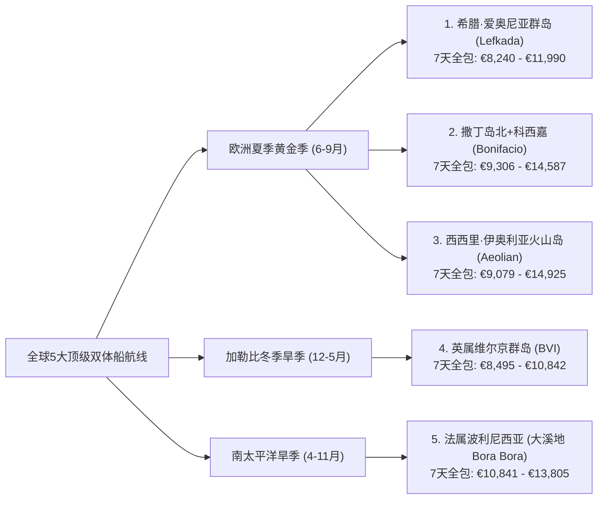

# ⛵ 全球 5 大最值得体验的双体帆船航线规划书（含 7 天全包报价拆解 & 每日详细行程）

> **适用船型基准**：**4 卧双体帆船（4-Cabin Catamaran，40–45 英尺，如 Lagoon 42 / Bali 4.2 / Fountaine Pajot Astrea 42 / Bali Catspace，适合 6–8 人）** + **雇佣专业船长（Skipper）**，租期 **7 天（周六 17:00 登船 — 下周六 09:00 离船）**。  
> **核心选线标准**：以已体验过克罗地亚（斯普利特/杜布罗夫尼克线）的进阶航海玩家为基准，在全球范围内精选**综合体验能与克罗地亚媲美甚至在单项上超越**的 **5 条殿堂级航线**，覆盖**欧洲夏季黄金季（3条）**、**加勒比冬季旱季（1条）**与**南太平洋终极天堂（1条）**。

---

## 一、 五大殿堂级航线横向总览与全包预算对比

### 7天全包落地总价六维拆解总表（单位：欧元 €，基于 2027 实时船价）

$$\text{7天落地总价} = \text{① 裸船周租金} + \text{② 专业船长费} + \text{③ 船长伙食与小费} + \text{④ 必选基地杂费} + \text{⑤ 7天港口/浮球费} + \text{⑥ 7天燃油费}$$

| 费用细项 | **1. 希腊·莱夫卡达** *(爱奥尼亚群岛南线)* | **2. 撒丁岛北+科西嘉** *(La Maddalena & Bonifacio)* | **3. 西西里·火山群岛** *(Aeolian Islands)* | **4. 英属维尔京群岛** *(加勒比海 BVI)* | **5. 法属波利尼西亚** *(大溪地 Bora Bora)* |
| :--- | :--- | :--- | :--- | :--- | :--- |
| **最佳出行月份** | **6月 / 9月**（7-8月次之） | **6月中下旬 / 9月上中旬** | **6月 / 9月**（5月/10月亦佳） | **12月 – 次年5月**（6月特惠） | **4月 – 11月**（6-9月极佳） |
| **① 裸船7天租金（平旺季）** | **€5,650 – €6,800** | **€5,356 – €6,800** | **€5,329 – €5,733** | **€3,985 – €4,484** *(6月)* | **€7,591 – €8,500** *(6月)* |
| **① 裸船7天租金（最高峰）** | **€7,885 – €9,000** *(8月)* | **€7,577 – €9,800** *(8月)* | **€8,156 – €10,460** *(8月)* | **€5,496 – €6,192** *(2月)* | **€8,900 – €9,965** *(7-8月)* |
| **② 专业船长费（7天）** | **€1,400 – €1,470** *(€200–210/天)* | **€1,750 – €1,897** *(€250–271/天)* | **€1,600 – €1,785** *(€229–255/天)* | **€2,170** *(€310/天)* | **€1,750 – €1,960** *(€250–280/天)* |
| **③ 船长伙食 & 离船小费** | **€400** *(伙食€250+小费€150)* | **€450** *(伙食€280+小费€170)* | **€450** *(伙食€280+小费€170)* | **€1,100** *(伙食€300+美式15%小费€800)* | **€500** *(伙食€300+小费€200)* |
| **④ 必选基地杂费** *(Charter Pack/清洁/税)* | **€350 – €480** *(全欧最低清洁费)* | **€600 – €690** *(含床品毛巾及国家公园许可)* | **€600 – €650** *(Transit Log 必选包)* | **€680** *(清洁€485+巡航税/救援费)* | **€450 – €550** *(末期清洁及床品包)* |
| **⑤ 7天港口 / 浮球停泊费** | **€120 – €220** *(市政码头€20/晚+餐厅免费栈桥)* | **€800 – €1,300** *(Bonifacio及撒丁岛码头较贵)* | **€750 – €1,100** *(火山岛私人浮球€120–200/晚)* | **€280 – €350** *(每晚挂官方浮球 €40–50)* | **€200 – €350** *(泻湖浮球/锚泊为主)* |
| **⑥ 7天燃油费（柴油+汽油）** | **€320 – €420** | **€350 – €450** | **€350 – €480** | **€280 – €350** | **€350 – €480** |
| **💰 平旺季 7天全包总价** | **€8,240 – €9,690** | **€9,306 – €11,587** | **€9,079 – €10,198** | **€8,495 – €9,134** *(5-6月)* | **€10,841 – €12,340** |
| **💰 最高峰 7天全包总价** | **€10,475 – €11,990** | **€11,527 – €14,587** | **€11,906 – €14,925** | **€10,006 – €10,842** *(1-3月)* | **€12,150 – €13,805** |
| **👥 8人平摊人均（平旺季）** | **€1,030 – €1,210 / 人** | **€1,160 – €1,450 / 人** | **€1,135 – €1,275 / 人** | **€1,060 – €1,140 / 人** | **€1,355 – €1,540 / 人** |

> **💡 铺位与押金险（Damage Waiver）关键提示**：
> 1. **4+1 / 4+2 船首船员舱**：雇佣专业船长必须提供独立床位。若 8 位乘客希望住满 4 间主客舱且客厅沙龙不睡人，选船时务必确认带有 **船首独立船长舱（Forepeak Cabin，标注为 `4+1` 或 `4+2` Cabins）**。
> 2. **免赔押金险**：上述航线的可退还信用卡预授权押金（Security Deposit）通常为 **€3,000 – €4,500**。建议在基地或预订平台加购 **€350 – €500/周 的免赔押金险（Damage Waiver）**，将刮蹭自负额降至 €0–€300。

---

## 二、 航线 1：希腊 · 爱奥尼亚群岛南线（Lefkada 经典 7 天环线）

> **定位**：**欧洲综合体验与性价比之王**——拥有克罗地亚同款的平静内海与威尼斯风情古镇，但海底为白色石灰岩，海水呈现更惊艳的“荧光牛奶蓝”，且码头与餐饮消费比克罗地亚低 30% 以上。

| 代表景观：凯法利尼亚岛 Fiskardo 威尼斯彩色古港 | 代表景观：伊萨卡岛 Kioni 马蹄形海湾古镇 |
| :---: | :---: |
|  |  |

### 1. 代表性实时船源与精确报价拆解
* **推荐船源 1（经典热门款）**：[Boataround — Lagoon 42 "La Mar" (Ionian Charter 运营，Lefkas Marina)](https://www.boataround.com/boat/lagoon-42-la-mar-1?checkIn=2027-06-19&checkOut=2027-06-26)
  * **6月（06-19 至 06-26）裸船价**：**€6,800**（原价 €8,500，8折）｜ **8月旺季**：**€9,000** ｜ **9月**：**€7,650**
  * **必选杂费**：清洁费 €350 + 床品毛巾 €15/人（8人 €120）+ 舷外机油 €10 = **€480**
  * **船长费**：**€200/天 × 7 = €1,400**（另加船长伙食与小费约 €400）
  * **港口与燃油**：7天港口费约 **€150**（多停餐厅免费栈桥或 €20 市政码头）+ 燃油费 **€350**
  * **👉 6月 7天全包落地总价**：**€9,580**（8人平摊 **€1,197/人**）
* **推荐船源 2（2025准新船）**：[Boataround — Bali Catspace "One Flirt" (2025年，Lefkas Marina)](https://www.boataround.com/boat/bali-catspace-one-flirt?checkIn=2027-06-19&checkOut=2027-06-26)（6月裸船 **€6,555**，9月 **€6,460**，Transit log **€360**，6月7天全包约 **€9,215**）

### 2. 7天每日详细行程表（总航程约 85 海里，日均航行 2 小时）

| 天数 | 航段路线 | 距离 / 航时 | 日间游泳/玩水亮点 | 夜晚停靠古镇 & 餐饮停泊攻略 |
| :--- | :--- | :--- | :--- | :--- |
| **Day 1 (周六)** | **Lefkas Marina $\rightarrow$ Meganisi (Spartochori)** | 11 NM / 1.5h | 17:00 登船起航，穿行莱夫卡达静水运河与尼德里海峡 | 停靠 **梅加尼西岛 Spilia Bay** *Taverna Spilia* 私家木栈桥（吃饭免停船费），步行上山逛鲜花簇拥的悬崖古村 **Spartochori** 看日落 |
| **Day 2 (周日)** | **Meganisi $\rightarrow$ Kalamos / Kastos** | 12 NM / 2.0h | 探访二战潜艇藏身的 **Papanikolis 巨型海蚀洞**，在无人小岛 Formikoula 浮潜 | 停靠松林高山环抱的隐世古镇 **Kalamos**（港务长 George 协助系缆），或在对岸 **Kastos 岛** 百年石风车下喝日落鸡尾酒 |
| **Day 3 (周一)** | **Kalamos $\rightarrow$ Atokos $\rightarrow$ Ithaca (Kioni)** | 15 NM / 2.5h | 停靠无人岛 **Atokos（One House Bay 猪岛）**，在透明果冻海里与野生游泳小黑猪互动 | 夜泊爱奥尼亚最浪漫的马蹄湾古镇 **伊萨卡岛 Kioni**，去水边的 *Calypso* 餐厅吃慢炖羊腿与白葡萄酒海鲜 |
| **Day 4 (周二)** | **Kioni $\rightarrow$ Vathy $\rightarrow$ Kefalonia (Fiskardo)** | 14 NM / 2.0h | 午间在仅能乘船抵达的 **Gidaki 牛奶蓝海滩** 游泳，顺访伊萨卡首府 **Vathy 峡湾** | 夜泊颜值巅峰 **凯法利尼亚岛 Fiskardo**（18世纪威尼斯巴洛克彩色古港），去名店 *Tassia* 吃现捞海鲜大餐、逛精品街 |
| **Day 5 (周三)** | **Fiskardo $\rightarrow$ Assos $\rightarrow$ Lefkada (Sivota)** | 18 NM / 2.5h | 白天锚泊在 **Assos 威尼斯古堡马蹄湾**，划桨板上岸喝冰咖啡；远眺 **Myrtos 悬崖海滩** | 北上返航停靠莱夫卡达南端 **Sivota 天然口袋峡湾**，直接系泊在 *12 Gods* 或 *Stavros* 海鲜餐厅浮桥（免停船费包水电） |
| **Day 6 (周四/五)** | **Sivota $\rightarrow$ Skorpios $\rightarrow$ Lefkas Marina** | 15 NM / 2.0h | 白天在梅加尼西岛南端悬崖湾及船王奥纳西斯私人岛屿 **Skorpios** 外围海域畅游 | 17:00 前返回 **Lefkas Marina** 加油，晚上步行逛莱夫卡达镇彩色老街，去 *Frini Sto Molo* 享用欢送晚宴 |
| **Day 7 (周六)** | **Lefkas Marina 09:00 离船** | — | — | 距离 Preveza/Aktion (PVK) 机场仅 25 分钟车程 |

---

## 三、 航线 2：意大利撒丁岛北 + 法国科西嘉（Bonifacio 跨国 7 天航线）

> **定位**：**欧洲视觉震撼与果冻海天花板**——一次航程横跨意、法两国，把全地中海透明度第一的**马达莱纳花岗岩泻湖**与**法国博尼法乔 70 米白垩悬崖裂缝古城**组合在一起。

| 代表景观：法国科西嘉 Bonifacio 70米白垩悬崖古城 | 代表景观：撒丁岛 Caprera 岛 Cala Coticcio 花岗岩果冻海 |
| :---: | :---: |
|  |  |

### 1. 代表性实时船源与精确报价拆解
* **推荐船源**：[Boataround — Bali Catspace "Tursiops" (2022年，Marina di Portisco, Olbia)](https://www.boataround.com/boat/bali-catspace-tursiops?checkIn=2027-06-19&checkOut=2027-06-26)
  * **6月（06-19 至 06-26）裸船特惠价**：**€5,356**（原价 €8,820，立减 40%）｜ **8月**：**€7,577** ｜ **9月**：**€4,892**
  * **必选杂费**：Transit log（清洁及床品）**€690/次** + 马达莱纳国家公园巡航许可约 **€80**
  * **船长费**：**€271/天 × 7 = €1,897**（另加伙食与小费约 €450）
  * **港口与燃油**：7天港口/浮球费约 **€1,000**（含 1 晚 Bonifacio 悬崖内港 + 1 晚 La Maddalena 码头 + 其余海湾锚泊）+ 燃油费 **€400**
  * **👉 6月 7天全包落地总价**：**€9,873** ｜ **9月全包总价**：**€9,409**（8人平摊 **€1,176/人**）

### 2. 7天每日详细行程表（总航程约 75 海里，日均航行 1.5–2 小时）

| 天数 | 航段路线 | 距离 / 航时 | 日间游泳/玩水亮点 | 夜晚停靠古镇 & 餐饮停泊攻略 |
| :--- | :--- | :--- | :--- | :--- |
| **Day 1 (周六)** | **Marina di Portisco $\rightarrow$ Cala di Volpe / Porto Cervo** | 8 NM / 1.0h | 傍晚起航驶入翡翠海岸名流海湾 **Cala di Volpe（狐狸湾）**，欣赏全球顶级超艇 | 在狐狸湾安全下锚或停靠超艇之都 **Porto Cervo（切尔沃港）**，在甲板喝撒丁岛 Vermentino 冰白葡萄酒 |
| **Day 2 (周日)** | **Porto Cervo $\rightarrow$ Caprera $\rightarrow$ La Maddalena** | 12 NM / 1.5h | 锚泊在卡普雷拉岛号称“小大溪地”的 **Cala Coticcio** 玫瑰花岗岩峡湾浮潜 | 停靠群岛历史中心 **La Maddalena 老港（Cala Gavetta）**，逛热那亚风格老街、吃撒丁岛特色龙虾意面 |
| **Day 3 (周一)** | **La Maddalena $\rightarrow$ Spargi $\rightarrow$ Budelli (圣母泻湖)** | 9 NM / 1.5h | 畅游 Spargi 岛的 **Cala Corsara** 白沙滩，乘小艇远眺传奇 **Budelli 粉红沙滩** | 夜泊由三座无人岛合围出的天然浅水泻湖 **Porto della Madonna（圣母港）**，在发光蒂芙尼蓝水面上看星空 |
| **Day 4 (周二)** | **Budelli $\rightarrow$ 法国 Lavezzi 群岛 $\rightarrow$ Bonifacio** | 14 NM / 2.0h | 跨越海峡进入法国，在 **Îles Lavezzi（拉韦齐花岗岩无人群岛）** 与密集鱼群浮潜 | **全周高潮**：下午从 70 米白垩悬崖裂缝驶入法国 **Bonifacio（博尼法乔）** 内港，登顶悬崖古城吃科西嘉法餐（需提前通过 Navily/港务局预订泊位） |
| **Day 5 (周三)** | **Bonifacio $\rightarrow$ Rondinara $\rightarrow$ Santa Teresa Gallura** | 15 NM / 2.0h | 白天前往科西嘉南岸完美的贝壳形海湾 **Baie de Rondinara** 玩桨板与游泳 | 傍晚返回撒丁岛北端峡湾古镇 **Santa Teresa Gallura**，逛热闹的 Vittorio Emanuele 广场与海崖灯塔 |
| **Day 6 (周四/五)** | **Santa Teresa $\rightarrow$ Cala di Trana $\rightarrow$ Portisco** | 17 NM / 2.5h | 沿途停靠 **Cala di Trana** 金色沙丘海湾与 **Mortorio 无人岛** 最后畅游 | 返回 **Marina di Portisco** 母港，晚餐在港湾餐厅享用撒丁岛烤乳猪（Porceddu） |
| **Day 7 (周六)** | **Marina di Portisco 09:00 离船** | — | — | 距奥尔比亚机场（Olbia Costa Smeralda Airport）仅 25 分钟车程 |

---

## 四、 航线 3：意大利西西里 + 伊奥利亚七大火山群岛（Aeolian Islands 7 天航线）

> **定位**：**地中海最独特的探险与美食美酒之巅**——联合国世界自然遗产，7座火山岛呈现截然不同的奇幻地貌，压轴大戏是**夜晚把双体船停在 Stromboli 活火山海面，边喝香槟边看火红岩浆喷入夜空**。

| 代表景观：海面夜观 Stromboli 活火山喷发赤红岩浆 | 代表景观：Panarea 岛 Cala Junco 天然玄武岩翡翠泳池 |
| :---: | :---: |
|  |  |

### 1. 代表性实时船源与精确报价拆解
* **推荐船源（2026全新船）**：[Boataround — Fountaine Pajot Astrea 42 "Harley Quinn" (2026年，Marina di Portorosa, Sicily)](https://www.boataround.com/boat/fountaine-pajot-astrea-42-harley-quinn?checkIn=2027-06-19&checkOut=2027-06-26)
  * **6月（06-19 至 06-26）裸船价**：**€5,733**（原价 €7,100，8折）｜ **8月**：**€8,156** ｜ **9月**：**€5,329**
  * **必选杂费**：Transit log（含最终清洁、床品、沙滩浴巾、免费舷外机）**€600/次**
  * **船长费**：**€255/天 × 7 = €1,785**（另加伙食与小费约 €450）
  * **港口与燃油**：7天港口/浮球费约 **€850** + 燃油费 **€420**
  * **👉 6月 7天全包落地总价**：**€9,838** ｜ **9月全包总价**：**€9,434**（8人平摊 **€1,179/人**）

### 2. 7天每日详细行程表（总航程约 95 海里，日均航行 2–2.5 小时）

| 天数 | 航段路线 | 距离 / 航时 | 日间游泳/玩水亮点 | 夜晚停靠古镇 & 餐饮停泊攻略 |
| :--- | :--- | :--- | :--- | :--- |
| **Day 1 (周六)** | **Marina di Portorosa $\rightarrow$ Vulcano (Porto Ponente)** | 15 NM / 2.0h | 傍晚直奔 **武尔卡诺岛（Vulcano）**，在冒着海底地热气泡的火山黑沙滩海湾下锚 | 锚泊 **Porto di Ponente**，日落前花 45 分钟登顶冒着硫磺蒸汽的 **Gran Cratere 大火山口** 俯瞰七岛全景 |
| **Day 2 (周日)** | **Vulcano $\rightarrow$ Lipari (白浮石海滩 & 古镇)** | 8 NM / 1.5h | 绕行武尔卡诺西岸 **Grotta del Cavallo（马洞）** 与天然火山泳池 **Venus Pool**，再去利帕里岛 **Spiaggia Bianca（白浮石果冻海）** 游泳 | 夜泊群岛千年首府 **Lipari（Marina Corta 小港）**，逛 16 世纪西班牙海防卫城，去 *Filippino* 吃西西里红虾意面与 Cannoli |
| **Day 3 (周一)** | **Lipari $\rightarrow$ Salina (Pollara & Santa Maria)** | 12 NM / 2.0h | 驶向双子火山绿岛 **萨利纳（Salina）**，在电影《邮差》取景地 **Pollara 半圆火山口悬崖湾** 浮潜 | 停靠 **Santa Maria Salina** 码头，傍晚乘车去悬崖酒庄 *Capofaro* 或 *Hauner* 品尝黄金甜白葡萄酒 Malvasia，去 *Alfredo* 吃招牌面包（Pane Cunzato） |
| **Day 4 (周二)** | **Salina $\rightarrow$ Panarea (Cala Junco)** | 12 NM / 2.0h | 在 **帕纳雷阿岛（Panarea）** 南端由柱状玄武岩围成的天然翡翠泳池 **Cala Junco** 畅游，探访悬崖顶青铜时代史前村落；再去 **Lisca Bianca** 海底喷气孔浮潜 | 夜泊无车纯白名流小岛 **Panarea** 浮球区，乘水上出租车（Taxi Boat）登岛去 *Raya* 露台酒吧看夜景 |
| **Day 5 (周三)** | **Panarea $\rightarrow$ Stromboli（夜观活火山喷发）** | 11 NM / 1.5h | 下午抵达过去两千年持续喷发的 **斯特龙博利活火山岛（Stromboli）**，登岸逛黑沙滩上的纯白小镇 San Vincenzo | **终生难忘之夜**：日落时船长将双体船开到岛西北侧 **火之斜坡（Sciara del Fuoco）** 海面，在甲板上边喝香槟边看活火山每隔 15–20 分钟向夜空喷射赤红岩浆 |
| **Day 6 (周四/五)** | **Stromboli $\rightarrow$ Lipari南角 $\rightarrow$ Portorosa** | 32 NM / 4.0h | 顺风南下返航，中途在利帕里南端 **Faraglioni 奇岩双峰** 游泳午餐 | 傍晚返回 **Marina di Portorosa** 母港，享用西西里海鲜欢送晚宴 |
| **Day 7 (周六)** | **Marina di Portorosa 09:00 离船** | — | — | 前往卡塔尼亚机场（CTA）或顺游陶尔米纳（Taormina）古希腊剧场 |

---

## 五、 航线 4：英属维尔京群岛（加勒比海 BVI 7 天经典环线）

> **定位**：**冬季避寒与热带珊瑚礁/沙滩酒吧狂欢之王**——全球公认航海条件最轻松的“世界帆船之都”，全程在平静水道内目视跳岛，每晚挂官方浮球（无需倒车抢码头），白天与海龟魔鬼鱼同游，下午直接从船尾游去海滩酒吧喝朗姆酒。

| 代表景观：Virgin Gorda 巨石浴场 The Baths | 代表景观：Jost Van Dyke 白湾与湿美金酒吧 Soggy Dollar Bar |
| :---: | :---: |
|  |  |

### 1. 代表性实时船源与精确报价拆解
* **推荐船源 1**：[Boataround — Bali 4.2 "Dorothea" (Navigare Yachting 运营，Tortola Hodge's Creek Marina)](https://www.boataround.com/boat/bali-42-dorothea?checkIn=2027-02-13&checkOut=2027-02-20)
  * **2月冬季旺季（02-13 至 02-20）裸船价**：**€6,192**（原价 €7,740）｜ **6月初夏特惠价**：**€4,484**
* **推荐船源 2**：[Boataround — Lagoon 42 "Bellatrix" (Dream Yacht 运营，Tortola)](https://www.boataround.com/boat/lagoon-42-bellatrix?checkIn=2027-06-19&checkOut=2027-06-26)（2月旺季 **€5,496**，6月仅 **€3,985**）
* **BVI 必选杂费与船长明细**：
  * **必选清洁及床品（Transit log）**：**€485** + 环境巡航税及海上救援费约 **€195**（8人合计）
  * **船长费**：**€310/天 × 7 = €2,170**（外加船长伙食 €300 + 加勒比海惯例离船小费约 €800）
  * **7天系泊浮球费（BoatyBall / 国家公园浮球）**：每晚约 €45，7天合计 **€300** + 燃油费 **€300**
  * **👉 6月初夏 7天全包落地总价**：**€8,535 – €9,034** ｜ **2月冬季旺季全包总价**：**€10,046 – €10,742**

### 2. 7天每日详细行程表（总航程约 65 海里，日均航行 1.5 小时）

| 天数 | 航段路线 | 距离 / 航时 | 日间珊瑚礁浮潜/玩水亮点 | 夜晚停泊海湾 & 赤脚沙滩酒吧攻略 |
| :--- | :--- | :--- | :--- | :--- |
| **Day 1 (周六)** | **Tortola $\rightarrow$ Norman Island（金银岛）** | 7 NM / 1.0h | 穿越弗朗西斯·德雷克爵士水道，在 **The Caves（海盗藏宝洞）** 与 **The Indians（印第安岩礁）** 浮潜看珊瑚鱼群 | 挂浮球夜泊 **The Bight**，乘小艇登上停在海湾中央的传奇海盗船漂浮酒吧 **Willy T** 跳水狂欢，或在 *Pirates Bight* 吃海滩晚餐 |
| **Day 2 (周日)** | **Norman $\rightarrow$ Salt Island $\rightarrow$ Cooper Island** | 8 NM / 1.0h | 上午在 **RMS Rhone（1867年英国皇家邮轮沉船遗址）** 浮潜（船体清晰可见），下午在 **Cistern Point** 与野生海龟同游 | 挂浮球夜泊精品生态岛 **Cooper Island Beach Club**，品尝自酿精酿啤酒与珍藏朗姆酒廊 |
| **Day 3 (周一)** | **Cooper $\rightarrow$ Virgin Gorda (The Baths & North Sound)** | 12 NM / 1.5h | **全周自然奇观**：系泊国家公园浮球，游上岸穿越 **The Baths（巨石浴场）** 半淹没在翡翠海水中的花岗岩巨石迷宫与一线天洞穴 | 下午航入 **North Sound（北湾）**，停靠超艇云集的 **Saba Rock**（下午5点看喂大海鲢 Tarpon）或 **Bitter End Yacht Club** |
| **Day 4 (周二)** | **Virgin Gorda $\rightarrow$ Anegada（火烈鸟珊瑚环礁）** | 15 NM / 2.0h | 扬帆北上唯一的珊瑚平岛 **阿内加达（Anegada）**，租吉普车去 **Loblolly Bay** 20公里无人白沙滩浮潜、去盐湖看野生粉红火烈鸟群 | 夜泊 Setting Point，晚上在沙滩烛光下享用提前预订的 **Anegada 炭烤两斤重加勒比大龙虾**（*Lobster Trap* 或 *Potter's by the Sea*） |
| **Day 5 (周三)** | **Anegada $\rightarrow$ Guana Island $\rightarrow$ Cane Garden Bay** | 18 NM / 2.5h | 顺东北信风畅快航行至 **Monkey Point（猴子角）** 浮潜看成群大鱼与海龟 | 夜泊托托拉北岸椰林环绕的 **Cane Garden Bay**，在 *Myett's* 听现场钢鼓乐（Steel Pan）看加勒比火烧云日落 |
| **Day 6 (周四/五)** | **Cane Garden $\rightarrow$ Sandy Spit $\rightarrow$ Jost Van Dyke** | 8 NM / 1.0h | 先停靠明信片上的袖珍无人白沙岛 **Sandy Spit**，随后驶入全球最著名的 **White Bay（白湾）**，跳进齐腰深牛奶蓝海水游向 **Soggy Dollar Bar（湿美金酒吧）** 喝原版 Painkiller | 傍晚转入隔壁 **Great Harbour** 挂浮球，去传奇老店 **Foxy's Tamarind Bar** 参加海滩 BBQ 派对；次日早晨轻松返抵 Tortola 基地 |
| **Day 7 (周六)** | **Tortola 基地 09:00 离船** | — | — | 乘车去牛肉岛机场（EIS）或乘快艇 50 分钟回美属圣托马斯（STT）返程 |

---

## 六、 航线 5：法属波利尼西亚 · 大溪地顺风群岛（Raiatea $\rightarrow$ Bora Bora 7 天航线）

> **定位**：**全球双体船包船界的终极人生清单（Bucket List #1）**——在博拉博拉岛住一晚四季水屋要 €2,000+，而包一艘 4 卧双体船，人均 €1,370 就能拥有整整 7 天**“停在奥特马努火山峰正下方七色泻湖里的移动私人水屋”**！而且 **6–9 月正值大溪地全年最清爽少雨的黄金旱季**。

| 代表景观：Bora Bora 七色泻湖与奥特马努火山峰 | 代表景观：外围珊瑚环礁保护下的镜面荧光蓝泻湖 |
| :---: | :---: |
|  |  |

### 1. 代表性实时船源与精确报价拆解
* **推荐船源**：[Boataround — Lagoon 42 "Poe Hina" (Poe Charter 运营，大溪地/顺风群岛)](https://www.boataround.com/boat/lagoon-42-poe-hina?checkIn=2027-06-19&checkOut=2027-06-26) 或 **Dream Yacht / The Moorings Raiatea 基地 4卧双体船**
  * **6月（06-19 至 06-26）裸船价**：**€7,591** ｜ **7-8月旺季 Lagoon 43 新船**：**€9,965**
  * **必选杂费**：最终清洁及床品包 **€450**
  * **船长费**：**€260/天 × 7 = €1,820**（另加伙食与小费约 €500）
  * **港口与燃油**：大溪地全程在环礁泻湖内免费下锚或挂免费/低价餐厅浮球，7天停泊费仅 **€200** + 燃油费 **€400**
  * **👉 6月 7天全包落地总价**：**€10,961**（8人平摊仅 **€1,370/人**，不到博拉博拉酒店水屋 2 晚的房费！）

### 2. 7天每日详细行程表（总航程约 80 海里，80% 时间在零风浪环礁泻湖内航行）

| 天数 | 航段路线 | 距离 / 航时 | 日间泻湖/珊瑚礁体验亮点 | 夜晚停泊泻湖锚地 & 特色攻略 |
| :--- | :--- | :--- | :--- | :--- |
| **Day 1 (周六)** | **Raiatea（赖阿特阿岛）$\rightarrow$ Taha'a（塔哈香草岛）** | 8 NM / 1.0h | 在同一个巨型环礁泻湖内向北航行 1 小时即达 **Motu Ceran 无人珊瑚小岛**，跳进透明度 30 米的浅滩浮潜 | 夜泊塔哈岛 **Apu Bay**，参观大溪地黑珍珠养殖场（可现场挑选黑珍珠），登岸参观天然波利尼西亚香草种植园 |
| **Day 2 (周日)** | **Taha'a 环岛 $\rightarrow$ Tautau 珊瑚花园** | 7 NM / 1.0h | **全周最佳浮潜**：把船停在 **Motu Tautau（塔哈珊瑚花园）**，顺着天然海流在五彩斑斓的活珊瑚水道中“漂流浮潜（Drift Snorkel）” | 在塔哈岛西侧浅滩下锚，正面远眺 20 海里外博拉博拉岛的日落剪影，在船尾吃大溪地生鱼沙拉（Poisson Cru，椰奶青柠金枪鱼） |
| **Day 3 (周一)** | **Taha'a $\rightarrow$ Bora Bora（博拉博拉泻湖）** | 22 NM / 3.0h | 唯一一段 3 小时跨海航行，穿过 Teavanui 水道进入传奇的 **博拉博拉七色泻湖**，在 **Motu Tapu** 白沙洲游泳 | 夜泊 **Bora Bora Yacht Club / MaiKai** 浮球，乘小艇去世界名流打卡的 **Bloody Mary's（血腥玛丽沙地餐厅）** 吃炭烤剑鱼与龙虾 |
| **Day 4 (周二)** | **Bora Bora 泻湖深度环游（魔鬼鱼水道 & Matira）** | 8 NM / 1.0h | 上午在 **Stingray Avenue（魔鬼鱼水道）** 齐胸深的蒂芙尼蓝浅滩与几十只温顺的赤魟（魔鬼鱼）和黑鳍礁鲨同游；下午停靠 **Matira Beach** | **全周最美锚地**：夜泊博拉博拉东侧珊瑚环礁内侧（Motu Piti Aau），船头正对海拔 727 米的 **奥特马努山（Mt. Otemanu）** 绝美主峰 |
| **Day 5 (周三)** | **Bora Bora（蝠鲼点）$\rightarrow$ 返航 Taha'a 东岸** | 22 NM / 3.0h | 上午在博拉博拉泻湖的 **Anau 清洁站** 浮潜观赏翼展 3 米的野生巨型鬼蝠鲼（Manta Rays），午后顺风返回塔哈岛 **Haamene Bay** | 夜泊塔哈岛深入内陆的峡湾，去岸上法国大厨主理的私房餐厅用餐 |
| **Day 6 (周四/五)** | **Taha'a $\rightarrow$ Raiatea（Faaroa 热带雨林河 & Opoa）** | 12 NM / 1.5h | 驶入赖阿特阿岛 **Faaroa Bay**，乘船尾橡皮艇逆流进入全波利尼西亚唯一可通航的热带雨林河流探险；参观世界文化遗产 **Taputapuatea 古代毛利神庙** | 傍晚返回 **Raiatea 基地码头**，伴随当地乌克丽丽琴声享用欢送大餐 |
| **Day 7 (周六)** | **Raiatea 基地 09:00 离船** | — | — | 距 Raiatea 机场（RFP）仅 10 分钟车程，乘机 45 分钟返回帕皮提（PPT）国际机场 |

---

## 七、 选线决策速查卡

* **如果您计划在 6–9 月去欧洲**，想延续克罗地亚那种**“风平浪静 + 每天逛高颜值古镇 + 岸上大餐”**的节奏，但想要**水更蓝、花费省 25%** $\rightarrow$ 选 **航线 1：希腊·莱夫卡达（爱奥尼亚南线）**。
* **如果您计划在 6月或9月去欧洲**，追求**“全欧第一透明度果冻海 + 最震撼的 70 米悬崖裂缝古城进港”** $\rightarrow$ 选 **航线 2：意大利撒丁岛北 + 法国科西嘉（Bonifacio）**。
* **如果您是资深美食与美酒控**，想体验**“海面仰望活火山夜间喷发岩浆”**的世界奇观 $\rightarrow$ 选 **航线 3：西西里·伊奥利亚火山群岛**。
* **如果您计划在冬季/春节/春假（12–5月）出行**，向往**“珊瑚海龟浮潜 + 免倒车挂浮球 + 游上白沙滩酒吧喝朗姆酒”** $\rightarrow$ 选 **航线 4：加勒比海 BVI**。
* **如果您想完成人生终极海岛梦想（4–11月皆宜，含 6–9 月暑假）**，想用超值价格把整艘双体船停在博拉博拉七色泻湖中央 $\rightarrow$ 选 **航线 5：法属波利尼西亚（大溪地）**。
